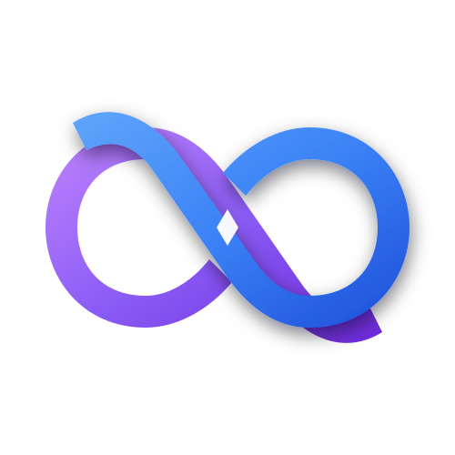
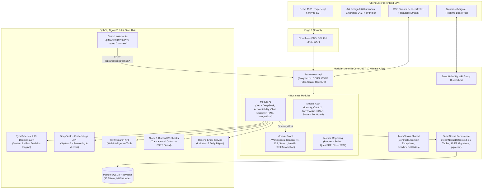

<p align="center">
  <a href="https://app.teamnexus.cloud" target="_blank" rel="noopener noreferrer">
    
  </a>
</p>

<h1 align="center">TeamNexus</h1>

<p align="center">
  <strong>Trợ lý Điều phối Không gian Làm việc Thông minh (Intelligent Workspace Orchestration Platform)</strong><br/>
  Nền tảng quản lý dự án & cộng tác nhóm thế hệ mới, kết hợp Kanban Real-time với Kiến trúc Hybrid AI (Jev 1.13 System 1 + DeepSeek System 2), Cơ sở Tri thức Ngữ nghĩa RAG (<code>pgvector</code>), Tích hợp Hệ sinh thái Mở (Slack, Discord, GitHub) và Lớp Giải trình Minh bạch (Accountability Layer).
</p>

<p align="center">
  <a href="https://github.com/Thinh-TT/TeamNexus/actions/workflows/ci-backend.yml">
    
  </a>
  <a href="https://github.com/Thinh-TT/TeamNexus/actions/workflows/ci-web.yml">
    
  </a>
  
  
  
  
  
  
  
</p>

---

## 🚀 Trải Nghiệm Trực Tiếp (Production Live)

Hệ sinh thái TeamNexus đã được triển khai hoàn chỉnh trên môi trường Cloud Production với domain riêng, bảo mật SSL nghiêm ngặt và tự động hóa kiểm thử liên tục (CI/CD):

| Thành phần | Đường dẫn / Định danh | Hạ tầng & Công nghệ |
|---|---|---|
| 🌐 **Web Application** | [https://app.teamnexus.cloud](https://app.teamnexus.cloud) | Hosted trên **Vercel**, DNS & WAF quản lý qua **Cloudflare** (SSL Full Strict) |
| ⚙️ **API Backend Service** | [https://api.teamnexus.cloud](https://api.teamnexus.cloud) | Containerized Docker trên **Render** (.NET 10 Web API, Base: `/api`) |
| 📖 **Tài liệu API (Scalar UI)** | [https://api.teamnexus.cloud/scalar](https://api.teamnexus.cloud/scalar) | Giao diện OpenAPI / Scalar tương tác trực quan cho toàn bộ endpoints |
| 🗄️ **Cơ sở dữ liệu & Vector** | Neon Serverless PostgreSQL (`pgvector`) | Singapore region (`ap-southeast-1`), **35 bảng vật lý**, **16/16** EF Core migrations sạch |
| ✉️ **Transactional Email** | `TeamNexus <noreply@teamnexus.cloud>` | Cloudflare DNS xác thực SPF, DKIM, DMARC + **Resend API** |

> 💡 **Hướng dẫn Trải nghiệm 1-Click (OAuth Login)**:
> - Người dùng có thể truy cập ngay [https://app.teamnexus.cloud](https://app.teamnexus.cloud) và đăng nhập nhanh bằng **tài khoản Google hoặc GitHub cá nhân**.
> - Hệ thống tự động cấp quyền người dùng chuẩn (`User`), hỗ trợ khởi tạo Workspace mới hoặc trải nghiệm Workspace mẫu với đầy đủ bảng Kanban, đa nhân cách AI ảo và dữ liệu thực tế.
>
> ⚠️ **Lưu ý Cold-start (Render Free Tier)**: Máy chủ API sẽ tạm ngủ nếu không có lượt truy cập trong 15 phút. Request đầu tiên có thể mất ~30–60 giây để khởi động. Giao diện Web đã tích hợp sẵn cơ chế đếm lùi, thông báo tiếng Việt mượt mà và tự động kết nối lại (Auto-reconnect).

---

## 💡 Điểm Đột Phá & Giá Trị Cốt Lõi

TeamNexus giải quyết triệt để vấn đề phân mảnh thông tin, thiếu minh bạch và độ trễ ra quyết định trong các nhóm phát triển phần mềm thông qua bốn trụ cột công nghệ:

### 1. Kiến trúc Hybrid AI (System 1 + System 2) & Semantic RAG (`pgvector`)
Không phụ thuộc đơn thuần vào việc ép Large Language Models (LLM) đoán token chậm chạp và tốn kém, TeamNexus áp dụng mô hình phân tách nhận thức kết hợp truy xuất tri thức ngữ nghĩa:
- **System 1 — Phản xạ Quyết định Siêu tốc (TypeSafe Jev 1.13 qua Decisions API `/api/alpha/decisions`)**:
  - Tiếp nhận bối cảnh và trả về các quyết định có cấu trúc tĩnh (`Choice`, `Score`, `Noul`) trong **`~100–300ms`** kèm điểm tự tin định lượng `confidence ∈ [0, 1]`.
  - Định tuyến tự chủ 3 ngưỡng tất định (`ConfidenceRouting`): `≥ 0.85` (`DirectAssign`), `0.50..0.85` (`OfferChoices`), và `< 0.50` (`ManualRequired` — xóa trắng gợi ý để chống ảo giác).
  - Đảm nhiệm: Phân loại tác vụ thông minh (**Auto-Triage** Domain/WorkType), đề xuất phân công nhân sự (**Smart Assignee Dispatching**) ẩn danh hóa ứng viên (`cand-N`), thẩm định tiêu chí nghiệm thu và lọc tín hiệu rủi ro cho AI Observer.
- **System 2 — Tư duy Ngôn ngữ, Đa Nhân cách & RAG (DeepSeek + `pgvector` HNSW)**:
  - Hỗ trợ **4 nhân cách chuyên gia (`Personas`)**: `general`, `scrum_master`, `tech_lead`, `qa_security` cùng vòng lặp suy luận **7 công cụ ReAct**.
  - Tích hợp **Cơ sở Tri thức Ngữ nghĩa (Workspace Semantic RAG)** lưu trữ vector nhúng `1536` chiều trực tiếp trong PostgreSQL với chỉ mục láng giềng gần đúng **HNSW (`vector_cosine_ops`)**.

### 2. Hệ Thống Giải Trình AI Minh Bạch (Accountability Layer)
Mọi tác động ghi dữ liệu của AI và tự động hóa ngoại vi đều tuân thủ cơ chế **Human-in-the-Loop** và **Hoàn tác 100%**:
- **Nguyên tắc bất biến**: AI **không bao giờ** ghi đè trực tiếp vào cơ sở dữ liệu nghiệp vụ mà không qua kiểm soát.
- **Vòng đời trạng thái (CAS State Machine)**:
  $$\text{AI Proposal} \longrightarrow \text{Pending Action Log} \longrightarrow \begin{cases} \text{Human Approved} \implies \text{Áp dụng thay đổi + Lưu Snapshot} \\ \text{Human Rejected} \implies \text{Hủy đề xuất} \end{cases}$$
- **Khả năng Hoàn tác 100% (Reversible Undo)**: Mọi thao tác (`10` bộ `IAiActionApplier`, bao gồm cả tự động hóa GitHub PR/Issue và kế hoạch tự phục hồi `RecoveryPlan`) đều lưu `before_snapshot` và `applied_snapshot`, cho phép hoàn tác (`Undo`) đưa dữ liệu về nguyên trạng chỉ bằng 1 cú nhấp chuột.

### 3. Hệ Sinh Thái Công Cụ Phát Triển Mở (Slack, Discord & GitHub Webhooks)
- **Outbound (Slack & Discord)**: Đẩy cảnh báo thông minh từ AI Observer qua hàng đợi bền vững **Transactional Outbox** (`webhook_delivery_outbox`) kèm cơ chế thử lại lũy tiến (`5s → 30m`), cầu chì tự ngắt (**Circuit Breaker** sau 10 lỗi liên tiếp) và bộ lọc chống tấn công **SSRF (`WebhookUrlValidator`)**.
- **Inbound (GitHub Webhooks)**: Xác thực chữ ký số **HMAC-SHA256** thời gian hằng (`FixedTimeEquals`), tự động nhận diện mã thẻ tuần tự **`TN-123`** trong PR để chuyển cột sang **Đang xét duyệt (`is_in_review`)** hoặc **Hoàn thành (`is_done`)**, tự động tạo thẻ từ GitHub Issue kèm **Jev Auto-Triage**, và đồng bộ bình luận một chiều qua tài khoản hệ thống `GitHub Bot`.

### 4. Đồng Bộ Hóa Thời Gian Thực (Real-time Kanban Core)
- Xây dựng trên nền tảng **ASP.NET Core SignalR (`BoardHub`)** kết hợp bộ thư viện kéo thả `@dnd-kit`.
- Cập nhật tức thời trạng thái di chuyển thẻ, thêm cột, chỉnh sửa nhãn, huy hiệu PR/Issue và bình luận giữa mọi thành viên trong cùng Workspace mà không cần tải lại trang.

---

## 🌟 Bản Đồ Tính Năng (Feature Matrix)

```text
┌────────────────────────────────────────────────────────────────────────────────────────┐
│                                 TEAMNEXUS CAPABILITIES                                 │
├────────────────────────┬──────────────────────────┬────────────────────────────────────┤
│ 📋 KANBAN & WORKSPACE  │ 🤖 HYBRID AI & RAG SUITE │ 🔗 HỆ SINH THÁI & BÁO CÁO          │
├────────────────────────┼──────────────────────────┼────────────────────────────────────┤
│ • Kéo thả Real-time    │ • Jev 1.13 Auto-Triage   │ • GitHub PR/Issue Automation       │
│ • Mã thẻ tuần tự TN-123│ • Smart Assignee (cand-N)│ • Slack & Discord Outbox Alerts    │
│ • Cột In-Review / Done │ • AI Task & Board Chat   │ • Điểm sức khỏe dự án (0–100)      │
│ • Calendar View        │ • 4 Multi-Agent Personas │ • Burndown & Velocity Chart        │
│ • Tìm kiếm Keyset      │ • 7 ReAct Tools & RAG    │ • Xuất báo cáo PDF & Excel         │
│ • Activity Log Audit   │ • Observer & RecoveryPlan│ • Daily Digest Email tự động       │
└────────────────────────┴──────────────────────────┴────────────────────────────────────┘
```

### Chi tiết các phân hệ:
1. **Không gian làm việc & Kanban Thời gian thực**:
   - **Quản trị Workspace**: Tạo mới, đổi tên, chuyển nhượng quyền sở hữu nguyên tử, xóa mềm và mời thành viên qua Email token băm SHA-256.
   - **Bảng Kanban đa năng**: Tùy biến cột linh hoạt với 3 vai trò đặc biệt loại trừ tương hỗ: Hoàn thành (`isDone`), Đang xét duyệt (`isInReview`) và Chờ làm rõ (`isClarification`).
   - **Thẻ công việc (`TN-123`)**: Hỗ trợ Markdown an toàn, độ ưu tiên (`Low`, `Medium`, `High`, `Urgent`), gắn nhãn taxonomy chuẩn hóa, liên kết GitHub PR/Issue và cảnh báo hạn chót.
   - **Chế độ xem Lịch (Calendar View) & Tìm kiếm Keyset**: Chuyển đổi tức thời giữa Kanban và Lịch tháng; lọc thẻ đa tiêu chí xuyên bảng với phân trang Keyset tốc độ cao trên `(updated_at, id)`.

2. **Phân hệ Trí tuệ Nhân tạo Lai & Cơ sở Tri thức (Hybrid AI & Semantic RAG)**:
   - **Jev Auto-Triage & Smart Assignee**: Tự động gợi ý Miền kỹ thuật (`domain`), Loại công việc (`work_type`), Độ ưu tiên và xếp hạng nhân sự phù hợp nhất theo kỹ năng (`skills`) và tải WIP.
   - **AI Task Chat & Board Agent Chat (SSE)**: Hộp thoại tương tác thời gian thực qua Server-Sent Events, hỗ trợ đính kèm đa thẻ làm ngữ cảnh, chọn nhân cách chuyên gia (`Persona`) và sinh đề xuất hành động trực tiếp.
   - **AI Observer, Cảnh báo Sớm & Tự phục hồi (`RecoveryPlan`)**: Quét ngầm phát hiện nguy cơ trễ hạn sớm (`AtRiskDeadline`), nút thắt cổ chai, lệch tải nhân sự và đề xuất 4 chiến lược phục hồi (`ReassignTask`, `SplitSubtasks`, `ExtendDeadline`, `EscalateManager`).
   - **AI Agent Executor (7 ReAct Tools) & `pgvector` RAG**: Thành viên ảo nhận việc trực tiếp trên bảng, tự động tra cứu dữ liệu nội bộ, tìm kiếm ngữ nghĩa trên tài liệu Workspace (`workspace_knowledge_chunks`), kiểm tra tải thành viên, đối sánh kỹ năng, thẩm định tiêu chí nghiệm thu và tìm kiếm Internet (Tavily).

3. **Tích hợp Bên ngoài, Báo cáo & Thông báo Chủ động**:
   - **Tích hợp GitHub, Slack & Discord**: Đẩy cảnh báo tự động ra kênh chat nhóm; đồng bộ trạng thái Pull Request, Issue và bình luận từ GitHub kèm khả năng hoàn tác 100%.
   - **Chỉ số Sức khỏe Dự án (`ProjectHealth.Compute`)**: Hàm thuần chấm điểm từ `0–100` dựa trên 5 thành phần trọng số cộng đúng `100` (Quá hạn `40`, Rủi ro hạn chót `20`, Đình trệ `10`, Tuổi thọ thẻ mở `15`, Cân bằng tải `15`).
   - **Báo cáo Đa định dạng & Daily Digest**: Biểu đồ chuỗi thời gian Burndown/Velocity, xuất PDF (QuestPDF) và Excel (ClosedXML) trực tiếp trên RAM, cùng bản tin email tổng hợp mỗi sáng có chống gửi trùng ở tầng DB.

---

## 🏗️ Kiến Trúc Hệ Thống (System Architecture)

TeamNexus áp dụng mô hình kiến trúc **Modular Monolith** với **4 phân hệ nghiệp vụ chuẩn** (`Auth`, `Board`, `Ai`, `Reporting`), đảm bảo chiều phụ thuộc một chiều nghiêm ngặt (`Ai → Board`) thông qua hệ thống cổng giao tiếp (Ports & Adapters).



### Cấu trúc mã nguồn (Directory Tree):

```text
TeamNexus/
├── src/                                            # Backend (.NET 10 C# 13)
│   ├── TeamNexus.Api/                              #   Host entry point (Program.cs), CORS, Scalar OpenAPI (/scalar)
│   ├── TeamNexus.Persistence/                      #   TeamNexusDbContext duy nhất, 35 Entities, 16 EF Core Migrations
│   ├── Shared/TeamNexus.Shared/                    #   Cross-cutting contracts, CSRF filter, DeadlineRiskRules
│   └── Modules/                                    #   4 phân hệ nghiệp vụ độc lập
│       ├── Auth/TeamNexus.Modules.Auth/            #   Google/GitHub OAuth, JWT + HttpOnly Cookie, Refresh Token, RBAC
│       ├── Board/TeamNexus.Modules.Board/          #   Workspaces, Boards, Columns, Tasks (TN-123), Search, BoardHub
│       ├── Ai/TeamNexus.Modules.Ai/                #   Jev + DeepSeek, Accountability, Chat, Observer, RAG, Integrations
│       └── Reporting/TeamNexus.Modules.Reporting/  #   Progress/Velocity series, QuestPDF & ClosedXML exports
├── frontend/                                       # Frontend Web (React 19.2 + TypeScript 6.0 + Vite 8.2)
│   └── src/
│       ├── app/                                    #   Router & top-level shell wiring
│       ├── shared/                                 #   httpClient (Axios + CSRF), AppHeader, WorkspaceShell, utilities
│       └── features/                               #   Feature modules: auth, board, ai, dashboard, knowledge,
│                                                   #   members, profile, reporting, search, workspace, landing
├── tests/
│   └── TeamNexus.Api.Tests/                        #   xUnit test suite: Pure/ (666 tests) & Integration/ (680 tests)
├── project-docs/                                   #   Tài liệu đặc tả, kiến trúc, lộ trình, kế hoạch phase & báo cáo
└── TeamNexus.sln                                   #   Solution file
```

---

## 🛠️ Công Nghệ Sử Dụng (Tech Stack Matrix)

| Lĩnh vực | Công nghệ | Phiên bản / Chi tiết sử dụng |
|---|---|---|
| **Backend Core** | .NET & ASP.NET Core | **.NET 10.0**, C# 13, ASP.NET Core Minimal APIs |
| **Kiến trúc** | Modular Monolith | 4 phân hệ nghiệp vụ, giao tiếp in-process qua Ports & Adapters |
| **Cơ sở dữ liệu & Vector** | PostgreSQL & `pgvector` | **PostgreSQL 18**, **EF Core 10**, `Pgvector.EntityFrameworkCore`, HNSW Index |
| **Real-time & Streaming** | SignalR & SSE | `BoardHub` theo `boardId`, Server-Sent Events (`text/event-stream`) |
| **AI System 1 (Fast)** | TypeSafe Jev | **Jev 1.13** qua OpenRouter Decisions API (`/api/alpha/decisions`) |
| **AI System 2 & RAG** | DeepSeek & Embeddings | Function Calling (7 ReAct Tools), `text-embedding-3-small` (`1536` chiều) |
| **Tích hợp & Bảo mật** | Webhooks & DataProtection | `HMAC-SHA256` (`FixedTimeEquals`), SSRF Guard, Transactional Outbox |
| **Báo cáo** | QuestPDF & ClosedXML | Xuất PDF vector và bảng tính Excel `.xlsx` trực tiếp trên luồng RAM |
| **Frontend Core** | React & TypeScript | **React 19.2**, **TypeScript 6.0**, **Vite 8.2** |
| **UI System** | Ant Design | **Ant Design 6.6** (Hệ thiết kế *Luminous Enterprise v4.2*), `@dnd-kit` |
| **Testing** | xUnit & Vitest | **1.346** Backend tests (xUnit) · **799** Frontend tests (Vitest + Testing Library) |
| **Email & DevOps** | Resend, Docker, Actions | Resend API (SPF/DKIM/DMARC), Docker multi-stage, GitHub Actions CI/CD |

---

## 🧪 Kiểm Thử & Đảm Bảo Chất Lượng (Quality Assurance)

Dự án duy trì kỷ luật mã nguồn nghiêm ngặt với cổng chất lượng tự động trên GitHub Actions:

```text
[GitHub Actions CI]
  ├── Backend Pipeline: dotnet test (1,346 PASS / 0 FAIL / 0 SKIP — 666 Pure + 680 Integration)
  │                      dotnet build -warnaserror (0 Warning / 0 Error)
  │                      EF Core Migration Drift Check (has-pending-model-changes: CLEAN)
  └── Frontend Pipeline: vitest run (799 PASS / 0 FAIL across 129 test files)
                         oxlint (0 Warning / 0 Error)
                         tsc -b (TypeScript build exit code: 0)
```

- **1.346 Backend Tests**: Bao gồm `666` Pure Unit Tests (thuật toán tính điểm sức khỏe, `DeadlineRiskRules`, `ConfidenceRouting`, `WebhookUrlValidator`, `WebhookSignatureVerifier`, `TaskKeyParser`, sanitization) và `680` Integration Tests trên PostgreSQL `pgvector` thật cùng các bộ Fake Providers tất định.
- **799 Frontend Tests**: Kiểm thử toàn diện trên `129` tệp kiểm thử từ components, custom hooks, kéo thả thẻ, luồng SSE streaming, đồng bộ SignalR đến quản trị tích hợp Slack/Discord/GitHub.
- **16 Migrations Tuyệt Đối Sạch**: Chuỗi migration tuyến tính duy nhất quản lý **35 bảng vật lý**, bảo đảm `0` trôi dạt mô hình (`has-pending-model-changes`).

---

## 💻 Hướng Dẫn Cài Đặt & Chạy Môi Trường Local (Local Development)

### 1. Yêu cầu Tiên quyết
- **.NET SDK 10**: [Tải về từ Microsoft](https://dotnet.microsoft.com/download)
- **Node.js**: Phiên bản `^22.12.0` hoặc `^24.0.0` (khuyến nghị Node 24 để đồng nhất với môi trường CI)
- **PostgreSQL 18 kèm tiện ích `pgvector`**: Khuyến nghị chạy qua Docker bằng image chính thức `pgvector/pgvector:pg18` (lưu ý: image `postgres:18` chuẩn không kèm sẵn tiện ích `vector` cần cho Migration #14):
  ```bash
  docker run --name teamnexus-pg -e POSTGRES_PASSWORD=postgres -p 5432:5432 -d pgvector/pgvector:pg18
  ```

### 2. Cài đặt & Cấu hình Bí mật (User Secrets)
Clone mã nguồn về máy:
```bash
git clone https://github.com/Thinh-TT/TeamNexus.git
cd TeamNexus
```

Khởi tạo và cấu hình `User Secrets` cho project backend:
```bash
dotnet user-secrets init --project src/TeamNexus.Api

# Cấu hình Connection String tới database PostgreSQL cục bộ:
dotnet user-secrets set --project src/TeamNexus.Api "ConnectionStrings:DefaultConnection" "Host=localhost;Port=5432;Database=TeamNexus;Username=postgres;Password=postgres"

# Cấu hình JWT & API Keys (nếu chạy đầy đủ tính năng AI ngoài):
dotnet user-secrets set --project src/TeamNexus.Api "Jwt:Key" "your_super_secret_jwt_key_at_least_32_characters_long"
dotnet user-secrets set --project src/TeamNexus.Api "DeepSeek:ApiKey" "your_deepseek_api_key_or_empty"
dotnet user-secrets set --project src/TeamNexus.Api "Jev:ApiKey" "your_openrouter_api_key_or_empty"
dotnet user-secrets set --project src/TeamNexus.Api "Embeddings:ApiKey" "your_openrouter_api_key_or_empty"
dotnet user-secrets set --project src/TeamNexus.Api "Tavily:ApiKey" "your_tavily_api_key_or_empty"
```
*(Ghi chú: Nếu để trống các khóa API của Jev, DeepSeek, Embeddings, Tavily hoặc Email, hệ thống sẽ tự động kích hoạt chế độ Offline Fakes tất định `FakeJevDecisionProvider`, `FakeAiProvider`, `FakeEmbeddingProvider`, `FakeWebSearchProvider` và `NullEmailSender` mà không tiêu tốn token).*

### 3. Cập nhật Cơ sở Dữ liệu (Migrations)
Áp dụng toàn bộ 16 migrations lên database:
```bash
dotnet ef database update --project src/TeamNexus.Persistence --startup-project src/TeamNexus.Api
```

> ⚠️ **Lưu ý khi build trong môi trường Sandbox/CLI**:
> Để tránh hiện tượng treo tiến trình MSBuild named-pipe trên một số môi trường shell, khuyến nghị dùng tham số:
> ```bash
> dotnet build TeamNexus.sln -m:1 -nr:false --no-incremental
> ```

### 4. Khởi chạy Ứng dụng
Mở 2 terminal riêng biệt:

**Terminal 1 — Backend API Server:**
```bash
dotnet run --project src/TeamNexus.Api
# Backend lắng nghe tại: http://localhost:5000
# Scalar API Documentation: http://localhost:5000/scalar
```

**Terminal 2 — Frontend Web Client:**
```bash
cd frontend
npm install
npm run dev
# Frontend lắng nghe tại: http://localhost:5173 (tự động proxy /api sang port 5000)
```

Truy cập trình duyệt tại địa chỉ `http://localhost:5173` để bắt đầu làm việc.

### 5. Chạy Kiểm Thử Tự Động (Test Suite)
```bash
# Chạy toàn bộ 1.346 backend tests:
dotnet test tests/TeamNexus.Api.Tests/TeamNexus.Api.Tests.csproj

# Chạy toàn bộ 799 frontend tests:
cd frontend
npm test
```

---

## 📚 Bản Đồ Tài Liệu Dự Án (Project Documentation Sitemap)

Hệ thống tài liệu thiết kế, kiến trúc và nghiệm thu được tổ chức chuẩn hóa trong thư mục [`project-docs/`](project-docs/):

- 📋 [`01-system-specification.md`](project-docs/01-system-specification.md): Đặc tả yêu cầu hệ thống, ranh giới kiến trúc và 12 nhóm năng lực chức năng cốt lõi (Giai đoạn 1 → 15).
- 📐 [`02-tech-stack-decisions.md`](project-docs/02-tech-stack-decisions.md): Hồ sơ quyết định kiến trúc & công nghệ (ADR): Modular Monolith, Hybrid AI, `pgvector` RAG, Transactional Outbox và Bảo mật.
- 🗺️ [`03-roadmap.md`](project-docs/03-roadmap.md): Lộ trình thực thi tổng thể 16 giai đoạn kèm bảng tổng hợp số đo kiểm thử và migration.
- 🗄️ [`04-database-design.md`](project-docs/04-database-design.md): Thiết kế cơ sở dữ liệu PostgreSQL (Sơ đồ ERD, đặc tả 35 bảng vật lý, chỉ mục HNSW và lịch sử 16 EF Core migrations).
- 🎓 [`05-academic-project-transition.md`](project-docs/05-academic-project-transition.md): Định hướng chuyển đổi từ Dự án Cá nhân sang Đồ án Học thuật, phân định khối lượng kế thừa và tổng hợp các đóng góp AI & Hệ sinh thái mở.
- ⚡ [`06-adjust-and-upgrade-with-jev.md`](project-docs/06-adjust-and-upgrade-with-jev.md): Kiến trúc chuyên sâu về Hybrid AI (TypeSafe Jev 1.13 System 1 kết hợp DeepSeek System 2, Multi-Agent Personas và Semantic RAG).
- 🔗 [`07-external-integrations-design.md`](project-docs/07-external-integrations-design.md): Thiết kế kỹ thuật Giai đoạn 15: Tích hợp Slack/Discord Transactional Outbox và GitHub Webhooks tự động hóa hai chiều.
- 📝 [`tasks/`](project-docs/tasks/): Kế hoạch thi hành từng giai đoạn (`phase-*.md`) và thư mục [`tasks/handovers/`](project-docs/tasks/handovers/) chứa tài liệu bàn giao hợp đồng API/UI.
- 📊 [`report/`](project-docs/report/): Báo cáo kết quả kiểm thử nghiệm thu (`phase-*-test-report.md`), kiểm toán môi trường Production và thư mục [`report/reviews/`](project-docs/report/reviews/).

---

## 📄 Bản Quyền & Giấy Phép (License)

Dự án được phân phối dưới giấy phép **MIT License**. Chi tiết xem tại tập tin `LICENSE`.

<p align="center">
  Phát triển với sự tận tâm bởi kỹ sư TeamNexus • 2026
</p>
