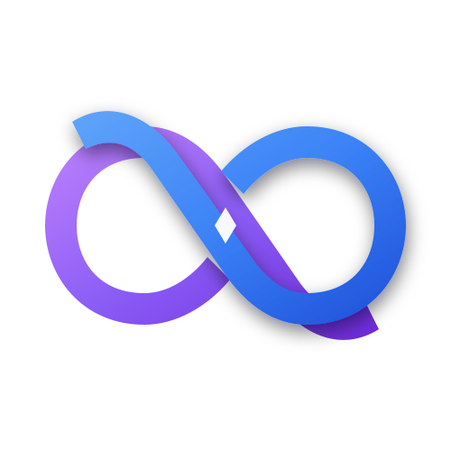
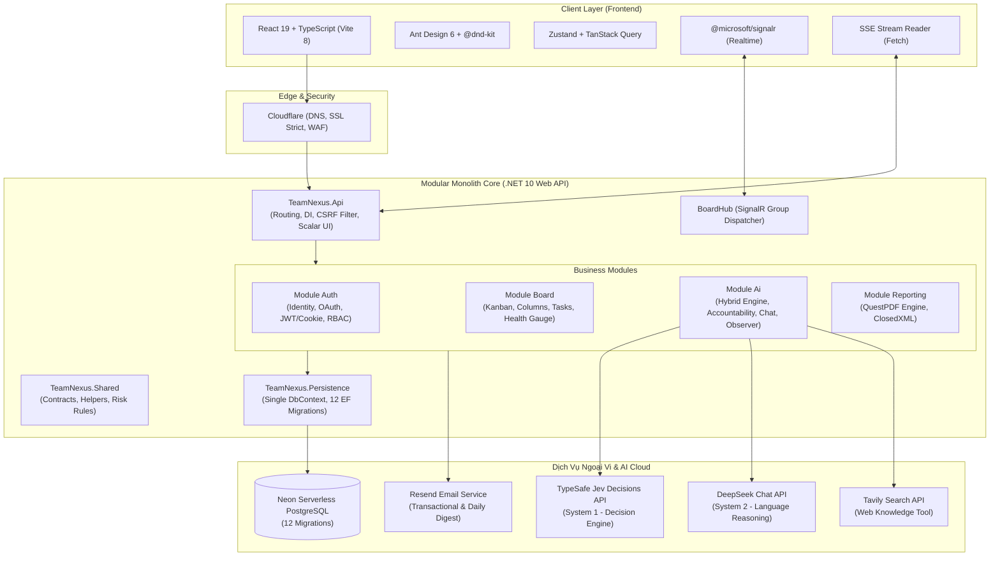

<p align="center">
  <a href="https://app.teamnexus.cloud" target="_blank" rel="noopener noreferrer">
    
  </a>
</p>

<h1 align="center">TeamNexus</h1>

<p align="center">
  <strong>Trợ lý Điều phối Không gian Làm việc Thông minh (Intelligent Workspace Orchestration Platform)</strong><br/>
  Nền tảng quản lý dự án & cộng tác nhóm thế hệ mới, kết hợp Kanban Real-time với Kiến trúc Hybrid AI đột phá (Jev System 1 + DeepSeek System 2) và Hệ thống Giải trình Minh bạch (Accountability Layer).
</p>

<p align="center">
  <a href="https://github.com/Thinh-TT/TeamNexus/actions/workflows/ci-backend.yml">
    
  </a>
  <a href="https://github.com/Thinh-TT/TeamNexus/actions/workflows/ci-web.yml">
    
  </a>
  
  
  
  
  
  
  
</p>

---

## 🚀 Trải Nghiệm Trực Tiếp (Production Live)

Hệ sinh thái TeamNexus đã được triển khai hoàn chỉnh trên môi trường Cloud Production với domain riêng, bảo mật SSL nghiêm ngặt và tự động hóa kiểm thử liên tục (CI/CD):

| Thành phần | Đường dẫn / Định danh | Hạ tầng & Công nghệ |
|---|---|---|
| 🌐 **Web Application** | [https://app.teamnexus.cloud](https://app.teamnexus.cloud) | Hosted trên **Vercel**, DNS & WAF quản lý qua **Cloudflare** (SSL Full Strict) |
| ⚙️ **API Backend Service** | [https://api.teamnexus.cloud](https://api.teamnexus.cloud) | Containerized Docker trên **Render** (.NET 10 Web API, Base: `/api`) |
| 📖 **Tài liệu API (Scalar UI)** | [https://api.teamnexus.cloud/scalar](https://api.teamnexus.cloud/scalar) | Giao diện OpenAPI / Scalar tương tác trực quan cho toàn bộ endpoints |
| 🗄️ **Cơ sở dữ liệu** | Neon Serverless PostgreSQL | Singapore region (`ap-southeast-1`), **12/12** EF Core migrations sạch |
| ✉️ **Transactional Email** | `TeamNexus <noreply@teamnexus.cloud>` | Cloudflare DNS xác thực SPF, DKIM, DMARC + **Resend API** |

> 💡 **Hướng dẫn Trải nghiệm 1-Click (OAuth Login)**:
> - Người dùng có thể truy cập ngay [https://app.teamnexus.cloud](https://app.teamnexus.cloud) và đăng nhập nhanh bằng **tài khoản Google hoặc GitHub cá nhân**.
> - Hệ thống tự động cấp quyền người dùng chuẩn (`User`), khởi tạo Workspace mẫu với đầy đủ bảng Kanban, thành viên AI ảo và các dữ liệu trải nghiệm thực tế.
>
> ⚠️ **Lưu ý Cold-start (Render Free Tier)**: Máy chủ API sẽ tạm ngủ nếu không có lượt truy cập trong 15 phút. Request đầu tiên có thể mất ~30–60 giây để khởi động. Giao diện Web đã tích hợp sẵn cơ chế đếm lùi, thông báo tiếng Việt mượt mà và tự động kết nối lại (Auto-reconnect).

---

## 💡 Điểm Đột Phá & Giá Trị Cốt Lõi

TeamNexus giải quyết triệt để vấn đề "bất đồng ngầm", thiếu minh bạch và tắc nghẽn thông tin trong các nhóm làm việc thông qua ba trụ cột công nghệ:

### 1. Kiến trúc Hybrid AI (System 1 + System 2)
Không phụ thuộc đơn thuần vào việc ép Large Language Models (LLM) đoán token chậm chạp và tốn kém, TeamNexus áp dụng mô hình phân tách nhận thức:
- **System 1 — Phản xạ Quyết định Siêu tốc (TypeSafe Jev 1.13 qua OpenRouter Decisions API)**:
  - Tiếp nhận bối cảnh và trả về các quyết định có cấu trúc tĩnh (`Choice`, `Score`, `Noul`) trong **dưới 300ms** (so với 2–5s của LLM truyền thống).
  - Tiết kiệm 90–95% chi phí token so với LLM prompting; đầu ra có kiểu dữ liệu chuẩn, triệt tiêu 100% rủi ro vỡ JSON schema hoặc rò rỉ ID hệ thống.
  - Đảm nhiệm: Phân loại tác vụ thông minh (Auto-Triage Domain/WorkType), đề xuất phân công nhân sự (Assignee Dispatching) theo hồ sơ kỹ năng & giới hạn WIP, và định tuyến mức độ nghiêm trọng rủi ro cho AI Observer.
- **System 2 — Tư duy Ngôn ngữ & Giải trình Sâu (DeepSeek Chat qua LLM API)**:
  - Chỉ kích hoạt khi thực sự cần tổng hợp, giải thích ngữ cảnh chi tiết hoặc tương tác đàm thoại với con người.
  - Đảm nhiệm: Trợ lý trò chuyện cấp Thẻ/Bảng (SSE Streaming), soạn thảo đề xuất, phân rã công việc phức tạp, tóm tắt tổng quan.

### 2. Hệ Thống Giải Trình AI Minh Bạch (Accountability Layer)
Một trong những rào cản lớn nhất của AI trong doanh nghiệp là tính "khó lường" (black-box) và nguy cơ ghi đè dữ liệu sai lệch. TeamNexus thiết lập cơ chế **Human-in-the-loop** không khoan nhượng:
- **Nguyên tắc bất biến**: AI **không bao giờ** được phép ghi đè trực tiếp vào cơ sở dữ liệu nghiệp vụ (Task, Member, Column).
- **Vòng đời trạng thái (CAS State Machine)**:
  $$\text{AI Proposal} \longrightarrow \text{Pending Action Log} \longrightarrow \begin{cases} \text{Human Approved} \implies \text{Áp dụng thay đổi} \\ \text{Human Rejected} \implies \text{Hủy đề xuất} \end{cases}$$
- **Khả năng Hoàn tác 100% (Reversible Undo)**: Mọi thao tác sau khi được Manager phê duyệt đều lưu lại `before_snapshot`, cho phép hoàn tác (Undo) đưa dữ liệu về nguyên trạng chỉ bằng 1 cú nhấp chuột.

### 3. Đồng Bộ Hóa Thời Gian Thực (Real-time Kanban Core)
- Xây dựng trên nền tảng **ASP.NET Core SignalR** kết hợp bộ thư viện kéo thả hiện đại `@dnd-kit`.
- Cập nhật tức thời trạng thái di chuyển thẻ, thêm cột, chỉnh sửa nhãn, bình luận giữa mọi thành viên trong cùng Workspace mà không cần tải lại trang.
- Cơ chế quản lý kết nối theo Board Hub, xử lý reconnection tự động khi gián đoạn mạng.

---

## 🌟 Bản Đồ Tính Năng (Feature Matrix)

```
┌──────────────────────────────────────────────────────────────────────────────────┐
│                               TEAMNEXUS CAPABILITIES                             │
├──────────────────────┬──────────────────────┬────────────────────────────────────┤
│ 📋 KANBAN REAL-TIME  │ 🤖 BỘ TRỢ LÝ AI      │ 📊 QUẢN TRỊ & BÁO CÁO              │
├──────────────────────┼──────────────────────┼────────────────────────────────────┤
│ • Kéo thả mượt mà    │ • Jev Auto-Triage    │ • Điểm sức khỏe dự án (Health)    │
│ • Nhãn & Priority    │ • Smart Dispatching  │ • Burndown & Velocity chart        │
│ • Due date & Quá hạn │ • AI Task/Board Chat │ • Xuất báo cáo PDF (QuestPDF)      │
│ • Calendar View      │ • AI Smart Setup     │ • Xuất báo cáo Excel (ClosedXML)   │
│ • Activity log audit │ • AI Observer ngầm   │ • Daily Digest Email tự động       │
│ • Phân trang keyset  │ • Agent Executor     │ • Notification Center (@mention)   │
└──────────────────────┴──────────────────────┴────────────────────────────────────┘
```

### Chi tiết các phân hệ:
1. **Không gian làm việc & Kanban**:
   - **Bảng Kanban đa năng**: Tự do tùy biến cột, thiết lập cột hoàn thành (`isDone`), sắp xếp thứ tự trực quan.
   - **Thẻ công việc chi tiết**: Hỗ trợ Markdown, độ ưu tiên (Low, Medium, High, Urgent), gắn nhãn màu sắc, ngày hết hạn có cảnh báo tự động.
   - **Chế độ xem Lịch (Calendar View)**: Chuyển đổi giữa Kanban và Lịch tháng, gom nhóm thẻ theo ngày hạn địa phương, phát hiện trễ hạn trực quan.
   - **Tìm kiếm đa tiêu chí (Cross-board Search)**: Lọc thẻ theo người phụ trách, nhãn kết hợp (AND), khoảng thời gian, phân trang Keyset tốc độ cao.

2. **Phân hệ Trí tuệ Nhân tạo (Hybrid AI Suite)**:
   - **Jev Auto-Triage**: Tự động gợi ý Miền kỹ thuật (Backend, Frontend, DevOps, Database, Mobile, QA), Loại hình (Feature, Bug, Refactor) và Mức ưu tiên chỉ sau vài mili-giây.
   - **Smart Assignee Dispatching**: Đề xuất người nhận việc tối ưu dựa trên hồ sơ kỹ năng thành viên, vai trò chính và tải công việc hiện tại (WIP limits).
   - **AI Task Chat & Board Agent Chat**: Hộp thoại tương tác thời gian thực qua Server-Sent Events (SSE), hỗ trợ kéo thả đính kèm tối đa 8 thẻ công việc làm ngữ cảnh, tự động trích xuất đề xuất hành động.
   - **AI Observer & Cảnh báo Sớm**: Quét ngầm định kỳ phát hiện nút thắt cổ chai, thẻ bị đình trệ và cảnh báo nguy cơ trễ hạn sớm (`AtRiskDeadline`) trước khi sự cố xảy ra.
   - **AI Agent Executor**: Đóng vai trò thành viên ảo có thể được gán thẻ công việc, tự động chạy vòng lặp Function Calling kết hợp tra cứu web (Tavily Search) để soạn thảo kết quả.

3. **Báo cáo, Giám sát & Quản trị**:
   - **Chỉ số Sức khỏe Dự án (Project Health Score)**: Thuật toán tất định chấm điểm từ 0–100 dựa trên 5 chiều đo lường: tỷ lệ quá hạn, rủi ro deadline, thẻ đóng băng, tuổi thọ thẻ và mức độ lệch tải nhân sự.
   - **Báo cáo Tiến độ Đa định dạng**: Xuất dữ liệu thống kê ra file PDF đẹp mắt (QuestPDF) hoặc bảng tính Excel phân tích chuyên sâu (ClosedXML) tức thời (on-demand).
   - **Trung tâm Thông báo & Email Hàng Ngày**: Đầy đủ chuông báo badge, nhắc nhở khi được gán việc hoặc @mention trong thảo luận; hệ thống Daily Digest tự động tổng hợp công việc cần làm mỗi sáng gửi về hòm thư người dùng.

---

## 🏗️ Kiến Trúc Hệ Thống (System Architecture)

TeamNexus áp dụng mô hình kiến trúc **Modular Monolith** phân tách rõ ràng ranh giới nghiệp vụ (Bounded Contexts), kết hợp giao tiếp hướng sự kiện nội bộ và khả năng mở rộng độc lập từng module.



### Cấu trúc mã nguồn (Directory Tree):

```
TeamNexus/
├── src/                                         # Backend (.NET 10 C#)
│   ├── TeamNexus.Api/                          #   Điểm khởi chạy: Program.cs, middleware, CORS, OpenAPI
│   ├── TeamNexus.Persistence/                  #   DbContext duy nhất, cấu hình Entity, 12 EF migrations
│   ├── Modules/
│   │   ├── Auth/TeamNexus.Modules.Auth/         #   Xác thực: Google/GitHub OAuth, JWT, Quản lý tài khoản
│   │   ├── Board/TeamNexus.Modules.Board/       #   Nghiệp vụ Kanban, Real-time SignalR, Sức khỏe dự án
│   │   ├── Ai/TeamNexus.Modules.Ai/             #   Hybrid AI (Jev + DeepSeek), Accountability, Observer
│   │   └── Reporting/TeamNexus.Modules.Reporting/ # Xuất báo cáo PDF & Excel theo yêu cầu
│   └── Shared/TeamNexus.Shared/                #   Contracts, Shared Value Objects, Risk models
├── frontend/                                   # Frontend Web (React 19 + TypeScript + Vite)
│   ├── src/
│   │   ├── api/                                #   HTTP client (Axios), CSRF token handler
│   │   ├── features/                           #   Tổ chức theo tính năng: auth, board, ai, reporting, dashboard
│   │   ├── hooks/                              #   Custom React hooks (SignalR, useDroppable, shortcuts)
│   │   └── store/                              #   Global state management (Zustand)
│   └── tests/                                  #   Bộ test giao diện (Vitest, Testing Library)
├── tests/
│   └── TeamNexus.Api.Tests/                    #   Bộ test toàn diện backend (Unit, Integration, Architecture)
├── project-docs/                               #   Toàn bộ tài liệu đặc tả, quyết định kỹ thuật & lộ trình
└── TeamNexus.sln                               #   Visual Studio / dotnet Solution
```

---

## 🛠️ Công Nghệ Sử Dụng (Tech Stack Matrix)

| Lĩnh vực | Công nghệ | Phiên bản / Chi tiết sử dụng |
|---|---|---|
| **Backend Core** | .NET (C#) | **.NET 10.0**, C# 13, ASP.NET Core Minimal APIs / Controllers |
| **Kiến trúc** | Modular Monolith | Tách module sạch, giao tiếp in-process qua Interface / DTO |
| **Cơ sở dữ liệu** | PostgreSQL & EF Core | **EF Core 10**, Neon Serverless PostgreSQL, 12 Migrations |
| **Real-time** | ASP.NET Core SignalR | Hub group theo boardId, tự động reconnect, payload gọn nhẹ |
| **AI System 1** | TypeSafe Jev | **Jev 1.13** qua OpenRouter Decisions API (`Choice`, `Score`, `Noul`) |
| **AI System 2** | DeepSeek Chat | LLM API, Function Calling, SSE streaming (`text/event-stream`) |
| **Báo cáo** | QuestPDF & ClosedXML | Xuất PDF vector sắc nét và bảng tính Excel `.xlsx` on-demand |
| **Frontend Core** | React & TypeScript | **React 19.2**, **TypeScript 6.0**, **Vite 8.2** |
| **UI Component** | Ant Design | **Ant Design 6.6**, `@ant-design/icons`, responsive layout |
| **Drag & Drop** | @dnd-kit | `@dnd-kit/core`, `@dnd-kit/sortable`, kéo thả thẻ & thả vào AI Chat |
| **State Management**| Zustand & React Query| Cache server state với TanStack Query v5, client state với Zustand |
| **Testing** | xUnit & Vitest | xUnit, FluentAssertions, FakeProviders; Vitest, Testing Library |
| **Email Service** | Resend API | Transactional mail & Daily digest, xác thực DNS qua Cloudflare |
| **CI/CD & DevOps** | Docker & GitHub Actions| Multi-stage Docker build, CI pipelines tự động chặn rớt test |

---

## 🧪 Kiểm Thử & Đảm Bảo Chất Lượng (Quality Assurance)

Dự án duy trì kỷ luật mã nguồn nghiêm ngặt với cổng chất lượng tự động trên GitHub Actions:

```
[GitHub Actions CI]
  ├── Backend Pipeline: dotnet test (912 PASS / 0 FAIL / 0 SKIP)
  │                      dotnet build -warnaserror (0 Warning / 0 Error)
  │                      EF Core Migration Drift Check (has-pending-model-changes: CLEAN)
  └── Frontend Pipeline: vitest run (657 PASS / 0 FAIL across 107 test files)
                         oxlint (0 Warning / 0 Error)
                         tsc -b (TypeScript build exit code: 0)
```

- **912 Backend Tests**: Bao gồm Pure Unit Tests (logic nghiệp vụ, thuật toán tính điểm sức khỏe, sanitization), Integration Tests với InMemory/PostgreSQL Database, Fake AI Providers và Architecture Boundary Tests bảo vệ tính độc lập của các module.
- **657 Frontend Tests**: Kiểm thử toàn diện từ components, custom hooks, tương tác kéo thả đến tích hợp xử lý stream SSE và đồng bộ SignalR.
- **12 Migrations Tuyệt Đối Sạch**: Chuỗi migration tuyến tính duy nhất, bảo đảm tính toàn vẹn dữ liệu từ giai đoạn sơ khai đến nền tảng Autonomous Agent hiện đại.

---

## 💻 Hướng Dẫn Cài Đặt & Chạy Môi Trường Local (Local Development)

### 1. Yêu cầu Tiên quyết
- **.NET SDK 10**: [Tải về từ Microsoft](https://dotnet.microsoft.com/download)
- **Node.js**: Phiên bản `^22.12.0` hoặc `^24.0.0` (khuyến nghị Node 24 để đồng nhất với môi trường CI)
- **PostgreSQL**: Phiên bản 16 trở lên (cài đặt cục bộ hoặc sử dụng Docker container)

### 2. Cài đặt & Cấu hình Bí mật (User Secrets)
Clone mã nguồn về máy:
```bash
git clone https://github.com/Thinh-TT/TeamNexus.git
cd TeamNexus
```

Khởi tạo và cấu hình `User Secrets` cho project backend:
```bash
dotnet user-secrets init --project src/TeamNexus.Api

# Cấu hình Connection String tới database PostgreSQL cục bộ:
dotnet user-secrets set --project src/TeamNexus.Api "ConnectionStrings:DefaultConnection" "Host=localhost;Port=5432;Database=TeamNexus;Username=postgres;Password=your_password"

# Cấu hình JWT & API Keys (nếu chạy đầy đủ tính năng AI ngoài):
dotnet user-secrets set --project src/TeamNexus.Api "Jwt:Key" "your_super_secret_jwt_key_at_least_32_characters_long"
dotnet user-secrets set --project src/TeamNexus.Api "DeepSeek:ApiKey" "your_deepseek_api_key_or_empty"
dotnet user-secrets set --project src/TeamNexus.Api "Jev:ApiKey" "your_openrouter_api_key_or_empty"
dotnet user-secrets set --project src/TeamNexus.Api "Tavily:ApiKey" "your_tavily_api_key_or_empty"
```
*(Ghi chú: Nếu để trống API Key của Jev hoặc DeepSeek, hệ thống sẽ tự động kích hoạt `FakeJevDecisionProvider` và `FakeAiProvider` phục vụ kiểm thử offline tất định mà không tiêu tốn token).*

### 3. Cập nhật Cơ sở Dữ liệu (Migrations)
Áp dụng toàn bộ 12 migrations lên database:
```bash
dotnet ef database update --project src/TeamNexus.Persistence --startup-project src/TeamNexus.Api
```

> ⚠️ **Lưu ý khi build trong môi trường Sandbox/CLI**:
> Nếu gặp hiện tượng `dotnet build` trả về `0 Warning(s) / 0 Error(s)` nhưng không sinh DLL mới do named-pipe bị chặn, hãy dùng tham số:
> ```bash
> dotnet build TeamNexus.sln -m:1 -nr:false
> ```

### 4. Khởi chạy Ứng dụng
Mở 2 terminal riêng biệt:

**Terminal 1 — Backend API Server:**
```bash
dotnet run --project src/TeamNexus.Api
# Backend lắng nghe tại: http://localhost:5000
# Scalar API Documentation: http://localhost:5000/scalar
```

**Terminal 2 — Frontend Web Client:**
```bash
cd frontend
npm install
npm run dev
# Frontend lắng nghe tại: http://localhost:5173 (tự động proxy /api sang port 5000)
```

Truy cập trình duyệt tại địa chỉ `http://localhost:5173` để bắt đầu làm việc!

### 5. Chạy Kiểm Thử Tự Động (Test Suite)
```bash
# Chạy toàn bộ 912 backend tests:
dotnet test TeamNexus.sln

# Chạy toàn bộ 657 frontend tests:
cd frontend
npm test
```

---

## 📚 Bản Đồ Tài Liệu Dự Án (Project Documentation Sitemap)

Hệ thống tài liệu thiết kế chi tiết được tổ chức khoa học trong thư mục [project-docs/](file:///e:/TeamNexus/project-docs/):

- 📋 [01-system-specification.md](file:///e:/TeamNexus/project-docs/01-system-specification.md): Đặc tả yêu cầu kỹ thuật, phân tích nghiệp vụ và ranh giới hệ thống từ Giai đoạn 1 đến 14.7.
- 📐 [02-tech-stack-decisions.md](file:///e:/TeamNexus/project-docs/02-tech-stack-decisions.md): Các quyết định lựa chọn kiến trúc (ADR), Modular Monolith, JWT, SignalR và Anti-Hallucination.
- 🗺️ [03-roadmap.md](file:///e:/TeamNexus/project-docs/03-roadmap.md): Lộ trình tiến độ tổng thể 16 giai đoạn (từ nền tảng đến Mobile Flutter).
- 🗄️ [04-database-design.md](file:///e:/TeamNexus/project-docs/04-database-design.md): Sơ đồ quan hệ thực thể (ERD), chiến lược phân vùng, chỉ mục và lịch sử 12 EF migrations.
- 🎓 [05-capstone-and-itgottalent.md](file:///e:/TeamNexus/project-docs/05-capstone-and-itgottalent.md): Bối cảnh chuyển giao học thuật, định hướng Đồ án Chuyên ngành và bài dự thi IT got Talent.
- ⚡ [06-adjust-and-upgrade-with-jev.md](file:///e:/TeamNexus/project-docs/06-adjust-and-upgrade-with-jev.md): Kiến trúc chuyên sâu về Hybrid AI: Mô hình ra quyết định không sinh văn bản Jev System 1 kết hợp DeepSeek System 2.
- 🎨 [07-upgrade-uiux-with-stitch.md](file:///e:/TeamNexus/project-docs/07-upgrade-uiux-with-stitch.md): Định hướng, hệ thống thiết kế Stitch (Intelligent Orchestration) và lộ trình nâng cấp UI/UX toàn diện.
- 📝 [tasks/](file:///e:/TeamNexus/project-docs/tasks/): Kế hoạch thi hành, checklist nghiệm thu DoD chi tiết của từng giai đoạn phát triển.
- 📊 [report/](file:///e:/TeamNexus/project-docs/report/): Báo cáo kết quả kiểm thử, ảnh chụp thực tế và số đo hiệu năng qua các đợt phát hành.

---

## 📄 Bản Quyền & Giấy Phép (License)

Dự án được phân phối dưới giấy phép **MIT License**. Chi tiết xem tại tập tin `LICENSE`.

<p align="center">
  Phát triển với sự tận tâm bởi nhóm kỹ sư TeamNexus • 2026
</p>
