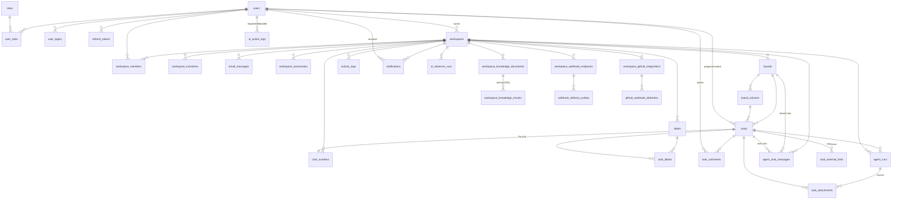

# TeamNexus – Tài liệu Thiết kế Cơ sở Dữ liệu (Database Design)

> Tài liệu đặc tả toàn bộ kiến trúc cơ sở dữ liệu PostgreSQL 18 (`pgvector`) của hệ thống **TeamNexus**, phản ánh chính xác trạng thái hiện hành qua **16 EF Core migrations** (**35 bảng vật lý**: 27 bảng nghiệp vụ + 7 bảng ASP.NET Core Identity + 1 bảng hạ tầng `data_protection_keys`).

---

## 1. Tổng quan Kiến trúc Dữ liệu

| Thành phần | Lựa chọn Kỹ thuật | Ghi chú Thiết kế |
|---|---|---|
| **Hệ quản trị CSDL** | PostgreSQL 18 + extension `pgvector` | Triển khai trên Neon Serverless (Production) và `pgvector/pgvector:pg18` (CI/Local) |
| **ORM & Migration** | EF Core 10 Code-First (`Npgsql` + `Pgvector.EntityFrameworkCore`) | Một chuỗi migration tuyến tính duy nhất từ `TeamNexusDbContext` |
| **Kiến trúc Module** | Modular Monolith (`Auth`, `Board`, `Ai`, `Reporting`) | Dùng chung `TeamNexusDbContext` đặt tại `TeamNexus.Persistence` |
| **Khóa chính (PK)** | `uuid` (`Guid`) cho toàn bộ bảng nghiệp vụ | Sinh tại tầng ứng dụng (`Guid.NewGuid()`) |
| **Quy ước đặt tên** | `snake_case` cho mọi bảng và cột | Ánh xạ từ thực thể C# `PascalCase` qua `IEntityTypeConfiguration` |
| **Kiểu thời gian** | `timestamptz` (luôn chuẩn hóa về UTC `Offset = 0`) | Tự động gắn `created_at` / `updated_at` qua `IAuditableEntity` |
| **Biểu diễn Enum** | Cột `text` / `varchar` + ràng buộc `CHECK` (hoặc từ điển mở) | Không dùng kiểu `ENUM` cứng của PostgreSQL để dễ mở rộng |
| **Xóa mềm (Soft Delete)** | Cột `deleted_at` (`timestamptz NULL`) + Global Query Filter | Áp dụng cho `workspaces`, `boards`, `tasks`, `task_comments`; riêng `workspace_knowledge_documents` dùng `status = 'deleted'` |
| **Dữ liệu bán cấu trúc** | `jsonb` | Dùng cho cơ sở lý luận AI (`basis`), ảnh chụp hoàn tác (`before/after/applied_snapshot`), nhật ký công cụ (`tool_call_trace`), kỹ năng (`skills`) |
| **Nhúng Vector (RAG)** | `vector(1536)` + chỉ mục `HNSW (vector_cosine_ops)` | Cố định số chiều `1536` trên `workspace_knowledge_chunks.embedding` |
| **Lưu trữ tệp nhị phân** | `bytea` (giới hạn `≤ 512 KB`) | Dùng duy nhất cho `task_attachments.content` |

### 1.1. DbContext Hợp nhất & Quy ước Định danh Actor
- **Một `TeamNexusDbContext` duy nhất** kế thừa `IdentityDbContext<ApplicationUser, IdentityRole<Guid>, Guid>` quản lý toàn bộ thực thể Identity, thực thể nghiệp vụ và bảng vòng khóa `DataProtectionKeys` (`IDataProtectionKeyContext`).
- **Phân biệt Thành viên Người thật, AI Agent và Tài khoản Hệ thống:**
  - `workspace_members.member_type` (`'human'` | `'ai_agent'`) là trường phân biệt duy nhất giữa thành viên con người và trợ lý AI trong một workspace.
  - Mỗi chuyên gia AI (`persona_key` ∈ `'general'`, `'scrum_master'`, `'tech_lead'`, `'qa_security'`) của một workspace được ánh xạ tới một bản ghi `users` riêng biệt (khởi tạo tự động khi cần, khóa đăng nhập).
  - Tài khoản hệ thống toàn cục (như `GitHub Bot` — `00000000-0000-0000-0000-00000000b071`) được đánh dấu bằng cờ `users.is_system = true`, không thuộc `workspace_members` và bị chặn đăng nhập tương tác tại `AuthService`.

---

## 2. Sơ đồ Quan hệ Thực thể (ERD)

---

## 3. Chi tiết Bảng theo Phân hệ

> **Ký hiệu:** `PK` = Khóa chính · `FK` = Khóa ngoại · `UQ` = Ràng buộc duy nhất · `IX` = Chỉ mục.

### 3.1. Phân hệ Xác thực — Các bảng Identity & Refresh Token (Giai đoạn 1, 9, 13, 15)

Các bảng mặc định của ASP.NET Core Identity được ánh xạ sang tên `snake_case`: `users`, `roles`, `user_roles`, `user_logins`, `user_claims`, `role_claims`, `user_tokens`.

#### `users` (`ApplicationUser`)
| Cột | Kiểu | Null | Ràng buộc / Mặc định | Ý nghĩa |
|---|---|---|---|---|
| `id` | `uuid` | — | PK | Định danh người dùng (con người, AI Agent hoặc Bot hệ thống) |
| `user_name` | `text` | — | UQ | Tên định danh tài khoản |
| `normalized_user_name` | `text` | — | UQ (IX) | Tên định danh chuẩn hóa chữ hoa |
| `email` | `text` | null | UQ | Địa chỉ email (`NULL` đối với tài khoản `ai_agent`) |
| `normalized_email` | `text` | null | UQ (IX) | Email chuẩn hóa |
| `email_confirmed` | `boolean` | — | | Trạng thái xác thực email |
| `password_hash` | `text` | null | | Chuẩn Identity (`NULL` cho tài khoản OAuth / Agent / Bot) |
| `security_stamp` | `text` | — | | Chuẩn Identity |
| `concurrency_stamp` | `text` | — | | Chuẩn Identity |
| `phone_number` / `phone_number_confirmed` | `text` / `bool` | null / — | | Chuẩn Identity |
| `two_factor_enabled` / `lockout_enabled` | `boolean` | — | | Đặt `true` để khóa đăng nhập đối với tài khoản `ai_agent` |
| `lockout_end` / `access_failed_count` | `timestamptz` / `int` | null / — | | Chuẩn Identity |
| `display_name` | `text` | — | | Tên hiển thị trên giao diện |
| `avatar_url` | `text` | null | | Đường dẫn ảnh đại diện (`http://` hoặc `https://`) |
| `digest_enabled` | `boolean` | — | `DEFAULT true` | *(Giai đoạn 13)* Bật/tắt nhận bản tin Daily Email Digest mỗi sáng |
| `is_system` | `boolean` | — | `DEFAULT false` | *(Giai đoạn 15)* Đánh dấu tài khoản hệ thống (`GitHub Bot`), chặn đăng nhập OAuth/JWT |
| `created_at` | `timestamptz` | — | | Thời điểm tạo tài khoản |

#### `roles` & `user_roles` & `user_logins`
- **`roles`:** Gồm `id` (PK), `name` (UQ), `normalized_name` (UQ). Chỉ lưu đúng **2 vai trò toàn cục** (tinh giản từ Giai đoạn 9): `Admin` (quản trị viên nền tảng, bảo vệ bởi `SystemAdminPolicy`) và `User` (mặc định cho mọi người dùng đăng nhập OAuth).
- **`user_roles`:** Bảng nối `(user_id, role_id)` PK composite, FK → `users` và `roles`.
- **`user_logins`:** Lưu liên kết OAuth `(login_provider, provider_key)` PK composite (`Google` / `GitHub`), FK `user_id` → `users`.

#### `refresh_tokens`
| Cột | Kiểu | Null | Ràng buộc / Mặc định | Ý nghĩa |
|---|---|---|---|---|
| `id` | `uuid` | — | PK | Định danh bản ghi token |
| `user_id` | `uuid` | — | FK → `users`, IX | Chủ sở hữu token |
| `token_hash` | `text` | — | | Mã băm `SHA-256` của refresh token (không lưu token thô) |
| `expires_at` | `timestamptz` | — | | Thời điểm hết hạn (mặc định 7 ngày) |
| `created_at` | `timestamptz` | — | | Thời điểm phát hành |
| `revoked_at` | `timestamptz` | null | | Thời điểm thu hồi (khi đăng xuất hoặc xoay vòng) |
| `replaced_by_token_id` | `uuid` | null | FK → `refresh_tokens` | Trỏ tới token mới thay thế trong chuỗi xoay vòng chống phát lại |

---

### 3.2. Phân hệ Không gian làm việc & Thành viên (Giai đoạn 1, 7, 11, 14.7, 15)

#### `workspaces`
| Cột | Kiểu | Null | Ràng buộc / Mặc định | Ý nghĩa |
|---|---|---|---|---|
| `id` | `uuid` | — | PK | Định danh không gian làm việc |
| `name` | `varchar(120)` | — | | Tên không gian làm việc |
| `description` | `varchar(2000)` | null | | Mô tả không gian làm việc |
| `owner_id` | `uuid` | — | FK → `users`, IX | Chủ sở hữu hiện tại của workspace |
| `next_task_number` | `bigint` | — | `DEFAULT 1` | *(Giai đoạn 15)* Bộ đếm nguyên tử cấp số thứ tự thẻ `TN-123` |
| `created_at` / `updated_at` | `timestamptz` | — | | Thời điểm tạo và cập nhật |
| `deleted_at` | `timestamptz` | null | Global Query Filter | Thời điểm xóa mềm |

#### `workspace_members`
| Cột | Kiểu | Null | Ràng buộc / Mặc định | Ý nghĩa |
|---|---|---|---|---|
| `workspace_id` | `uuid` | — | PK (composite), FK → `workspaces` | Không gian làm việc |
| `user_id` | `uuid` | — | PK (composite), FK → `users` | Thành viên (người thật hoặc AI Agent) |
| `role` | `text` | — | CHECK `IN ('Admin','Manager','Member')` | Vai trò phân quyền nghiệp vụ trong workspace |
| `member_type` | `text` | — | CHECK `IN ('human','ai_agent')`, `DEFAULT 'human'` | *(Giai đoạn 7)* Phân biệt thành viên con người và trợ lý AI |
| `ai_agent_name` | `text` | null | | *(Giai đoạn 7)* Tên hiển thị của AI Agent (`NULL` với người thật) |
| `skills` | `jsonb` | — | `DEFAULT '[]'::jsonb` | *(Giai đoạn 14.7A)* Danh sách kỹ năng chuẩn hóa phục vụ gợi ý phân công |
| `primary_role` | `varchar(50)` | — | `DEFAULT 'Member'` | *(Giai đoạn 14.7A)* Chức danh chuyên môn chính (VD: `Backend Dev`, `QA Engineer`) |
| `capacity_weight` | `double precision` | — | `DEFAULT 1.0`, CHECK `> 0` | *(Giai đoạn 14.7A)* Trọng số năng lực xử lý công việc |
| `max_wip_limit` | `int` | — | `DEFAULT 5`, CHECK `>= 0` | *(Giai đoạn 14.7A)* Giới hạn số thẻ tối đa đang thực hiện cùng lúc |
| `persona_key` | `varchar(40)` | null | CHECK `IN ('general','scrum_master','tech_lead','qa_security')` | *(Giai đoạn 14.7B)* Định danh vai trò chuyên gia AI (`NULL` bắt buộc đối với `human`) |
| `joined_at` | `timestamptz` | — | | Thời điểm gia nhập workspace |

> **Ràng buộc duy nhất theo Persona:** Chỉ mục biểu thức `uq_workspace_members_ai_persona` trên `(workspace_id, COALESCE(persona_key, 'general')) WHERE member_type = 'ai_agent'` đảm bảo mỗi workspace có tối đa 1 thành viên ảo cho mỗi vai trò chuyên gia.

#### `workspace_invitations` (Giai đoạn 11)
| Cột | Kiểu | Null | Ràng buộc / Mặc định | Ý nghĩa |
|---|---|---|---|---|
| `id` | `uuid` | — | PK | Mã định danh lời mời |
| `workspace_id` | `uuid` | — | FK → `workspaces` (Restrict), IX | Workspace phát hành lời mời |
| `invited_email` | `varchar(320)` | — | UQ partial `(workspace_id, invited_email) WHERE status = 'Pending'` | Địa chỉ email người được mời |
| `invited_role` | `varchar(32)` | — | CHECK `IN ('Admin','Manager','Member')`, `DEFAULT 'Member'` | Vai trò sẽ nhận khi chấp nhận lời mời |
| `token_hash` | `varchar(128)` | — | UQ | Mã băm `SHA-256` của token lời mời gửi qua email |
| `invited_by_user_id` | `uuid` | — | FK → `users` (Restrict), IX | Quản lý tạo lời mời |
| `status` | `varchar(32)` | — | CHECK `IN ('Pending','Accepted','Cancelled','Expired')` | Trạng thái vòng đời lời mời |
| `expires_at` | `timestamptz` | — | | Thời hạn hiệu lực (mặc định 7 ngày) |
| `accepted_by_user_id` | `uuid` | null | FK → `users` (Restrict), IX | Người dùng chấp nhận lời mời |
| `accepted_at` | `timestamptz` | null | | Thời điểm chấp nhận |
| `created_at` / `updated_at` | `timestamptz` | — | | Thời điểm tạo và cập nhật |

#### `email_messages` (Giai đoạn 11 & 13)
| Cột | Kiểu | Null | Ràng buộc / Mặc định | Ý nghĩa |
|---|---|---|---|---|
| `id` | `uuid` | — | PK | Định danh bản ghi email |
| `workspace_id` | `uuid` | — | FK → `workspaces` (Restrict), IX `(workspace_id, created_at)` | Workspace liên quan |
| `to_email` | `varchar(320)` | — | | Địa chỉ email người nhận |
| `kind` | `varchar(40)` | — | | Loại email: `Invitation`, `QuickNotice`, `DailyDigest` |
| `subject` | `varchar(200)` | — | | Tiêu đề email |
| `body_preview` | `varchar(500)` | — | | Bản trích yếu nội dung |
| `sent_by_user_id` | `uuid` | null | FK → `users` (Restrict), IX | Người gửi (`NULL` khi hệ thống gửi tự động như `DailyDigest`) |
| `status` | `varchar(32)` | — | CHECK `IN ('Queued','Sent','Failed')` | Trạng thái gửi |
| `provider_message_id` | `varchar(200)` | null | | Mã thông điệp trả về từ Resend API |
| `error` | `varchar(500)` | null | | Chi tiết lỗi nếu gửi thất bại |
| `created_at` / `updated_at` | `timestamptz` | — | | Thời điểm tạo và cập nhật |

---

### 3.3. Phân hệ Bảng điều khiển Kanban (Giai đoạn 2, 7, 15)

#### `boards`
| Cột | Kiểu | Null | Ràng buộc / Mặc định | Ý nghĩa |
|---|---|---|---|---|
| `id` | `uuid` | — | PK | Định danh bảng Kanban |
| `workspace_id` | `uuid` | — | FK → `workspaces`, IX | Không gian làm việc chứa bảng |
| `name` | `text` | — | | Tên bảng |
| `description` | `text` | null | | Mô tả bảng |
| `created_at` / `updated_at` | `timestamptz` | — | | Thời điểm tạo và cập nhật |
| `deleted_at` | `timestamptz` | null | Global Query Filter | Thời điểm xóa mềm |

#### `board_columns`
| Cột | Kiểu | Null | Ràng buộc / Mặc định | Ý nghĩa |
|---|---|---|---|---|
| `id` | `uuid` | — | PK | Định danh cột trạng thái |
| `board_id` | `uuid` | — | FK → `boards`, IX | Bảng chứa cột |
| `name` | `text` | — | | Tên cột (VD: *Cần làm*, *Đang làm*, *Đang duyệt PR*, *Hoàn thành*) |
| `position` | `int` | — | UQ `(board_id, position)` | Thứ tự hiển thị cột trên bảng |
| `is_done` | `boolean` | — | `DEFAULT false` | Cột hoàn thành (thẻ vào cột này được gán `completed_at`) |
| `is_clarification` | `boolean` | — | `DEFAULT false`, UQ partial `WHERE is_clarification` | *(Giai đoạn 7)* Cột *"Chờ làm rõ"* do AI Agent quản lý |
| `is_in_review` | `boolean` | — | `DEFAULT false`, UQ partial `WHERE is_in_review` | *(Giai đoạn 15)* Cột *"Đang duyệt PR"* cho tự động hóa GitHub PR |
| `created_at` / `updated_at` | `timestamptz` | — | | Thời điểm tạo và cập nhật |

> **Quy tắc loại trừ cờ cột:** Ba cờ `is_done`, `is_clarification` và `is_in_review` loại trừ lẫn nhau hoàn toàn (một cột chỉ được bật tối đa 1 cờ).

#### `tasks` (`BoardTask`)
| Cột | Kiểu | Null | Ràng buộc / Mặc định | Ý nghĩa |
|---|---|---|---|---|
| `id` | `uuid` | — | PK | Định danh thẻ công việc |
| `board_id` | `uuid` | — | FK → `boards`, IX | Bảng chứa thẻ |
| `column_id` | `uuid` | — | FK → `board_columns`, IX | Cột trạng thái hiện tại |
| `task_number` | `bigint` | — | `DEFAULT 0`, IX `(board_id, task_number)` | *(Giai đoạn 15)* Số thứ tự định danh `TN-123` trong phạm vi workspace |
| `title` | `text` | — | | Tiêu đề công việc |
| `description` | `text` | null | | Nội dung mô tả chi tiết (hỗ trợ Markdown) |
| `position` | `int` | — | IX `(board_id, column_id, position)` | Thứ tự sắp xếp thẻ trong cột |
| `assignee_id` | `uuid` | null | FK → `users`, IX | Người phụ trách (thành viên người thật hoặc `ai_agent`) |
| `due_date` | `timestamptz` | null | | Hạn hoàn thành (luôn chuẩn hóa UTC) |
| `priority` | `text` | null | CHECK `IN ('Low','Medium','High','Urgent')` | Mức độ ưu tiên |
| `created_by` | `uuid` | — | FK → `users` | Người tạo thẻ (hoặc `GitHub Bot` khi tạo tự động từ Issue) |
| `created_at` / `updated_at` | `timestamptz` | — | | Thời điểm tạo và cập nhật |
| `completed_at` | `timestamptz` | null | | Thời điểm hoàn thành |
| `deleted_at` | `timestamptz` | null | Global Query Filter | Thời điểm xóa mềm |

#### `labels`, `task_labels` & `task_comments`
- **`labels`:** `id` (PK), `workspace_id` (FK → `workspaces`, UQ `(workspace_id, name)`), `name`, `color` (mã màu hex), `created_at`.
- **`task_labels`:** Bảng nối `(task_id, label_id)` PK composite, FK → `tasks` và `labels`.
- **`task_comments`:** `id` (PK), `task_id` (FK → `tasks`, IX), `author_id` (FK → `users`, IX), `content` (`text ≤ 2000`), `created_at`, `updated_at`, `deleted_at` (Global Query Filter).

---

### 3.4. Phân hệ AI — Lớp Giải trình, Giám sát & Thực thi (Giai đoạn 4, 5, 7)

#### `ai_action_logs` (Accountability Layer)
| Cột | Kiểu | Null | Ràng buộc / Mặc định | Ý nghĩa |
|---|---|---|---|---|
| `id` | `uuid` | — | PK | Định danh bản ghi hành động AI |
| `action` | `varchar(64)` | — | | Loại hành động (`CreateSubtasks`, `PostComment`, `PostAttachment`, `CreateBoardFromTemplate`, `UpdateTaskFields`, `MoveTaskToColumn`, `RecoveryPlan`, `CreateKnowledgeDocument`, `GitHubPrMoveTask`, `GitHubIssueCreateTask`) |
| `entity_type` | `varchar(64)` | — | IX `(entity_type, entity_id, created_at)` | Phạm vi tác động (`Board`, `Task`, `Workspace`) |
| `entity_id` | `uuid` | null | | Định danh thực thể bị tác động |
| `basis` | `jsonb` | — | | Tóm tắt ngữ cảnh/cơ sở dữ liệu đầu vào của quyết định AI |
| `before_snapshot` | `jsonb` | null | | Ảnh chụp dữ liệu trước khi áp dụng (phục vụ khôi phục khi Undo) |
| `after_snapshot` | `jsonb` | null | | Nội dung đề xuất sẽ áp dụng khi được phê duyệt |
| `applied_snapshot` | `jsonb` | null | | Dữ liệu thực tế đã ghi khi `Approved` (danh sách ID đã tạo, cột cũ, v.v.) |
| `status` | `text` | — | CHECK `IN ('Pending','Approved','Rejected','Undone')` | Trạng thái vòng đời giải trình |
| `requested_by_user_id` | `uuid` | — | FK → `users`, IX | Chủ thể khởi tạo đề xuất (người dùng, `ai_agent` hoặc `GitHub Bot`) |
| `decided_by_user_id` | `uuid` | null | FK → `users` | Quản lý phê duyệt / từ chối / hoàn tác |
| `decided_at` | `timestamptz` | null | | Thời điểm ra quyết định |
| `decision_note` | `text` | null | | Ghi chú lý do từ chối hoặc hoàn tác (`≤ 500` ký tự) |
| `created_at` / `updated_at` | `timestamptz` | — | | Thời điểm tạo và cập nhật |

#### `activity_logs`, `notifications` & `ai_observer_runs` (Giai đoạn 5)
- **`activity_logs` (Append-only Event Store):** `id` (PK), `workspace_id` (FK, IX `(workspace_id, created_at)`), `board_id` (FK nullable), `user_id` (FK nullable), `entity_type`, `entity_id`, `action` (`TaskCreated`, `TaskUpdated`, `TaskMoved`, `TaskCompleted`, `TaskDeleted`, `CommentAdded`, `WorkspaceCreated`, `WorkspaceUpdated`, `WorkspaceOwnerTransferred`, `WorkspaceDeleted`), `payload` (`jsonb`), `created_at`, `updated_at`.
- **`notifications`:** `id` (PK), `workspace_id` (FK), `recipient_user_id` (FK → `users`, IX `(recipient_user_id, is_read)`), `type` (`OverdueTask`, `AtRiskDeadline`, `StalledTask`, `Overload`, `Bottleneck`, `AgentRunFailed`, `AgentAwaitingClarification`, `AgentOutputPending`, `RecoveryPlanPending`, `WorkspaceInvitation`, `MemberJoined`, `TaskAssigned`, `CommentOnTask`, `CommentMention`), `title`, `message`, `payload` (`jsonb`), `is_read` (`bool default false`), `created_at`, `read_at`.
- **`ai_observer_runs`:** `id` (PK), `workspace_id` (FK, IX), `started_at`, `finished_at`, `status` (CHECK `IN ('Running','Completed','Skipped','Failed')`), `summary` (`jsonb` lưu thống kê tín hiệu, lượng token và kết quả thẩm định Jev).

#### `agent_runs` & `task_attachments` (Giai đoạn 7)
- **`agent_runs` (Nhật ký tiến trình chạy Agent):** `id` (PK), `workspace_id` (FK, IX `(workspace_id, started_at)`), `board_id` (FK, IX), `task_id` (FK, IX `(task_id, started_at)`), `agent_user_id` (FK → `users`), `triggered_by_user_id` (FK → `users`), `status` (CHECK `IN ('Running','AwaitingClarification','AwaitingApproval','Completed','Failed')`, IX partial `WHERE status = 'Running'`), `stop_reason` (CHECK `IN ('DraftProduced','QuestionAsked','ToolLimit','TimeLimit','TokenBudget','ProviderError','Cancelled','TaskChanged','InternalError')`), `clarification_question`, `clarification_comment_id` (FK), `resolution_comment_id` (FK), `previous_run_id` (self-FK), `tool_call_trace` (`jsonb`), `trace_truncated` (`bool`), `tool_call_count` (`int`), `llm_call_count` (`int`), `prompt_tokens` (`int`), `completion_tokens` (`int`), `output_kind` (`'Comment'` | `'Attachment'`), `ai_action_log_id` (FK → `ai_action_logs`), `notification_sent` (`bool`), `error`, `started_at`, `finished_at`, `created_at`, `updated_at`.
- **`task_attachments` (Tệp đính kèm đầu ra của Agent — bảng duy nhất xóa vật lý khi Undo):** `id` (PK), `task_id` (FK → `tasks`, IX), `created_by_user_id` (FK → `users`), `source_run_id` (FK → `agent_runs`), `file_name` (ASCII chuẩn hóa), `content_type`, `size_bytes` (`int`), `content` (`bytea ≤ 512 KB`), `created_at`.

---

### 3.5. Phân hệ Báo cáo (Giai đoạn 6 & 13)
Module `TeamNexus.Modules.Reporting` hoạt động hoàn toàn theo cơ chế **truy vấn chỉ đọc (Read-only Projection)** trên dữ liệu sẵn có của `tasks`, `boards`, `board_columns`, `activity_logs` và `ai_observer_runs`; không sử dụng bảng lưu trữ riêng.

---

### 3.6. Phân hệ Hội thoại AI, Taxonomy & Kho Tri thức Ngữ nghĩa RAG (Giai đoạn 14.5, 14.6, 14.7)

#### `agent_chat_messages` (Giai đoạn 14.5 & 14.6 — Lịch sử hội thoại cấp Bảng và cấp Thẻ)
| Cột | Kiểu | Null | Ràng buộc / Mặc định | Ý nghĩa |
|---|---|---|---|---|
| `id` | `uuid` | — | PK | Định danh tin nhắn hội thoại |
| `board_id` | `uuid` | null | FK → `boards` (Restrict), IX `(board_id, created_at)` | Đặt giá trị khi là hội thoại cấp Bảng (`task_id = NULL`) |
| `task_id` | `uuid` | null | FK → `tasks` (Restrict), IX `(task_id)` | Đặt giá trị khi là hội thoại cấp Thẻ (`board_id = NULL`) |
| `workspace_id` | `uuid` | — | FK → `workspaces` (Restrict), IX `(workspace_id, created_at)` | Phục vụ quét dọn dẹp định kỳ (retention 90 ngày) toàn workspace |
| `user_id` | `uuid` | null | FK → `users` (Restrict) | Người gửi đối với lượt `User`; `NULL` đối với lượt `Assistant` |
| `role` | `varchar(16)` | — | CHECK `IN ('User','Assistant')` | Vai trò lượt tin nhắn |
| `content` | `text` | — | | Nội dung văn bản (`≤ 16.000` ký tự, đã lọc sạch mã GUID) |
| `attachments` | `jsonb` | null | | Danh sách thẻ đính kèm `[{ taskId, title }]` trên hội thoại cấp Bảng |
| `created_at` / `updated_at` | `timestamptz` | — | | Thời điểm ghi nhận (truy vấn sắp xếp theo `created_at → role → id`) |

> **Ràng buộc phạm vi (`ck_agent_chat_messages_scope`):** `CHECK (num_nonnulls(board_id, task_id) = 1)` đảm bảo mỗi tin nhắn thuộc đúng một trong hai phạm vi (Bảng hoặc Thẻ).

#### `workspace_taxonomies` (Giai đoạn 14.7 Track A — Từ điển phân loại chuẩn)
| Cột | Kiểu | Null | Ràng buộc / Mặc định | Ý nghĩa |
|---|---|---|---|---|
| `id` | `uuid` | — | PK | Định danh mục từ điển |
| `workspace_id` | `uuid` | — | FK → `workspaces` (Restrict), UQ `(workspace_id, kind, key)` | Không gian làm việc sở hữu từ điển |
| `kind` | `varchar(20)` | — | CHECK `IN ('domain','work_type')`, IX `(workspace_id, kind, position)` | Phân nhóm: Miền kỹ thuật (`domain`) hoặc Loại công việc (`work_type`) |
| `key` | `varchar(40)` | — | | Khóa định danh chuẩn đưa vào Jev `Choice` (VD: `backend`, `bug`) |
| `label` | `varchar(80)` | — | | Nhãn hiển thị trên giao diện |
| `color_hex` | `varchar(16)` | — | | Mã màu hiển thị |
| `position` | `int` | — | | Thứ tự hiển thị |
| `created_at` / `updated_at` | `timestamptz` | — | | Thời điểm tạo và cập nhật |

#### `workspace_knowledge_documents` (Giai đoạn 14.7 Track B — Tài liệu Kho tri thức dự án)
| Cột | Kiểu | Null | Ràng buộc / Mặc định | Ý nghĩa |
|---|---|---|---|---|
| `id` | `uuid` | — | PK | Định danh tài liệu tri thức |
| `workspace_id` | `uuid` | — | FK → `workspaces` (Restrict), IX `(workspace_id, created_at)` | Không gian làm việc sở hữu tài liệu |
| `title` | `varchar(300)` | — | | Tiêu đề tài liệu |
| `source_url` | `varchar(1000)` | null | | Đường dẫn nguồn tham chiếu (tùy chọn) |
| `content` | `text` | — | | Toàn văn nội dung tài liệu (`≤ 400.000` ký tự) |
| `status` | `varchar(20)` | — | CHECK `IN ('pending','ready','failed','deleted')` | Trạng thái nhúng vector (`deleted` đóng vai trò xóa mềm) |
| `error` | `varchar(500)` | null | | Chi tiết lỗi nếu quá trình nhúng vector thất bại |
| `chunk_count` | `int` | — | `DEFAULT 0` | Số đoạn văn bản (chunks) đã chia |
| `created_by_user_id` | `uuid` | — | FK → `users` (Restrict) | Quản lý khởi tạo yêu cầu nạp tài liệu |
| `created_at` / `updated_at` | `timestamptz` | — | | Thời điểm tạo và cập nhật |

#### `workspace_knowledge_chunks` (Giai đoạn 14.7 Track B — Các đoạn văn bản & Vector 1536 chiều)
| Cột | Kiểu | Null | Ràng buộc / Mặc định | Ý nghĩa |
|---|---|---|---|---|
| `id` | `uuid` | — | PK | Định danh đoạn văn bản |
| `document_id` | `uuid` | — | FK → `workspace_knowledge_documents` (Cascade), UQ `(document_id, chunk_index)` | Tài liệu gốc |
| `workspace_id` | `uuid` | — | IX `(workspace_id)` | Phi chuẩn hóa từ tài liệu gốc để truy vấn RAG trực tiếp trên một bảng |
| `chunk_index` | `int` | — | | Thứ tự đoạn trong tài liệu (`0..N`) |
| `content` | `text` | — | | Nội dung đoạn văn bản (`≤ 1.200` ký tự) |
| `embedding` | `vector(1536)` | null | IX HNSW `USING hnsw (embedding vector_cosine_ops)` | Vector nhúng ngữ nghĩa 1536 chiều (`NULL` khi đang chờ `KnowledgeEmbeddingRunner` xử lý) |
| `created_at` / `updated_at` | `timestamptz` | — | | Thời điểm tạo và cập nhật |

---

### 3.7. Phân hệ Tích hợp Hệ sinh thái Bên ngoài (Giai đoạn 15 — Migration #15 & #16)

#### `task_numbers` (Đảm bảo tính duy nhất mã `TN-123` toàn Workspace)
| Cột | Kiểu | Null | Ràng buộc / Mặc định | Ý nghĩa |
|---|---|---|---|---|
| `workspace_id` | `uuid` | — | PK (composite), FK → `workspaces` (Cascade) | Không gian làm việc |
| `task_number` | `bigint` | — | PK (composite) | Số thứ tự công việc trong workspace (`1, 2, 3...`) |
| `task_id` | `uuid` | — | UQ, FK → `tasks` (Cascade) | Thẻ công việc tương ứng |

#### `workspace_webhook_endpoints` (Cấu hình kênh Outbound Slack / Discord)
| Cột | Kiểu | Null | Ràng buộc / Mặc định | Ý nghĩa |
|---|---|---|---|---|
| `id` | `uuid` | — | PK | Định danh điểm cuối webhook |
| `workspace_id` | `uuid` | — | FK → `workspaces` (Cascade), IX `(workspace_id, is_active)` | Không gian làm việc |
| `name` | `varchar(100)` | — | | Tên gợi nhớ của kênh thông báo |
| `provider` | `varchar(20)` | — | CHECK `IN ('slack','discord')` | Nhà cung cấp đích |
| `target_url` | `varchar(1000)` | — | | URL Incoming Webhook (đã qua kiểm định chống SSRF, ẩn khi trả về GET) |
| `subscribed_events` | `varchar(500)` | — | | Chuỗi sự kiện đăng ký nhận (phân cách bằng dấu phẩy) |
| `is_active` | `boolean` | — | `DEFAULT true` | Trạng thái hoạt động (tự động tắt khi circuit breaker ngắt ở 10 lỗi liên tiếp) |
| `failure_count` | `int` | — | `DEFAULT 0` | Số lần gửi lỗi liên tiếp hiện tại |
| `last_success_at` / `last_failure_at` | `timestamptz` | null | | Thời điểm gửi thành công / thất bại gần nhất |
| `last_error` | `varchar(500)` | null | | Thông điệp lỗi gần nhất |
| `created_by_user_id` | `uuid` | — | FK → `users` (Restrict) | Quản lý tạo kênh |
| `created_at` / `updated_at` | `timestamptz` | — | | Thời điểm tạo và cập nhật |

#### `webhook_delivery_outbox` (Hàng đợi Transactional Outbox cho Slack / Discord)
| Cột | Kiểu | Null | Ràng buộc / Mặc định | Ý nghĩa |
|---|---|---|---|---|
| `id` | `uuid` | — | PK | Định danh bản ghi hàng đợi |
| `endpoint_id` | `uuid` | — | FK → `workspace_webhook_endpoints` (Cascade), UQ `(endpoint_id, dedupe_key)` | Điểm cuối nhận tin |
| `workspace_id` | `uuid` | — | IX `(workspace_id, created_at)` | Không gian làm việc |
| `notification_id` | `uuid` | null | | Định danh thông báo gốc (nếu có) |
| `event_type` | `varchar(60)` | — | | Loại sự kiện (`ObserverFinding`, `OverdueTask`, `MemberJoined`, `AgentRunFailed`, v.v.) |
| `dedupe_key` | `varchar(120)` | — | | Khóa chống tạo trùng bản tin trong hàng đợi |
| `payload_json` | `jsonb` | — | | Dữ liệu thông báo dùng để dựng bản tin Slack Block Kit / Discord Embed |
| `status` | `varchar(20)` | — | CHECK `IN ('Pending','Sent','Failed')`, IX `(status, next_attempt_at)` | Trạng thái xử lý |
| `attempt_count` / `max_attempts` | `int` | — | `DEFAULT 0` / `DEFAULT 5` | Số lần đã thử và trần số lần thử tối đa |
| `next_attempt_at` / `sent_at` | `timestamptz` | — / null | | Thời điểm thử tiếp theo / thời điểm gửi thành công |
| `last_http_status` | `int` | null | | Mã phản hồi HTTP gần nhất |
| `last_error` | `varchar(500)` | null | | Thông điệp lỗi gần nhất |
| `created_at` / `updated_at` | `timestamptz` | — | | Thời điểm tạo và cập nhật |

#### `workspace_github_integrations` (Cấu hình Inbound GitHub Webhook cấp Workspace)
| Cột | Kiểu | Null | Ràng buộc / Mặc định | Ý nghĩa |
|---|---|---|---|---|
| `id` | `uuid` | — | PK | Định danh cấu hình tích hợp GitHub |
| `workspace_id` | `uuid` | — | UQ, FK → `workspaces` (Cascade) | Mỗi workspace có tối đa 1 cấu hình GitHub Integration |
| `webhook_token` | `uuid` | — | UQ | Mã định danh ngẫu nhiên trên URL nhận webhook (`/api/webhooks/github/{webhookToken}`) |
| `secret_ciphertext` | `text` | — | | Khóa bí mật HMAC đã mã hóa bằng `IDataProtectionProvider` |
| `secret_hint` | `varchar(16)` | — | | 4 ký tự cuối của khóa bí mật để hiển thị nhận diện trên giao diện |
| `is_enabled` | `boolean` | — | `DEFAULT true` | Bật/tắt xử lý sự kiện từ GitHub |
| `default_board_id` | `uuid` | null | FK → `boards` (SetNull) | Bảng mặc định để tạo thẻ mới khi có GitHub Issue mở |
| `issue_label_filter` | `varchar(500)` | null | | Bộ lọc nhãn Issue được phép tự động tạo thẻ |
| `auto_move_on_pr` | `boolean` | — | `DEFAULT true` | Tự động kéo thẻ sang `In Review` / `Done` theo trạng thái PR |
| `auto_create_tasks_from_issues` | `boolean` | — | `DEFAULT false` | Tự động tạo thẻ công việc từ GitHub Issue mới |
| `sync_issue_comments` | `boolean` | — | `DEFAULT true` | Đồng bộ bình luận một chiều từ GitHub vào thẻ |
| `created_by_user_id` | `uuid` | — | FK → `users` (Restrict) | Quản lý thiết lập cấu hình |
| `created_at` / `updated_at` | `timestamptz` | — | | Thời điểm tạo và cập nhật |

#### `github_webhook_deliveries` (Sổ nhật ký & Chống phát lại GitHub Webhook)
| Cột | Kiểu | Null | Ràng buộc / Mặc định | Ý nghĩa |
|---|---|---|---|---|
| `id` | `uuid` | — | PK | Định danh lượt nhận webhook |
| `integration_id` | `uuid` | — | FK → `workspace_github_integrations` (Cascade), UQ `(integration_id, delivery_id)` | Cấu hình tích hợp nhận sự kiện |
| `workspace_id` | `uuid` | — | IX `(workspace_id, received_at)` | Không gian làm việc |
| `delivery_id` | `varchar(100)` | — | | Giá trị header `X-GitHub-Delivery` (dùng làm khóa idempotency chống phát lại) |
| `event_name` / `action` | `varchar(50)` | — / null | | Tên sự kiện (`ping`, `pull_request`, `issues`, `issue_comment`) và hành động con |
| `repository_full_name` | `varchar(200)` | null | | Tên kho mã nguồn (`owner/repo`) |
| `status` | `varchar(20)` | — | CHECK `IN ('Processed','Ignored','Failed')` | Kết quả xử lý |
| `summary` / `error_message` | `varchar(500)` | null | | Tóm tắt kết quả thực thi hoặc thông điệp lỗi |
| `received_at` | `timestamptz` | — | | Thời điểm tiếp nhận yêu cầu |

#### `task_external_links` (Liên kết Thẻ công việc ↔ GitHub Pull Request / Issue)
| Cột | Kiểu | Null | Ràng buộc / Mặc định | Ý nghĩa |
|---|---|---|---|---|
| `id` | `uuid` | — | PK | Định danh liên kết |
| `workspace_id` | `uuid` | — | IX `(workspace_id, provider, link_type, external_id)` | Không gian làm việc |
| `task_id` | `uuid` | — | FK → `tasks` (Cascade), UQ `(task_id, provider, link_type, external_id)` | Thẻ công việc được liên kết |
| `provider` | `varchar(20)` | — | CHECK `IN ('github')` | Hệ thống bên ngoài |
| `link_type` | `varchar(20)` | — | CHECK `IN ('pull_request','issue')` | Loại đối tượng liên kết |
| `external_id` | `varchar(120)` | — | | Định danh đối tượng bên ngoài (VD: `owner/repo#88`) |
| `external_url` | `varchar(1000)` | — | | Đường dẫn trực tiếp tới PR hoặc Issue trên GitHub |
| `title` | `varchar(300)` | — | | Tiêu đề PR hoặc Issue |
| `state` | `varchar(20)` | — | CHECK `IN ('draft','open','merged','closed')` | Trạng thái hiện tại của PR hoặc Issue |
| `created_at` / `updated_at` | `timestamptz` | — | | Thời điểm tạo và cập nhật |

#### `data_protection_keys` (Bảng hạ tầng lưu trữ vòng khóa ASP.NET Core Data Protection — Migration #16)
- Gồm `id` (`integer` identity PK), `friendly_name` (`text`), `xml` (`text`). Được quản lý bởi `Microsoft.AspNetCore.DataProtection.EntityFrameworkCore` để bảo toàn vòng khóa giải mã `secret_ciphertext` qua các đợt khởi động lại container.

---

## 4. Tổng hợp Enum & Ràng buộc Giá trị Hợp lệ

| Tên Miền / Enum | Cột áp dụng | Tập giá trị hợp lệ | Cơ chế kiểm soát |
|---|---|---|---|
| **Identity Role (Toàn cục)** | `roles.name` | `Admin`, `User` | Seed cố định qua Migration #7 |
| **`WorkspaceRole`** | `workspace_members.role`, `workspace_invitations.invited_role` | `Admin`, `Manager`, `Member` | `CHECK` constraint |
| **`MemberType`** | `workspace_members.member_type` | `human`, `ai_agent` | `CHECK` constraint |
| **`PersonaKey`** | `workspace_members.persona_key` | `general`, `scrum_master`, `tech_lead`, `qa_security` (`NULL` cho `human`) | `CHECK` constraint kép |
| **`TaskPriority`** | `tasks.priority` | `Low`, `Medium`, `High`, `Urgent` | `CHECK` constraint |
| **`AiActionStatus`** | `ai_action_logs.status` | `Pending`, `Approved`, `Rejected`, `Undone` | `CHECK` constraint |
| **`AiActionType`** | `ai_action_logs.action` | `CreateSubtasks`, `PostComment`, `PostAttachment`, `CreateBoardFromTemplate`, `UpdateTaskFields`, `MoveTaskToColumn`, `RecoveryPlan`, `CreateKnowledgeDocument`, `GitHubPrMoveTask`, `GitHubIssueCreateTask` | Từ điển mở (`varchar(64)`) |
| **`ObserverRunStatus`** | `ai_observer_runs.status` | `Running`, `Completed`, `Skipped`, `Failed` | `CHECK` constraint |
| **`AgentRunStatus`** | `agent_runs.status` | `Running`, `AwaitingClarification`, `AwaitingApproval`, `Completed`, `Failed` | `CHECK` constraint |
| **`AgentStopReason`** | `agent_runs.stop_reason` | `DraftProduced`, `QuestionAsked`, `ToolLimit`, `TimeLimit`, `TokenBudget`, `ProviderError`, `Cancelled`, `TaskChanged`, `InternalError` | `CHECK` constraint |
| **`AgentOutputKind`** | `agent_runs.output_kind` | `Comment`, `Attachment` | `CHECK` constraint |
| **`InvitationStatus`** | `workspace_invitations.status` | `Pending`, `Accepted`, `Cancelled`, `Expired` | `CHECK` constraint |
| **`EmailMessageStatus`** | `email_messages.status` | `Queued`, `Sent`, `Failed` | `CHECK` constraint |
| **`AgentChatRole`** | `agent_chat_messages.role` | `User`, `Assistant` | `CHECK` constraint |
| **`TaxonomyKind`** | `workspace_taxonomies.kind` | `domain`, `work_type` | `CHECK` constraint |
| **`KnowledgeDocumentStatus`** | `workspace_knowledge_documents.status` | `pending`, `ready`, `failed`, `deleted` | `CHECK` constraint |
| **`WebhookProvider`** | `workspace_webhook_endpoints.provider` | `slack`, `discord` | `CHECK` constraint |
| **`WebhookOutboxStatus`** | `webhook_delivery_outbox.status` | `Pending`, `Sent`, `Failed` | `CHECK` constraint |
| **`GitHubDeliveryStatus`** | `github_webhook_deliveries.status` | `Processed`, `Ignored`, `Failed` | `CHECK` constraint |
| **`ExternalLinkType`** | `task_external_links.link_type` | `pull_request`, `issue` | `CHECK` constraint |
| **`ExternalLinkState`** | `task_external_links.state` | `draft`, `open`, `merged`, `closed` | `CHECK` constraint |

---

## 5. Chiến lược Chỉ mục & Tối ưu Hiệu năng

| Bảng | Chỉ mục (Index) | Loại | Mục đích Tối ưu Truy vấn |
|---|---|---|---|
| `refresh_tokens` | `user_id` | IX | Tra cứu và thu hồi chuỗi token theo người dùng |
| `workspace_members` | `(workspace_id, user_id)` | PK | Đảm bảo mỗi user chỉ có 1 vai trò trong 1 workspace |
| `workspace_members` | `(workspace_id, COALESCE(persona_key, 'general')) WHERE member_type = 'ai_agent'` | UQ (Expression + Partial) | Đảm bảo tối đa 1 thành viên ảo cho mỗi persona trong một workspace |
| `workspace_invitations` | `(workspace_id, invited_email) WHERE status = 'Pending'` | UQ (Partial) | Chống gửi trùng lời mời đang chờ cho cùng một địa chỉ email |
| `workspace_invitations` | `token_hash` | UQ | Xác thực nhanh liên kết chấp nhận lời mời |
| `email_messages` | `(workspace_id, created_at)` | IX | Tra cứu lịch sử gửi email và kiểm tra idempotency của Daily Digest |
| `board_columns` | `(board_id, position)` | UQ | Đảm bảo thứ tự cột không trùng lặp |
| `board_columns` | `board_id WHERE is_clarification = true` | UQ (Partial) | Tối đa 1 cột *"Chờ làm rõ"* trên mỗi bảng |
| `board_columns` | `board_id WHERE is_in_review = true` | UQ (Partial) | Tối đa 1 cột *"Đang duyệt PR"* trên mỗi bảng |
| `tasks` | `(board_id, column_id, position)` | IX | Tải bảng Kanban và sắp xếp thứ tự kéo-thả trong cột |
| `tasks` | `(board_id, task_number)` | IX | Tìm kiếm nhanh thẻ theo mã `TN-123` |
| `task_numbers` | `(workspace_id, task_number)` / `task_id` | PK / UQ | Bảo toàn tính duy nhất toàn cục của mã `TN-123` trong phạm vi workspace |
| `ai_action_logs` | `(entity_type, entity_id, created_at)` | IX | Truy vấn lịch sử hành động AI theo Bảng, Thẻ hoặc Workspace |
| `activity_logs` | `(workspace_id, created_at)` | IX | Phân trang keyset dòng hoạt động và quét định kỳ của AI Observer |
| `notifications` | `(recipient_user_id, is_read)` | IX | Đếm nhanh số thông báo chưa đọc trên thanh điều hướng |
| `agent_runs` | `(task_id, started_at)` / `status WHERE status = 'Running'` | IX / IX (Partial) | Lịch sử chạy của thẻ và quét thu dọn các lượt chạy mồ côi lúc khởi động |
| `agent_chat_messages` | `(board_id, created_at)` / `(workspace_id, created_at)` | IX | Phân trang keyset lịch sử chat và quét xóa tin nhắn quá 90 ngày |
| `workspace_taxonomies` | `(workspace_id, kind, key)` / `(workspace_id, kind, position)` | UQ / IX | Tra cứu và hiển thị từ điển danh mục chuẩn |
| `workspace_knowledge_chunks` | `USING hnsw (embedding vector_cosine_ops)` | HNSW Vector IX | Tìm kiếm láng giềng gần nhất theo khoảng cách cosine (`<=>`) cho RAG |
| `webhook_delivery_outbox` | `(status, next_attempt_at)` / `(endpoint_id, dedupe_key)` | IX / UQ | Tiến trình Outbox lấy bản tin đến hạn gửi và chống tạo trùng |
| `github_webhook_deliveries` | `(integration_id, delivery_id)` | UQ | Chống phát lại (anti-replay) sự kiện GitHub theo `X-GitHub-Delivery` |
| `task_external_links` | `(task_id, provider, link_type, external_id)` | UQ | Chống gắn trùng liên kết PR/Issue trên cùng một thẻ |

---

## 6. Lịch sử Chuỗi Migration (`TeamNexus.Persistence/Migrations`)

Toàn bộ lịch sử tiến hóa schema được quản lý qua **16 migrations** tuyến tính (`dotnet ef migrations has-pending-model-changes` = sạch 100%):

| # | Tên Migration | Giai đoạn | Nội dung Thay đổi Schema |
| :---: | :--- | :---: | :--- |
| **1** | `InitialSchema` | 1 | Khởi tạo 7 bảng Identity + `workspaces`, `workspace_members`, `refresh_tokens` |
| **2** | `Phase2KanbanSchema` | 2 | Bổ sung `boards`, `board_columns`, `tasks`, `labels`, `task_labels`, `task_comments` |
| **3** | `Phase2BoardColumnIsDone` | 2 | Bổ sung cờ `board_columns.is_done` |
| **4** | `Phase4AccountabilityLayer` | 4 | Bổ sung bảng `ai_action_logs` |
| **5** | `Phase5AiObserverSchema` | 5 | Bổ sung `activity_logs`, `notifications`, `ai_observer_runs` |
| **6** | `Phase7AiAgentSchema` | 7 | Bổ sung `member_type`/`ai_agent_name`, `is_clarification`, `agent_runs`, `task_attachments` |
| **7** | `Phase9RoleSimplification` | 9 | Tinh giản vai trò Identity toàn cục về 2 vai trò `Admin` và `User` |
| **8** | `Phase9ModelSync` | 9 | Đồng bộ hóa model snapshot và cấu hình quan hệ |
| **9** | `Phase11MemberProfile` | 11 | Bổ sung `workspace_invitations` và `email_messages` |
| **10** | `Phase13DailyDigest` | 13 | Bổ sung cột `users.digest_enabled` (`boolean NOT NULL DEFAULT true`) |
| **11** | `Phase14_5AgentChat` | 14.5 | Bổ sung bảng `agent_chat_messages` kèm CHECK phạm vi `num_nonnulls(board_id, task_id) = 1` |
| **12** | `Phase147AgentPlatform` | 14.7A | Bổ sung bảng `workspace_taxonomies` và 4 cột kỹ năng/tải công việc trên `workspace_members` |
| **13** | `Phase147AgentPersonas` | 14.7B | Bổ sung `workspace_members.persona_key` và thay thế index bằng `uq_workspace_members_ai_persona` |
| **14** | `Phase147KnowledgeBase` | 14.7B | Kích hoạt `CREATE EXTENSION vector;` + bổ sung `workspace_knowledge_documents` & `workspace_knowledge_chunks` |
| **15** | `Phase15ExternalIntegrations` | 15 | Bổ sung 6 bảng tích hợp ngoài, 4 cột mở rộng (`is_system`, `next_task_number`, `is_in_review`, `task_number`), backfill `TN-123` & seed `GitHub Bot` |
| **16** | `Phase15DataProtectionKeyRing` | 15 | Bổ sung bảng hạ tầng `data_protection_keys` lưu trữ bền vững vòng khóa Data Protection |

---

## 7. Các Nguyên tắc Toàn vẹn Dữ liệu & Bất biến Kỹ thuật

1. **Phân biệt Xóa mềm (`Soft Delete`) và Hoàn tác AI (`Undo`):**
   - Các bảng thực thể nghiệp vụ chính (`workspaces`, `boards`, `tasks`, `task_comments`) sử dụng `deleted_at` kèm Global Query Filter để ẩn dữ liệu đã xóa mà không làm gãy khóa ngoại lịch sử.
   - Khi thực thể cha có Global Query Filter (như `BoardTask` hoặc `WorkspaceKnowledgeDocument`), các thực thể con phụ thuộc bắt buộc (`TaskExternalLink`, `WorkspaceKnowledgeChunk`) đều được khai báo Query Filter tương ứng để đảm bảo tính nhất quán truy vấn và không phát sinh cảnh báo `EF10622`.
   - Riêng bảng `task_attachments` sử dụng cơ chế **xóa vật lý (Hard Delete)** khi Hoàn tác (`Undo`) nhằm giải phóng ngay dung lượng lưu trữ nhị phân `bytea` trên CSDL.
2. **Các bảng Nhật ký Chỉ ghi nối (`Append-Only Audit Logs`):**
   - Các bảng `ai_action_logs`, `activity_logs`, `notifications`, `ai_observer_runs`, `agent_runs`, `agent_chat_messages`, `webhook_delivery_outbox` và `github_webhook_deliveries` tuyệt đối không sử dụng soft-delete hay query filter để bảo toàn lịch sử kiểm toán độc lập (ngay cả khi bảng hoặc thẻ liên quan đã bị xóa mềm).
   - Dung lượng các bảng nhật ký được kiểm soát thông qua các tiến trình dọn dẹp theo lô định kỳ (`RetentionRunner` theo cửa sổ 30–90 ngày).
3. **Thứ tự Đọc Lịch sử Hội thoại (`agent_chat_messages`):**
   - Do hai bản ghi câu hỏi (`User`) và câu trả lời (`Assistant`) có thể được lưu trong cùng một giao dịch `SaveChangesAsync` và nhận cùng dấu thời gian `created_at`, mọi truy vấn nạp lịch sử hội thoại bắt buộc sắp xếp theo bộ ba `(created_at, role, id)` để câu hỏi luôn hiển thị trước câu trả lời.
4. **Kiểm soát Đồng thời, Cấp số Nguyên tử & Chống Chạy chồng:**
   - Việc cấp phát mã công việc `TN-123` thực hiện qua câu lệnh cập nhật nguyên tử `UPDATE workspaces SET next_task_number = next_task_number + 1 ... RETURNING` kết hợp bảng khóa `task_numbers`, triệt tiêu hoàn toàn nguy cơ trùng mã khi nhiều yêu cầu tạo thẻ diễn ra đồng thời.
   - Tiến trình quét `AI Observer` (theo workspace) và lượt chạy `AI Agent Executor` (theo task) sử dụng khóa tư vấn cấp phiên của PostgreSQL (`pg_try_advisory_lock`) kết hợp `SemaphoreSlim` để chống thực thi chồng chéo.
5. **Quy tắc Migration cho `pgvector` và Chỉ mục Biểu thức:**
   - Câu lệnh `CREATE EXTENSION IF NOT EXISTS vector;` và các chỉ mục biểu thức (`COALESCE(persona_key, 'general')`) được khai báo tường minh bằng `migrationBuilder.Sql(...)` trong file migration để đảm bảo PostgreSQL thực thi chính xác thứ tự phụ thuộc trước khi tạo cột `vector(1536)` và chỉ mục `HNSW`.

---

## 8. Tài liệu Tham chiếu Liên quan

- Đặc tả nghiệp vụ hệ thống: [`01-system-specification.md`](01-system-specification.md)
- Quyết định công nghệ & kiến trúc: [`02-tech-stack-decisions.md`](02-tech-stack-decisions.md)
- Lộ trình phát triển các giai đoạn: [`03-roadmap.md`](03-roadmap.md)
- Kiến trúc Hybrid AI & Jev: [`06-adjust-and-upgrade-with-jev.md`](06-adjust-and-upgrade-with-jev.md)
- Thiết kế tích hợp bên ngoài: [`07-external-integrations-design.md`](07-external-integrations-design.md)
