# TeamNexus — Thiết kế Kỹ thuật Giai đoạn 15: Tích hợp Hệ sinh thái Bên ngoài

> **Tài liệu thứ 07 của `project-docs/`.** Đặc tả kiến trúc kỹ thuật, lược đồ dữ liệu, hợp đồng API, mô hình bảo mật và cơ chế hoàn tác của **Giai đoạn 15 (`15.1` → `15.5`)**.
>
> **Trạng thái:** ✅ **ĐÃ HOÀN THÀNH & NGHIỆM THU** (`1.346` Backend tests PASS · `799` Frontend tests PASS · Migrations #15 & #16).
>
> **Tài liệu liên quan:** [`03-roadmap.md`](03-roadmap.md) · [`04-database-design.md`](04-database-design.md) · [`05-academic-project-transition.md`](05-academic-project-transition.md) · [`06-adjust-and-upgrade-with-jev.md`](06-adjust-and-upgrade-with-jev.md) · [`tasks/phase-15-0-external-integrations-master-plan.md`](tasks/phase-15-0-external-integrations-master-plan.md) · [`report/phase-15-external-integrations-test-report.md`](report/phase-15-external-integrations-test-report.md).

---

## 1. BỐI CẢNH & PHẠM VI THIẾT KẾ

### 1.1. Mục tiêu Cốt lõi
Đưa TeamNexus vượt ra khỏi phạm vi thông báo nội bộ (in-app) để kết nối trực tiếp với hệ sinh thái công cụ phát triển phần mềm:
1. **Outbound (Hướng phát cảnh báo ra ngoài):** Đẩy thông báo và cảnh báo rủi ro từ AI Observer sang **Slack** và **Discord** qua Incoming Webhook theo mô hình **Transactional Outbox** bền vững.
2. **Inbound (Hướng nhận sự kiện từ GitHub):** Tiếp nhận và xử lý sự kiện **GitHub Webhook** (`pull_request`, `issues`, `issue_comment`, `ping`) để tự động chuyển trạng thái thẻ công việc, tự động tạo thẻ từ Issue kèm phân loại **Jev System-1 Auto-Triage**, đồng bộ bình luận một chiều và bảo đảm **khả năng hoàn tác (Undo) 100%** qua **AI Accountability Layer**.

### 1.2. Phạm vi Loại trừ (Out-of-Scope có chủ đích)
- Không sử dụng Slack/Discord OAuth Bot hai chiều hoặc gửi tin nhắn trực tiếp (DM) cho từng cá nhân.
- Không ghi ngược (write-back) sang GitHub REST API (không tự động đóng PR hay đăng bình luận ngược lên GitHub) để tránh vòng lặp sự kiện vô hạn và giảm thiểu quyền hạn token.
- Không đồng bộ thao tác sửa hoặc xóa bình luận từ GitHub.

### 1.3. Các Quyết định Thiết kế Cốt lõi

| Mã | Quyết định kỹ thuật |
|:-:|---|
| **R1** | **Giữ nguyên 4 phân hệ nghiệp vụ (`Auth`, `Board`, `Ai`, `Reporting`):** Toàn bộ dịch vụ và điểm cuối Minimal API của Giai đoạn 15 được đặt trong `TeamNexus.Modules.Ai` (`Services/Integrations`, `DTOs/Integrations`, `Endpoints/*Endpoints.cs`), giao tiếp một chiều `Ai → Board` qua cổng hẹp `ITaskAutomation`. |
| **R2** | **Định danh thẻ tuần tự theo Workspace (`TN-123`):** Bổ sung bộ đếm nguyên tử `workspaces.next_task_number`, cột `tasks.task_number` và bảng ánh xạ `task_numbers(workspace_id, task_number, task_id)` để nhà phát triển tham chiếu trực tiếp trong nhánh và PR GitHub. |
| **R3** | **Cột Đang xét duyệt (`is_in_review`):** Bổ sung cờ `board_columns.is_in_review` (tối đa 1 cột/bảng, loại trừ tương hỗ với `is_done` và `is_clarification`). Khi PR mở/reopen/ready-for-review, thẻ tự động chuyển sang cột `is_in_review`; khi PR được merge, thẻ tự động chuyển sang cột `is_done`. |
| **R4** | **Tài khoản hệ thống `GitHub Bot` (`IsSystem = true`):** Định danh cố định `00000000-0000-0000-0000-00000000b071` dùng làm `created_by` cho thẻ sinh từ Issue, `user_id` cho bình luận đồng bộ từ GitHub và `requested_by_user_id` cho nhật ký hoàn tác. Tài khoản này bị chặn đăng nhập tương tác và làm mới token tại `AuthService`. |
| **R5** | **Hoàn tác 100% qua `AiActionLog`:** Mọi tác động tự động hóa từ GitHub (`GitHubPrMoveTask`, `GitHubIssueCreateTask`) đều ghi nhận `before_snapshot` và `applied_snapshot` ở trạng thái `Approved` trong bảng `ai_action_logs`, cho phép quản trị viên hoàn tác (`POST /api/ai-actions/{id}/undo`) qua đúng cổng `AiActionService` chuẩn. |
| **R6** | **Bảo mật Khóa bí mật & Chống SSRF:** Mã hóa `webhook_secret` bằng ASP.NET Core `IDataProtectionProvider` với vòng khóa lưu bền vững tại bảng `data_protection_keys`. Kiểm tra nghiêm ngặt mọi URL Slack/Discord qua `WebhookUrlValidator` để chặn triệt để tấn công SSRF. |

---

## 2. KIẾN TRÚC TỔNG THỂ & RANH GIỚI PHÂN HỆ

```mermaid
flowchart LR
  subgraph Producers["Nguồn phát sự kiện (Board & Ai)"]
    OBS["AiObserverService"]
    AG["AiAgentExecutorService"]
    MEM["WorkspaceMemberService (MemberJoined)"]
  end

  OBS & AG & MEM --> NS["NotificationService"]
  NS -->|Sau khi lưu DB| SINK["IExternalAlertSink<br/>(WebhookOutboxExternalAlertSink)"]
  SINK -->|Lọc theo subscribed_events| OUT[("webhook_delivery_outbox")]
  OUT --> RUN["WebhookOutboxRunner<br/>(BackgroundService)"]
  RUN -->|SSRF Guard + Formatter| SL["Slack Webhook"] & DC["Discord Webhook"]

  GH["GitHub Webhook"] -->|POST /api/webhooks/github/&#123;webhookToken&#125;| WH["GitHubWebhookEndpoints<br/>(256KB Limit + HMAC-SHA256)"]
  WH --> DL[("github_webhook_deliveries<br/>UQ delivery_id")]
  WH --> PROC["GitHubWebhookProcessor"]
  PROC --> LNK[("task_external_links")]
  PROC --> TA["ITaskAutomation (Port tại Board)"]
  TA --> TS["TaskAutomationService"]
  PROC --> TRI["ITaskTriageService.TriageForSystemAsync<br/>(Jev System-1)"]
  PROC --> ACT[("ai_action_logs<br/>GitHubPrMoveTask / GitHubIssueCreateTask")]
```



### 2.1. Tổ chức Mã nguồn trong `TeamNexus.Modules.Ai` & `TeamNexus.Modules.Board`

```text
src/Modules/Board/TeamNexus.Modules.Board/
  Services/
    ITaskAutomation.cs               // Cổng hẹp (Narrow Port) cho tự động hóa từ phân hệ Ai
    TaskAutomationService.cs         // Thực thi tạo thẻ, chuyển cột, gắn nhãn & phát SignalR

src/Modules/Ai/TeamNexus.Modules.Ai/
  Services/Integrations/
    WebhookUrlValidator.cs           // Chống SSRF: https-only, allow-list Slack/Discord, chặn IP nội bộ
    WebhookSecretProtector.cs        // Mã hóa/giải mã secret bằng IDataProtectionProvider + MaskHint
    WebhookSignatureVerifier.cs      // Xác thực chữ ký HMAC-SHA256 thời gian hằng (FixedTimeEquals)
    TaskKeyParser.cs                 // Trích xuất mã TN-123 từ tiêu đề, nhánh và thân PR/Issue
    SlackAlertPayloadFormatter.cs    // Định dạng bản tin Block Kit cho Slack
    DiscordAlertPayloadFormatter.cs  // Định dạng bản tin Rich Embed cho Discord
    WebhookOutboxExternalAlertSink.cs// Ghi sự kiện cảnh báo vào hàng đợi webhook_delivery_outbox
    WebhookOutboxRunner.cs           // Tiến trình gửi HTTP + Exponential Backoff + Circuit Breaker
    WebhookOutboxBackgroundService.cs// Vòng lặp định kỳ gọi WebhookOutboxRunner
    GitHubWebhookProcessor.cs        // Xử lý sự kiện PR, Issue (kèm Jev Triage) và Issue Comment
    GitHubPrMoveTaskApplier.cs       // IAiActionApplier hỗ trợ Undo chuyển cột PR
    GitHubIssueCreateTaskApplier.cs  // IAiActionApplier hỗ trợ Undo tạo thẻ từ Issue
  Endpoints/
    WebhookEndpoints.cs              // Quản lý kênh Slack/Discord & lịch sử gửi (Outbox)
    GitHubIntegrationEndpoints.cs    // Cấu hình tích hợp GitHub, xoay vòng khóa & liên kết thủ công
    GitHubWebhookEndpoints.cs        // Điểm cuối công khai nhận sự kiện từ GitHub
```

### 2.2. Nguyên tắc Suy giảm An toàn (Graceful Degradation)
- Khi Workspace chưa cấu hình kênh Slack/Discord hoặc tích hợp GitHub, mọi luồng nghiệp vụ cốt lõi hoạt động bình thường với chi phí bằng `0`.
- Mọi ngoại lệ phát sinh trong `WebhookOutboxExternalAlertSink` đều được bắt và ghi log an toàn, tuyệt đối không làm gián đoạn giao dịch tạo thông báo trong ứng dụng.
- Khi Jev System-1 tắt hoặc gặp lỗi mạng trong luồng `issues.opened`, thẻ công việc vẫn được tạo thành công với độ ưu tiên mặc định (`Medium`).

---

## 3. HƯỚNG OUTBOUND: CẢNH BÁO ĐA KÊNH SLACK & DISCORD

### 3.1. Chu trình Transactional Outbox
1. Khi `NotificationService` tạo thông báo (`AtRiskDeadline`, `OverdueTask`, `Bottleneck`, `WorkloadOverload`, `MemberJoined`, `AgentRunFailed`, `BudgetExceeded`), dịch vụ gọi `IExternalAlertSink.PublishAsync(ExternalAlertMessage)`.
2. `WebhookOutboxExternalAlertSink` truy vấn các bản ghi `workspace_webhook_endpoints` đang bật (`is_enabled = true`) của Workspace có đăng ký loại sự kiện tương ứng trong mảng JSON `subscribed_events`.
3. Với mỗi kênh khớp điều kiện, hệ thống định dạng payload JSON theo nhà cung cấp (`SlackAlertPayloadFormatter` hoặc `DiscordAlertPayloadFormatter`) và chèn một bản ghi `Pending` vào bảng `webhook_delivery_outbox`.
4. `WebhookOutboxRunner` quét các bản ghi `Pending` đã đến hạn (`next_attempt_at <= now`), kiểm tra lại URL qua `WebhookUrlValidator` (chống tấn công DNS rebinding / TOCTOU) và gửi HTTP `POST` (với `AllowAutoRedirect = false`).

### 3.2. Chính sách Thử lại Lũy tiến (Exponential Backoff) & Cầu chì Tự ngắt (Circuit Breaker)

| Lần thử thất bại (`attempt_count`) | Thời gian chờ trước lần thử kế tiếp (`next_attempt_at`) | Trạng thái bản ghi Outbox |
|:-:|:-:|---|
| Lần 1 | `+5 giây` | `Pending` |
| Lần 2 | `+30 giây` | `Pending` |
| Lần 3 | `+2 phút` (`120s`) | `Pending` |
| Lần 4 | `+10 phút` (`600s`) | `Pending` |
| Lần 5 (`>= max_attempts = 5`) | Dừng thử lại (`next_attempt_at = null`) | `Failed` (Dead-letter) |

- **Hỗ trợ `429 Too Many Requests`:** Nếu Slack hoặc Discord trả về mã `429` kèm header `Retry-After`, hệ thống ưu tiên lùi lịch theo giá trị lớn hơn giữa `Retry-After` và bậc backoff chuẩn.
- **Circuit Breaker (Cầu chì tự ngắt):** Mỗi lần gửi thành công sẽ đặt lại `failure_count = 0` trên `workspace_webhook_endpoints`. Nếu một kênh thất bại liên tiếp chạm ngưỡng **`10` lần (`failure_count >= 10`)**, hệ thống tự động ngắt kênh (`is_enabled = false`) để bảo vệ tài nguyên nền.

---

## 4. HƯỚNG INBOUND: TỰ ĐỘNG HÓA VỚI GITHUB WEBHOOKS

### 4.1. Quy trình Xác thực & Chống Phát lại tại Điểm cuối Webhook
Điểm cuối `POST /api/webhooks/github/{webhookToken:guid}` sử dụng `.AllowAnonymous()`, bỏ qua bộ lọc Cookie/CSRF nhưng áp dụng hàng rào kiểm định 6 bước nghiêm ngặt:
1. **Giới hạn kích thước:** Chặn ngay lập tức các yêu cầu có thân vượt quá **256 KB (`262.144` bytes)** với mã `413 Payload Too Large`.
2. **Tra cứu cấu hình:** Tìm `workspace_github_integrations` theo `webhook_token`. Nếu không tồn tại hoặc `is_enabled = false`, trả về `404 Not Found`.
3. **Kiểm tra Headers bắt buộc:** Đọc `X-GitHub-Event`, `X-GitHub-Delivery` và `X-Hub-Signature-256` (thiếu → `400`/`401`).
4. **Xác thực chữ ký số trên mảng byte thô:** Giải mã khóa bí mật bằng `WebhookSecretProtector`, tính toán `HMAC-SHA256` trực tiếp trên mảng byte nguyên bản trước khi phân tích JSON và đối chiếu bằng **`CryptographicOperations.FixedTimeEquals`** (sai lệch → `401 Unauthorized`).
5. **Chống phát lại (Anti-Replay Idempotency):** Kiểm tra cặp `(integration_id, delivery_id)` trong bảng `github_webhook_deliveries`. Nếu `delivery_id` đã tồn tại, trả về ngay `200 OK` (`{ duplicate: true }`) và không thực thi lại nghiệp vụ.
6. **Thực thi & Ghi vết:** Xử lý sự kiện qua `GitHubWebhookProcessor` và lưu kết quả (`Processed`, `Ignored`, hoặc `Failed`) vào `github_webhook_deliveries`.

### 4.2. Định danh Thẻ `TN-123` & Trích xuất Tự động (`TaskKeyParser`)
- Mọi thẻ công việc trong Workspace được cấp một số thứ tự duy nhất `task_number` (`1, 2, 3,...`) thông qua bảng `task_numbers` và bộ đếm `workspaces.next_task_number`, hiển thị trên giao diện dưới dạng **`TN-123`**.
- `TaskKeyParser` sử dụng biểu thức chính quy `\bTN-(?<num>[1-9]\d{0,8})\b` (không phân biệt hoa thường) để quét tiêu đề PR, tên nhánh (`head.ref`) và mô tả PR.
- Hệ thống chỉ ánh xạ các thẻ thuộc đúng `workspace_id` của tích hợp GitHub hiện hành (ngăn chặn tuyệt đối việc tham chiếu chéo giữa các Workspace).

### 4.3. Bảng Quy tắc Chuyển đổi Sự kiện GitHub

| Sự kiện GitHub (`X-GitHub-Event` + `action`) | Điều kiện áp dụng | Hành động tự động trong TeamNexus |
|---|---|---|
| `ping` | Hợp lệ chữ ký HMAC | Ghi nhận kết nối thành công trong `github_webhook_deliveries` (`Processed`). |
| `pull_request` (`opened`, `reopened`, `ready_for_review`, `synchronize`, `edited`) | Chứa mã `TN-123` khớp thẻ trong Workspace | • Tạo/cập nhật liên kết `task_external_links` (`link_type = 'pull_request'`, `status = 'open'` hoặc `'draft'`).<br>• Nếu PR không phải `draft`, `auto_move_on_pr = true`, bảng có cột `is_in_review` và thẻ chưa ở cột `is_done` → Tự động chuyển thẻ sang cột **`is_in_review`**.<br>• Ghi nhận nhật ký `AiActionType.GitHubPrMoveTask` (`Approved`) để hỗ trợ Hoàn tác. |
| `pull_request` (`closed` + `merged = true`) | PR liên kết với thẻ trong Workspace | • Cập nhật liên kết `status = 'merged'`.<br>• Nếu `auto_move_on_pr = true` và thẻ chưa ở cột `is_done` → Tự động chuyển thẻ sang cột **`is_done`**.<br>• Ghi nhận nhật ký `AiActionType.GitHubPrMoveTask` (`Approved`) kèm `before_snapshot` (`columnId`, `position`, `completedAt`). |
| `pull_request` (`closed` + `merged = false`) | PR liên kết với thẻ | Cập nhật liên kết `status = 'closed'` (chỉ cập nhật huy hiệu trạng thái trên thẻ, không di chuyển cột). |
| `issues` (`opened`) | `auto_create_task_on_issue = true`, có `target_board_id` và nhãn khớp `issue_trigger_label` (`teamnexus`) | • Tự động tạo thẻ công việc mới vào cột đầu tiên của bảng mục tiêu với `created_by = GitHub Bot`.<br>• Gọi **`ITaskTriageService.TriageForSystemAsync`** (Jev System-1) để tự động gán độ ưu tiên và nhãn taxonomy nếu đủ ngưỡng tự tin.<br>• Tạo liên kết `task_external_links` (`link_type = 'issue'`) và ghi nhận `AiActionType.GitHubIssueCreateTask` (`Approved`). |
| `issues` (`closed` / `reopened`) | Issue đã liên kết với thẻ | Cập nhật trạng thái huy hiệu liên kết (`closed` / `open`) trên thẻ công việc. |
| `issue_comment` (`created`) | Issue/PR đã liên kết với thẻ; người viết không phải Bot (`user.type != 'Bot'`) | Tự động tạo bình luận trên thẻ công việc với `user_id = GitHub Bot` và tiền tố nguồn gốc `**[GitHub @octocat]**`, phát sự kiện SignalR thời gian thực (không kích hoạt `@mention` nội bộ). |

### 4.4. Cơ chế Hoàn tác (Undo) Thống nhất qua `AiActionService`
Khác với cách tiếp cận lưu trạng thái hoàn tác rời rạc, TeamNexus hợp nhất toàn bộ khả năng hoàn tác của GitHub vào **AI Accountability Layer**:
- **`GitHubPrMoveTaskApplier`:** Khi quản trị viên nhấn **Hoàn tác** trên hành động chuyển cột tự động của PR, `UndoAsync` đọc `before_snapshot` (`columnId`, `position`, `completedAt`) và khôi phục thẻ về đúng cột và vị trí ban đầu thông qua `ITaskAutomation.MoveTaskAsSystemAsync`.
- **`GitHubIssueCreateTaskApplier`:** Khi hoàn tác hành động tự động tạo thẻ từ GitHub Issue, `UndoAsync` thực hiện xóa mềm (`deleted_at = now`) thẻ công việc đã tạo thông qua `ITaskAutomation.SoftDeleteTaskAsSystemAsync`.

---

## 5. MÔ HÌNH BẢO MẬT & PHÒNG THỦ CHIỀU SÂU

| Nguy cơ bảo mật | Biện pháp kỹ thuật đã thực thi |
|---|---|
| **Tấn công SSRF qua Webhook URL** | `WebhookUrlValidator` bắt buộc giao thức `https://`, không cho phép thông tin xác thực nhúng (`userinfo`), chỉ chấp nhận tên miền `hooks.slack.com` (`/services/...`) và `discord.com`/`discordapp.com` (`/api/webhooks/...`), đồng thời chặn mọi địa chỉ IP trần, `localhost`, loopback (`127.0.0.0/8`, `::1`), link-local (`169.254.0.0/16`) và dải mạng riêng RFC1918. Kiểm tra được thực hiện cả lúc lưu cấu hình lẫn trước mỗi lần gửi HTTP. |
| **Giả mạo sự kiện GitHub Webhook** | Xác thực chữ ký `X-Hub-Signature-256` (`HMAC-SHA256`) trực tiếp trên mảng byte nguyên bản bằng phép so sánh thời gian hằng `CryptographicOperations.FixedTimeEquals`. |
| **Lộ khóa bí mật (Secret Leakage)** | Khóa `webhook_secret` được mã hóa ở trạng thái nghỉ bằng `IDataProtectionProvider` (`Purpose = "TeamNexus.Integrations.GitHub.WebhookSecret.v1"`), vòng khóa lưu tại bảng `data_protection_keys`. API chỉ trả khóa thô **đúng một lần** khi khởi tạo hoặc xoay vòng (`rotate-secret`); mọi truy vấn `GET` chỉ trả về `secretMaskHint` (`••••abcd`). |
| **Lạm dụng tài khoản hệ thống `GitHub Bot`** | Cột `users.is_system = true` được kiểm tra tại `AuthService`: chặn hoàn toàn đăng nhập OAuth, cấp phát JWT và làm mới Refresh Token đối với tài khoản hệ thống. |
| **Tấn công phát lại (Replay Attack) & Chéo Tenant** | Ràng buộc duy nhất `UNIQUE (integration_id, delivery_id)` chặn xử lý trùng lặp sự kiện; mọi truy vấn tra cứu mã `TN-123` đều bị khóa chặt theo `workspace_id` của tích hợp. |

---

## 6. LƯỢC ĐỒ CƠ SỞ DỮ LIỆU (MIGRATIONS #15 & #16)

> Chi tiết đầy đủ về toàn bộ 35 bảng trong hệ thống được trình bày tại [`04-database-design.md`](04-database-design.md). Dưới đây là các cấu trúc bảng và cột thuộc Giai đoạn 15 (`Phase15ExternalIntegrations` & `Phase15DataProtectionKeyRing`):

1. **Mở rộng các bảng hiện hữu:**
   - `users.is_system boolean NOT NULL DEFAULT false` + seed tài khoản hệ thống `GitHub Bot` (`00000000-0000-0000-0000-00000000b071`).
   - `workspaces.next_task_number bigint NOT NULL DEFAULT 1`.
   - `board_columns.is_in_review boolean NOT NULL DEFAULT false` + chỉ mục duy nhất một phần `uq_board_columns_board_in_review` (`WHERE is_in_review = true AND deleted_at IS NULL`) + ràng buộc loại trừ 3 cờ (`ck_board_columns_single_special_role`).
   - `tasks.task_number bigint NOT NULL` + backfill số thứ tự tuần tự cho toàn bộ thẻ hiện có.
2. **6 bảng nghiệp vụ mới & 1 bảng hạ tầng khóa:**
   - `task_numbers`: Khóa chính kép `(workspace_id, task_number)` và chỉ mục duy nhất trên `task_id`, bảo đảm mã `TN-123` không bao giờ trùng lặp trong cùng một Workspace.
   - `workspace_webhook_endpoints`: Lưu cấu hình kênh Slack/Discord (`provider`, `name`, `webhook_url`, `secret_ciphertext`, `subscribed_events`, `is_enabled`, `failure_count`, `last_triggered_at`, `last_error_message`).
   - `webhook_delivery_outbox`: Hàng đợi Transactional Outbox (`endpoint_id`, `workspace_id`, `event_type`, `payload_json`, `status`, `attempt_count`, `max_attempts`, `next_attempt_at`, `last_status_code`, `last_error`, `delivered_at`).
   - `workspace_github_integrations`: Cấu hình tích hợp GitHub theo Workspace (`webhook_token` duy nhất, `secret_ciphertext`, `secret_mask_hint`, `repository_full_name`, `is_enabled`, `auto_move_on_pr`, `auto_create_task_on_issue`, `target_board_id`, `issue_trigger_label`).
   - `github_webhook_deliveries`: Nhật ký tiếp nhận và chống phát lại sự kiện GitHub (`integration_id`, `workspace_id`, `delivery_id`, `event_type`, `action`, `repository_full_name`, `signature_valid`, `status`, `summary`, `error_message`).
   - `task_external_links`: Liên kết giữa thẻ công việc và PR/Issue (`task_id`, `workspace_id`, `provider`, `link_type`, `external_id`, `external_url`, `title`, `status`, `author_handle`, `metadata_json`, `synced_at`).
   - `data_protection_keys`: Lưu trữ vòng khóa mã hóa XML của ASP.NET Core DataProtection (`id`, `friendly_name`, `xml`).

---

## 7. HỢP ĐỒNG ĐIỂM CUỐI HTTP (API ENDPOINTS)

### 7.1. Quản lý Kênh Cảnh báo Slack & Discord (`WebhookEndpoints.cs` — Admin/Manager)
| Phương thức | Đường dẫn (Route) | Mô tả chức năng |
|---|---|---|
| `GET` | `/api/workspaces/{workspaceId}/webhooks` | Liệt kê danh sách kênh Slack/Discord của Workspace (kèm `webhookUrlMasked` và danh sách bản ghi Outbox gần nhất) |
| `POST` | `/api/workspaces/{workspaceId}/webhooks` | Tạo mới kênh cảnh báo (kiểm tra `WebhookUrlValidator` chống SSRF trước khi lưu) |
| `PUT` | `/api/workspaces/{workspaceId}/webhooks/{endpointId}` | Cập nhật tên, URL, danh sách sự kiện đăng ký hoặc bật/tắt kênh (bật lại kênh tự động đặt `failure_count = 0`) |
| `DELETE` | `/api/workspaces/{workspaceId}/webhooks/{endpointId}` | Xóa kênh cảnh báo và các bản ghi Outbox liên quan |
| `POST` | `/api/workspaces/{workspaceId}/webhooks/{endpointId}/test` | Đưa một bản tin kiểm tra kết nối vào hàng đợi Outbox và kích hoạt gửi ngay lập tức |

### 7.2. Quản lý Tích hợp GitHub & Liên kết Thẻ (`GitHubIntegrationEndpoints.cs`)
| Phương thức | Đường dẫn (Route) | Phân quyền | Mô tả chức năng |
|---|---|---|---|
| `GET` | `/api/workspaces/{workspaceId}/github-integration` | Manager+ | Truy vấn cấu hình tích hợp GitHub (chỉ trả `secretMaskHint`) kèm 20 bản ghi `recentDeliveries` mới nhất |
| `PUT` | `/api/workspaces/{workspaceId}/github-integration` | Manager+ | Khởi tạo hoặc cập nhật cấu hình tích hợp GitHub (lần tạo đầu tiên sinh `webhookToken` và trả `plainSecret` đúng 1 lần) |
| `POST` | `/api/workspaces/{workspaceId}/github-integration/rotate-secret` | Manager+ | Xoay vòng khóa bí mật HMAC-SHA256 và trả về `plainSecret` mới đúng 1 lần |
| `GET` | `/api/tasks/{taskId}/external-links` | Member+ | Lấy danh sách các liên kết PR/Issue của thẻ công việc |
| `POST` | `/api/tasks/{taskId}/external-links` | Member+ | Đính kèm thủ công liên kết GitHub PR hoặc Issue vào thẻ công việc |
| `DELETE` | `/api/tasks/{taskId}/external-links/{linkId}` | Member+ | Gỡ bỏ liên kết PR/Issue khỏi thẻ công việc |

### 7.3. Điểm cuối Tiếp nhận GitHub Webhook (`GitHubWebhookEndpoints.cs`)
| Phương thức | Đường dẫn (Route) | Xác thực | Mã phản hồi |
|---|---|---|---|
| `POST` | `/api/webhooks/github/{webhookToken:guid}` | `X-Hub-Signature-256` (`HMAC-SHA256`) | `200 OK` (`processed` / `ignored` / `duplicate`) · `400` · `401` · `404` · `413` |

---

## 8. GIAO DIỆN NGƯỜI DÙNG (FRONTEND LUMINOUS ENTERPRISE v4.2)

- **Trang Cài đặt Workspace → Khối "Tích hợp Bên ngoài" (`ExternalIntegrationsCard.tsx`):**
  - **Tab Slack & Discord:** Hiển thị danh sách kênh với huy hiệu nhà cung cấp, URL đã che, bộ đếm lỗi, trạng thái bật/tắt, nút **Gửi thử**, hộp thoại thêm/sửa kênh và bảng lịch sử gửi Outbox.
  - **Tab GitHub:** Hiển thị hướng dẫn cấu hình Payload URL (`/api/webhooks/github/{webhookToken}`), cảnh báo khóa bí mật chỉ hiển thị một lần kèm nút sao chép và nút **Xoay vòng Secret**, công tắc bật tự động chuyển cột PR (`autoMoveOnPr`), công tắc tự động tạo thẻ từ Issue (`autoCreateTaskOnIssue`) kèm chọn Bảng đích và nhãn kích hoạt, cùng bảng **Nhật ký Webhook Deliveries**.
- **Thẻ Công việc (`TaskCard.tsx`) & Hộp thoại Chi tiết (`TaskDetailModal.tsx`):**
  - Hiển thị mã định danh **`TN-123`** bằng phông chữ моно `JetBrains Mono` (`var(--tn-font-mono)`).
  - Hiển thị các huy hiệu liên kết PR/Issue (`#42`) với màu sắc ngữ nghĩa theo trạng thái (`open` xanh lá, `merged` tím Electric Violet, `draft` xám, `closed` đỏ).
  - Khu vực quản lý liên kết ngoài trong hộp thoại chi tiết thẻ cho phép dán nhanh URL GitHub PR/Issue hoặc gỡ liên kết.
- **Cấu hình Cột trên Bảng (`BoardPage.tsx`):**
  - Bổ sung tùy chọn đánh dấu cột **"Đang xét duyệt (In Review)"** (`isInReview`), tự động loại trừ tương hỗ với cột *Hoàn thành (`isDone`)* và *Chờ làm rõ (`isClarification`)*.
