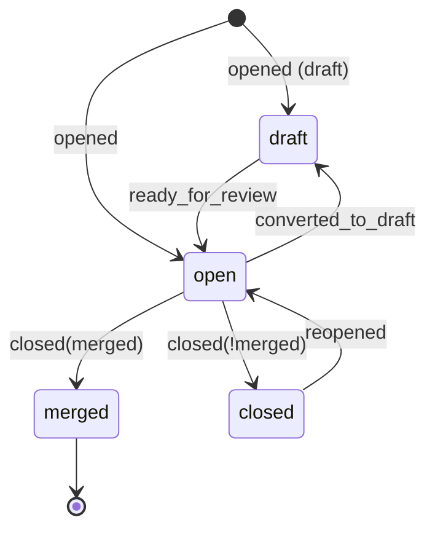

# TeamNexus — Thiết kế kỹ thuật Giai đoạn 15: Tích hợp bên ngoài

> **Trạng thái:** Thiết kế (chưa hiện thực). **Phụ thuộc:** Giai đoạn 14.5 A1.2 (`IExternalAlertSink`), 14.7 (Jev triage).
> **Tài liệu liên quan:** `03-roadmap.md` §Giai đoạn 15 · `05-capstone-and-itgottalent.md` §6.6 · `02-tech-stack-decisions.md` · `04-database-design.md` · `06-adjust-and-upgrade-with-jev.md` §3.1.
> **Độ phức tạp:** 🔴 Cao — webhook, lưu secret, eventual consistency, độ bền gửi ra ngoài.

---

## 1. Bối cảnh, phạm vi

### 1.1. Mục tiêu
Đưa TeamNexus ra khỏi "chỉ in-app":
1. **Outbound:** đẩy thông báo sang **Slack / Discord** (Incoming Webhook).
2. **Inbound:** nhận **GitHub webhook** (PR/Issue/Comment) để tự cập nhật task, đóng "vòng lặp khép kín" giữa quản lý công việc và mã nguồn.

### 1.2. Ngoài phạm vi (cố ý không làm)
- Slack/Discord **bot OAuth / gửi DM** (chừa đường mở rộng, xem §4.4).
- Microsoft Teams, Telegram (chỉ cần thêm provider — §4.3).
- GitHub **App/OAuth** chính thức; ghi ngược GitHub (comment/đóng issue từ TeamNexus).
- Đồng bộ **sửa/xoá** comment từ GitHub; review comments; Projects/Actions/Checks.
- Hard delete, đa tenant ở mức tổ chức GitHub.

### 1.3. Yêu cầu đã chốt

| # | Quyết định |
|---|---|
| R1 | Kênh: Slack + Discord qua Incoming Webhook URL; kiến trúc provider-registry để mở rộng tới Teams/Telegram → bot DM. |
| R2 | Manager bật/tắt **theo loại sự kiện**. Mặc định bật: `ObserverFinding`, `OverdueTask`, `MemberJoined`, `AgentRunFailed`. |
| R3 | Mỗi workspace gắn **1..n repo**; PAT **tuỳ chọn** (chỉ đọc thông tin PR/Issue khi gắn URL thủ công). |
| R4 | Liên kết task↔PR/Issue: gắn tay URL **+** tự nhận diện mã task (`TN-123`) trong tiêu đề / tên nhánh / mô tả PR. |
| R5 | PR merged → Done · PR opened/ready → In Review · Issue opened → tạo task (+Jev triage) · Issue closed → đóng task · comment → comment task · activity log · chip trạng thái PR. |
| R6 | PR merge tự chuyển Done, **ghi activity log + notify assignee + hoàn tác được**. |
| R7 | Cột **In Review** = cờ `is_in_review` trên `board_columns` (≤ 1/board). Không có cột ⇒ bỏ qua bước này. |
| R8 | Issue mới → task vào **board + cột mặc định theo repo**; người tạo = **bot user "GitHub"**. |
| R9 | Comment **một chiều** GitHub → TeamNexus, gắn nhãn "via GitHub @user". |
| R10 | Độ bền đầy đủ: mã hoá secret (Data Protection), delivery log + idempotency, outbox + retry. Tương lai host **VPS 24/7**. |
| D1 | Mã task: thêm `tasks.task_number` theo workspace → hiển thị `TN-123`. |
| D2 | Webhook secret do hệ thống sinh (hiện 1 lần); PR closed không merge chỉ đổi chip; "Done" chờ mọi PR liên kết đóng; xử lý webhook bất đồng bộ (202). |

---

## 2. Hiện trạng code tác động thiết kế (đã xác minh)

| # | Phát hiện | Hệ quả thiết kế |
|---|---|---|
| F1 | `IExternalAlertSink` (module Ai) được gọi từ `NotificationService` — nơi **cả 4 đường** ghi notification đi qua; gọi *sau commit*; **không bao giờ throw**; mặc định `NoOpExternalAlertSink`. | Outbound = 1 implementation + 1 dòng DI, **0 sửa producer**. |
| F2 | `ExternalAlertMessage(WorkspaceId, Type, Title, Message, PayloadJson, RecipientUserIds)` **không có id**. | Thêm `Guid? NotificationId`/`DedupeKey` tuỳ chọn (tham số cuối, mặc định null) để không phá test. |
| F3 | Chưa có notification "member mới join" (chỉ `WorkspaceInvitation`, `TaskAssigned`, …). | Thêm loại `MemberJoined` ở Board khi lời mời được chấp nhận / member được thêm. |
| F4 | `BoardTask.Id` là Guid; không có mã ngắn. | D1: `task_number`. |
| F5 | `BoardColumn` chỉ có `IsDone`, `IsClarification` (loại trừ nhau, partial unique). | Thêm `IsInReview` theo đúng khuôn mẫu. |
| F6 | `TaskService.MoveTaskAsync/CreateTaskAsync` đòi `userId` là **member**; MoveTask tự lo renumber, `CompletedAt`, SignalR (`TaskMoved`), `activity_logs` (`TaskMoved`, `TaskCompleted`). | Không nhân bản logic: thêm cổng `ITaskAutomation` (Board) chạy với **system actor** nhưng gọi chung lõi. |
| F7 | `TaskTriageService.TriageAsync` gọi `RequireMemberAsync`. | Thêm đường `TriageForSystemAsync` (bỏ check member, vẫn kiểm board tồn tại), fail-soft. |
| F8 | Quy ước module: Board khai báo **port**, Ai hiện thực **adapter** (`IEmailGateway`/`EmailGateway`); đăng ký sau để ghi đè. | Module mới `Integrations` đăng ký **sau** `AiModule`. |
| F9 | `activity_logs.user_id` nullable ("null khi system tạo"); `tasks.created_by` **bắt buộc**. | Bot user chỉ cần cho `created_by`/`task_comments.user_id`. |
| F10 | Chưa có Data Protection, route `/api/webhooks/*`, bảng integrations; backend chạy Render (mất filesystem). | Key ring lưu DB; làm mới toàn bộ. |
| F11 | Đã có nhiều `BackgroundService` (Observer, DailyDigest, AgentRunReaper, KnowledgeEmbedding). | Outbox dispatcher + event processor theo cùng khuôn (scoped runner tách riêng cho test). |

---

## 3. Kiến trúc tổng thể

```mermaid
flowchart LR
  subgraph Producers[Producer hiện có - KHÔNG sửa]
    OBS[Observer]; AG[Agent]; MEM[Member alerts]
  end
  OBS & AG & MEM --> NS[NotificationService]
  NS -->|sau commit| SINK[IExternalAlertSink<br/>= OutboxAlertSink]
  SINK -->|route theo channel + event_types| OUT[(integration_outbox)]
  OUT --> DISP[OutboxDispatcher<br/>BackgroundService]
  DISP --> REG{IChatProvider registry}
  REG --> SL[Slack] & DC[Discord]

  GH[GitHub] -->|POST /api/webhooks/github/&#123;publicId&#125;| WH[Webhook endpoint<br/>size limit + HMAC]
  WH --> DL[(webhook_deliveries<br/>UQ delivery_id)]
  WH -->|202| GH
  DL --> PROC[GitHubEventProcessor<br/>BackgroundService]
  PROC --> LNK[(task_external_links)]
  PROC --> TA[ITaskAutomation<br/>port Board, system actor]
  TA --> TS[TaskService / CommentService]
  PROC --> TRI[Jev triage fail-soft]
```



### 3.1. Module & ranh giới

```
src/Modules/Integrations/TeamNexus.Modules.Integrations/
  IntegrationsModule.cs            // DI, đăng ký SAU AiModule
  Security/        SecretProtector, SsrfGuard, HmacVerifier
  Outbound/        OutboxAlertSink, OutboxDispatcher(+Runner), EventCatalog,
                   Providers/{IChatProvider, SlackProvider, DiscordProvider, ChatProviderRegistry}
  Inbound/GitHub/  GitHubWebhookEndpoint, GitHubEventProcessor(+Runner),
                   TaskCodeParser, LinkStateMachine, GitHubApiClient(PAT, tuỳ chọn)
  Endpoints/       Channels, GitHubRepos, TaskLinks
```

- **Board** thêm port: `ITaskAutomation` (tạo task, chuyển cột, thêm comment ngoài, đặt `source`), `MemberJoined` notification.
- **Ai** thêm `TriageForSystemAsync` vào `ITaskTriageService`.
- **Integrations** phụ thuộc Board + Ai; **Board/Ai không phụ thuộc Integrations.**

### 3.2. Graceful degradation (yêu cầu cứng)
- Workspace không cấu hình ⇒ `OutboxAlertSink` thoát sớm bằng cache `IMemoryCache` (TTL 30s) "workspace có channel bật không"; **không ghi, không lỗi**.
- Webhook tới `publicId` lạ/tắt ⇒ `404` chung chung (không lộ repo có tồn tại).
- Mọi lỗi ở Integrations **không làm hỏng** luồng core (đúng khế ước F1).
- Test bắt buộc: toàn bộ test hiện có chạy y hệt khi Integrations bật nhưng chưa cấu hình.

---

## 4. Outbound: Slack / Discord

### 4.1. Luồng
1. Producer ghi `notifications` → `NotificationService` commit → gọi `sink.PublishAsync(msg)`.
2. `OutboxAlertSink`: map `msg.Type` → **event key** (§4.2); lấy các `integration_channels` của workspace có `enabled` và `event_types` chứa key; mỗi channel ghi **1 hàng outbox** (`dedupe_key` = `{notificationId|hash(type,payload)}`; trùng ⇒ bỏ qua nhờ UQ).
3. `OutboxDispatcher` (poll 5s, batch 20) lấy hàng `Pending` đến hạn bằng `FOR UPDATE SKIP LOCKED` (an toàn khi VPS chạy ≥ 2 instance), gửi qua provider, ghi `Sent` / lên lịch retry.
4. Sink **bao toàn bộ trong try/catch**, chỉ log.

### 4.2. Danh mục sự kiện & ánh xạ

| Event key (cấu hình được) | Từ `notifications.type` | Mặc định |
|---|---|---|
| `ObserverFinding` | các loại Observer (`AtRiskDeadline`, `Overload`, `Bottleneck`, `StalledTask`…) | ✅ |
| `OverdueTask` | `OverdueTask` | ✅ |
| `MemberJoined` | `MemberJoined` (mới — F3) | ✅ |
| `AgentRunFailed` | `AgentRunFailed`, `BudgetExceeded` | ✅ |
| `AgentAwaiting` | agent chờ làm rõ/duyệt | ❌ |
| `TaskAssigned`, `CommentMention`, `CommentOnTask`, `WorkspaceInvitation` | member alerts | ❌ (nhiễu, dành DM tương lai) |
| `GitHubAutomation` | PR merge → Done, Issue→task (từ Integrations) | ❌ |

Loại không nằm trong bảng ⇒ không đẩy (an toàn khi thêm loại notification mới).

### 4.3. Provider registry

```csharp
public interface IChatProvider
{
    string Key { get; }                              // "slack" | "discord"
    void ValidateUrl(Uri url);                       // allow-list host/path, https-only
    object BuildPayload(ExternalAlertMessage m, string appBaseUrl);
    Task<ProviderResult> SendAsync(Uri url, object payload, CancellationToken ct);
}
public sealed record ProviderResult(bool Ok, int? Status, TimeSpan? RetryAfter, bool Permanent, string? Error);
```

- **Slack:** `POST` JSON `{ text, blocks }`; `200 ok` = thành công; `404/410` (webhook bị thu hồi) = **permanent** → tự tắt channel + notify Manager.
- **Discord:** `POST` JSON `{ embeds:[{title, description, color, url, timestamp}] }`; `204` thành công; **`429` + `Retry-After`** ⇒ lùi đúng thời gian (giới hạn ~30 msg/phút/webhook); `404` = permanent.
- Màu/emoji theo severity (Critical đỏ … Low xám). Nội dung cắt theo giới hạn từng bên (Discord title 256, description 4096).
- Thêm Teams/Telegram = 1 class + 1 dòng `AddSingleton<IChatProvider, …>`; bảng/UI không đổi (provider là chuỗi).

### 4.4. Đường mở rộng (không làm ở Phase 15)
`ExternalAlertMessage.RecipientUserIds` đã có sẵn ⇒ provider "DM" tương lai cần thêm bảng `integration_user_links` (user ↔ Slack/Discord id); outbox/dispatcher dùng lại nguyên.

### 4.5. Retry & dead-letter

| Lần | Chờ trước lần kế |
|---|---|
| 1 → 2 | 1 phút |
| 2 → 3 | 5 phút |
| 3 → 4 | 30 phút |
| 4 → 5 | 2 giờ |
| >5 | `DeadLetter` (hiện trên UI, nút "Gửi lại") |

`429` dùng `max(Retry-After, bậc retry)` và **không** tính vào số lần thất bại. Hàng `Sent`/`DeadLetter` xoá sau 14 ngày (batch).

### 4.6. Test message
`POST …/channels/{id}/test` gửi 1 tin "✅ Kết nối thành công" **đồng bộ** (không qua outbox) để Manager thấy lỗi ngay; không ghi outbox.

---

## 5. Inbound: GitHub webhook

### 5.1. Thiết lập (luồng người dùng)
1. Manager: *Workspace Settings → Tích hợp → GitHub → Thêm repo* nhập `owner/repo`, chọn **board + cột mặc định** cho Issue mới, (tuỳ chọn) dán PAT.
2. Hệ thống sinh `public_id` (16 byte base64url) + **webhook secret** (32 byte) → hiển thị **một lần**: Payload URL `https://api.teamnexus.cloud/api/webhooks/github/{public_id}`, content-type `application/json`, secret, events: *Pull requests, Issues, Issue comments*.
3. Manager dán vào GitHub → GitHub gửi `ping` → delivery `Processed` → UI hiện "Đã kết nối ✓".
4. Mất secret ⇒ **Tạo lại** (secret cũ vô hiệu ngay).

### 5.2. Endpoint & thứ tự kiểm tra

`POST /api/webhooks/github/{publicId}` — `AllowAnonymous`, có rate-limit (theo IP + publicId), **không** dùng cookie/CSRF.

```
1. Body ≤ 1 MB (đọc có giới hạn, vượt ⇒ 413)
2. Tra repo_link theo publicId  → không có/disabled ⇒ 404
3. Đọc RAW bytes; tính HMAC-SHA256(secret, raw) ; so sánh "sha256=<hex>" với X-Hub-Signature-256
   bằng CryptographicOperations.FixedTimeEquals ; sai/thiếu ⇒ 401 (không nói lý do)
4. Đọc X-GitHub-Event, X-GitHub-Delivery (thiếu ⇒ 400)
5. INSERT webhook_deliveries (UQ repo_link_id, delivery_id)
     - trùng ⇒ 200 "duplicate" (idempotent, KHÔNG xử lý lại)
6. Trả 202 ngay; xử lý bất đồng bộ
```

> [!IMPORTANT]
> HMAC **bắt buộc** tính trên **bytes thô** trước khi parse JSON; parse rồi serialize lại sẽ lệch chữ ký.
> Với `ping`: lưu delivery rồi trả 200 (không cần xử lý thêm).

### 5.3. Chống replay — nói đúng giới hạn
Chữ ký GitHub **không có timestamp**, nên "replay" không chặn được bằng thời gian. Biện pháp thật:
1. **Idempotency theo `X-GitHub-Delivery`** (UQ) → gửi lại cùng delivery không gây tác dụng phụ.
2. **So `updated_at`/`merged_at` của payload với `last_event_at` của link** → event cũ/đảo thứ tự bị bỏ (§6.3).
3. Giữ delivery 30 ngày (quá hạn xoá batch); replay sau 30 ngày vẫn bị chặn bởi (2).
4. Hành động nguy hiểm (move Done) có **hoàn tác** (§6.5).

### 5.4. Bảng quy tắc event → hành động

| Event / action | Điều kiện | Hành động |
|---|---|---|
| `ping` | — | Đánh dấu repo "đã kết nối". |
| `pull_request.opened` / `reopened` / `ready_for_review` | PR liên kết với task (§6) | Cập nhật link `state=open`; nếu board có cột `is_in_review` và task **chưa** ở Done ⇒ chuyển task sang In Review. |
| `pull_request.converted_to_draft` | — | `state=draft`; **không** di chuyển task. |
| `pull_request.closed` + `merged=true` | PR liên kết | `state=merged`; nếu **không còn PR liên kết nào `open/draft`** ⇒ chuyển Done (§6.4), notify assignee. |
| `pull_request.closed` + `merged=false` | — | `state=closed` (chỉ đổi chip). |
| `issues.opened` | repo có default board/cột | **Tạo task** (§7). |
| `issues.closed` | Issue liên kết task | Chuyển task Done (nếu chưa). |
| `issues.reopened` | Issue liên kết task đã Done do automation | `state=open`; không tự mở lại task (ghi activity, gợi ý thủ công). |
| `issue_comment.created` | Issue/PR liên kết task; tác giả không phải Bot | Thêm comment (§8). |
| Khác | — | `Ignored`. |

### 5.5. Xử lý bất đồng bộ
`GitHubEventProcessor` (BackgroundService, poll 2s) lấy delivery `Received` bằng `SKIP LOCKED`, xử lý trong **1 DB transaction cho phần link/automation**, đặt `Processed|Ignored|Failed(+error)`; lỗi tạm (DB/Jev) retry ≤ 3 lần với lùi mũ rồi `Failed`. Có nút "Xử lý lại" trên delivery log (idempotent nhờ `last_event_at`).

---

## 6. Liên kết task ↔ PR/Issue

### 6.1. Mã task `TN-123` (D1)
- **Lưu trữ:** `workspaces.next_task_number` (bigint) cấp số; `tasks.task_number` (bigint) là bản sao để đọc nhanh. `tasks` **không** có `workspace_id` (chỉ có `board_id`) nên **tính duy nhất theo workspace** được thực thi bởi bảng phụ `task_numbers(workspace_id, task_number, task_id)` với PK `(workspace_id, task_number)` và UQ `task_id` (index biểu thức qua join là không khả thi trong PostgreSQL).
- **Cấp số:** trong cùng transaction tạo task: `UPDATE workspaces SET next_task_number = next_task_number + 1 WHERE id = @ws RETURNING next_task_number - 1` (khoá hàng workspace ⇒ không trùng khi tạo đồng thời).
- **Backfill:** theo `created_at, id` mỗi workspace; `next_task_number = max+1`.
- Tiền tố cố định `TN-` (cấu hình tương lai). Hiển thị trên `TaskCard`, `TaskDetailModal`, kết quả tìm kiếm.
- Cấp số nằm trong `CreateTaskAsync` và `ITaskAutomation.CreateAsync` (một nơi dùng chung).

### 6.2. Tự nhận diện
`TaskCodeParser` quét **tiêu đề PR, tên nhánh (`head.ref`), mô tả PR** (không quét comment) bằng `\bTN-(\d{1,9})\b` (không phân biệt hoa/thường), cũng nhận `#TN-123`. Mỗi mã → tra task **trong workspace của repo** (mã ngoài workspace bị bỏ — chống chéo tenant). Tối đa 10 mã/PR.
Kết quả: tạo `task_external_links(source='auto')` nếu chưa có. Mã không tồn tại/đã xoá mềm ⇒ bỏ qua, ghi `Ignored(reason)`.

### 6.3. Máy trạng thái & thứ tự sự kiện



- Mỗi event mang `updated_at` (PR/Issue). Nếu `payload.updated_at < link.last_event_at` ⇒ **bỏ** (đảo thứ tự). Bằng nhau ⇒ áp dụng chỉ khi state khác (idempotent).
- `merged` là trạng thái **cuối** (không quay lại `open`).

### 6.4. Quy tắc "Done" khi nhiều PR
Task chuyển Done khi: có ≥ 1 PR `merged` **và** không PR liên kết nào `open|draft`. Issue liên kết `closed` cũng thoả (độc lập PR). Nếu task đã ở cột `is_done` ⇒ không làm gì. Cột đích = cột `is_done` của **board của task**; board không có cột done ⇒ `Ignored(no_done_column)` + notify Manager một lần.

### 6.5. Hoàn tác
`task_external_links.last_automation` (jsonb):
```json
{ "action": "MovedToDone", "fromColumnId": "…", "toColumnId": "…", "at": "…", "deliveryId": "…", "undone": false }
```
`POST /api/tasks/{id}/links/{linkId}/undo-automation` (member+ của board): chỉ hợp lệ khi `undone=false` **và** task vẫn ở `toColumnId` ⇒ chuyển về `fromColumnId` qua `TaskService.MoveTaskAsync` (user thật → có activity log đúng người), `undone=true`. Sau hoàn tác, **PR đó không tự kéo lại Done** (cờ `suppress_automation`) cho tới khi có event mới hơn.

### 6.6. Gắn tay
`POST /api/tasks/{id}/links { url }`: parse URL `https://github.com/{owner}/{repo}/(pull|issues)/{n}`; repo phải thuộc workspace và đang bật. Có PAT ⇒ gọi `GET /repos/{r}/pulls|issues/{n}` để lấy `title/state/merged/updated_at` (timeout 5s, lỗi ⇒ vẫn lưu link với `state='unknown'`, chip xám). Không PAT ⇒ lưu link `state='unknown'` và cập nhật khi có webhook. Gắn tay **không** tự chuyển task ngay (chỉ chip) — trừ khi PR đã `merged` & có PAT (hiển thị gợi ý).

### 6.7. Hoạt động (activity log)
Mọi automation ghi `activity_logs` với `user_id = NULL` (system) và `Action` mới: `GitHubLinked`, `GitHubTaskMovedInReview`, `GitHubTaskMovedDone`, `GitHubIssueTaskCreated`, `GitHubCommentSynced`, `GitHubAutomationUndone`. **Không** vào `ObserverActivityActions` được Observer coi là tín hiệu rủi ro (tránh Observer hiểu nhầm); chỉ để hiển thị lịch sử.

---

## 7. Issue → Task (+ Jev)

1. Chọn `default_board_id/default_column_id` của repo (bị xoá/không còn ⇒ `Failed(no_target)` + notify Manager).
2. `ITaskAutomation.CreateAsync(boardId, columnId, title, description, actor=bot)`:
   - `title` = issue title (cắt 200), `description` = body (cắt 4000) + dòng đầu `🔗 GitHub issue #N (owner/repo) — mở bởi @login`.
   - `created_by` = bot user; không assignee; ghi link `source='auto', kind='issue'`.
   - Phát SignalR `TaskCreated` như thường (card hiện realtime).
3. **Sau commit**, nếu `Jev:Enabled`: `TriageForSystemAsync` (fail-soft, không chặn): theo ngưỡng doc 06 §2.3 — `confidence ≥ 0.85` ⇒ tự điền `priority` + gắn nhãn domain/work-type; thấp hơn ⇒ **không điền**, để Manager chọn. Jev tắt/lỗi ⇒ task vẫn tạo bình thường.
4. Notify Manager (`GitHubAutomation`, mặc định tắt outbound; in-app luôn có).
5. **Idempotency:** `issue.opened` trùng delivery đã chặn ở §5.2; thêm UQ `(repo_link_id, kind, number)` trên link loại `issue` nguồn auto để chống tạo 2 task khi retry.

### 7.1. Bot user "GitHub"
- Hàng `AspNetUsers` cố định (Id hằng số, email `github-bot@system.teamnexus.invalid`), `is_system=true`, **không** có mật khẩu/login ngoài, **không** là `workspace_members`.
- Mọi nơi liệt kê thành viên/assignee **không** hiện bot (đã không là member). UI hiển thị tác giả = "GitHub" + logo.
- Chặn đăng nhập/OAuth/forgot-password vào tài khoản này; test khẳng định.

---

## 8. Đồng bộ comment (một chiều)

- Chỉ `issue_comment.created`, tác giả `user.type != "Bot"`, và issue/PR có link tới task.
- `task_comments`: thêm `source` (`app|github`), `external_author` (login), `external_id` (comment id, **UQ** với `source`), `external_url`.
- Thân comment cắt theo giới hạn hiện có; hiển thị: *"**@octocat** · via GitHub"* + link gốc. `user_id` = bot.
- **Mention** `@x` trong nội dung GitHub **không** kích hoạt notification TeamNexus (tránh nhầm danh tính); comment vẫn tính "comment mới" cho SignalR.
- **Không** ghi ngược sang GitHub → không có vòng lặp.

---

## 9. Bảo mật

### 9.1. Lưu secret
- ASP.NET Core **Data Protection**: `AddDataProtection().SetApplicationName("TeamNexus").PersistKeysToDbContext<…>()` → bảng `data_protection_keys`. Purpose riêng: `TeamNexus.Integrations.v1.{ChannelUrl|WebhookSecret|Pat}`.
- Key ring trong DB **không tự mã hoá**; trên **VPS** thêm `ProtectKeysWithCertificate(cert)` (cert nằm ngoài DB) — là khuyến nghị triển khai §13. Trên Render hiện tại: ghi rõ rủi ro dư (ai đọc được DB đọc được key ring).
- Cột lưu `*_encrypted` (text). API **không bao giờ trả** secret/URL/PAT; chỉ `hasSecret`, `last4`, `maskedUrl`.
- Không log secret/URL/PAT/body webhook đầy đủ; `payload_excerpt` ≤ 2 KB đã lọc trường nhạy cảm; test khẳng định chuỗi secret không xuất hiện trong log/ngoại lệ (như tiền lệ Jev key).

### 9.2. Threat model

| Rủi ro | Biện pháp |
|---|---|
| **SSRF** qua URL channel | https-only; allow-list host (`hooks.slack.com`; `discord.com`/`discordapp.com`/`ptb.`/`canary.` với path `/api/webhooks/`); chặn IP riêng/loopback sau DNS resolve; `AllowAutoRedirect=false`; timeout 10s; giới hạn kích thước phản hồi. |
| Giả mạo webhook | HMAC-SHA256 so sánh hằng thời gian; `publicId` khó đoán; 401/404 không lộ lý do. |
| Replay | §5.3. |
| DoS endpoint | giới hạn body 1 MB; rate-limit; trả 202 sớm, xử lý nền; hàng đợi có giới hạn (delivery `Received` quá 500 ⇒ 429 tạm). |
| Rò secret | §9.1; secret hiện 1 lần; rotate. |
| Leo thang quyền qua automation | Bot chỉ thao tác trong **workspace của repo**; mã task chéo workspace bị bỏ; bot không phải member nên không đọc dữ liệu. |
| Chéo tenant | Mọi truy vấn task theo `workspace_id` của `github_repo_links`. |
| PAT bị lạm dụng | Chỉ dùng cho `GET` PR/Issue; khuyến nghị fine-grained PAT quyền *Pull requests: read, Issues: read* (ghi chú trên UI). |
| Phân quyền cấu hình | CRUD channel/repo, xem outbox/deliveries: **Admin/Manager** workspace; Member chỉ xem chip/link & gắn link trên task mình có quyền. |

---

## 10. Mô hình dữ liệu (migration `Phase15Integrations`)

> Quy ước theo `04-database-design.md`: `uuid` PK, `timestamptz`, text + CHECK cho enum, soft delete chỉ khi cần.

```sql
-- Kênh thông báo ra ngoài
CREATE TABLE integration_channels (
  id uuid PRIMARY KEY, workspace_id uuid NOT NULL REFERENCES workspaces(id),
  provider text NOT NULL CHECK (provider IN ('slack','discord')),
  name text NOT NULL, url_encrypted text NOT NULL, url_last4 text NOT NULL,
  enabled boolean NOT NULL DEFAULT true,
  event_types text[] NOT NULL,
  disabled_reason text NULL,
  created_by uuid NOT NULL, created_at timestamptz NOT NULL, updated_at timestamptz NOT NULL
);
CREATE INDEX ix_integration_channels_ws ON integration_channels(workspace_id) WHERE enabled;

CREATE TABLE integration_outbox (
  id uuid PRIMARY KEY, channel_id uuid NOT NULL REFERENCES integration_channels(id) ON DELETE CASCADE,
  event_key text NOT NULL, payload jsonb NOT NULL, dedupe_key text NOT NULL,
  status text NOT NULL CHECK (status IN ('Pending','Sent','DeadLetter')),
  attempts int NOT NULL DEFAULT 0, next_attempt_at timestamptz NOT NULL,
  last_error text NULL, sent_at timestamptz NULL,
  created_at timestamptz NOT NULL, updated_at timestamptz NOT NULL,
  UNIQUE (channel_id, dedupe_key)
);
CREATE INDEX ix_outbox_due ON integration_outbox(next_attempt_at) WHERE status='Pending';

-- Repo GitHub
CREATE TABLE github_repo_links (
  id uuid PRIMARY KEY, workspace_id uuid NOT NULL REFERENCES workspaces(id),
  repo_full_name text NOT NULL, public_id text NOT NULL UNIQUE,
  webhook_secret_encrypted text NOT NULL, pat_encrypted text NULL, pat_last4 text NULL,
  default_board_id uuid NULL REFERENCES boards(id), default_column_id uuid NULL REFERENCES board_columns(id),
  enabled boolean NOT NULL DEFAULT true, connected_at timestamptz NULL,
  created_by uuid NOT NULL, created_at timestamptz NOT NULL, updated_at timestamptz NOT NULL,
  UNIQUE (workspace_id, repo_full_name)
);

CREATE TABLE webhook_deliveries (
  id uuid PRIMARY KEY, repo_link_id uuid NOT NULL REFERENCES github_repo_links(id) ON DELETE CASCADE,
  delivery_id text NOT NULL, event text NOT NULL, action text NULL,
  status text NOT NULL CHECK (status IN ('Received','Processed','Ignored','Failed')),
  attempts int NOT NULL DEFAULT 0, error text NULL, payload_excerpt text NULL,
  received_at timestamptz NOT NULL, processed_at timestamptz NULL,
  UNIQUE (repo_link_id, delivery_id)
);
CREATE INDEX ix_deliveries_pending ON webhook_deliveries(received_at) WHERE status='Received';

CREATE TABLE task_external_links (
  id uuid PRIMARY KEY, task_id uuid NOT NULL REFERENCES tasks(id),
  repo_link_id uuid NOT NULL REFERENCES github_repo_links(id) ON DELETE CASCADE,
  kind text NOT NULL CHECK (kind IN ('pr','issue')), number int NOT NULL,
  url text NOT NULL, title text NULL,
  state text NOT NULL CHECK (state IN ('unknown','draft','open','merged','closed')),
  source text NOT NULL CHECK (source IN ('manual','auto')),
  last_event_at timestamptz NULL, last_automation jsonb NULL, suppress_automation boolean NOT NULL DEFAULT false,
  created_by uuid NULL, created_at timestamptz NOT NULL, updated_at timestamptz NOT NULL,
  UNIQUE (task_id, repo_link_id, kind, number)
);
CREATE INDEX ix_links_repo_number ON task_external_links(repo_link_id, kind, number);

-- Mã task theo workspace
ALTER TABLE workspaces ADD COLUMN next_task_number bigint NOT NULL DEFAULT 1;
ALTER TABLE tasks ADD COLUMN task_number bigint NULL;   -- NOT NULL sau backfill
CREATE TABLE task_numbers (
  workspace_id uuid NOT NULL REFERENCES workspaces(id), task_number bigint NOT NULL,
  task_id uuid NOT NULL UNIQUE REFERENCES tasks(id),
  PRIMARY KEY (workspace_id, task_number)
);

-- Cột In Review
ALTER TABLE board_columns ADD COLUMN is_in_review boolean NOT NULL DEFAULT false;
CREATE UNIQUE INDEX uq_board_columns_in_review ON board_columns(board_id) WHERE is_in_review;
ALTER TABLE board_columns ADD CONSTRAINT ck_board_columns_flags_exclusive
  CHECK ((is_done::int + is_clarification::int + is_in_review::int) <= 1);

-- Comment ngoài
ALTER TABLE task_comments
  ADD COLUMN source text NOT NULL DEFAULT 'app',
  ADD COLUMN external_author text NULL, ADD COLUMN external_id text NULL, ADD COLUMN external_url text NULL;
CREATE UNIQUE INDEX uq_task_comments_external ON task_comments(source, external_id) WHERE external_id IS NOT NULL;

-- Data Protection
CREATE TABLE data_protection_keys (id serial PRIMARY KEY, friendly_name text, xml text);

-- Bot
ALTER TABLE "AspNetUsers" ADD COLUMN is_system boolean NOT NULL DEFAULT false;
-- seed hàng bot (Id cố định) trong migration
```

**Lưu ý migration** (rút từ pgvector, doc 02 §2.11): các CHECK/partial index/`CREATE UNIQUE INDEX … WHERE` và backfill `task_number` viết **SQL thô** trong migration; backfill chạy trong cùng migration theo `ROW_NUMBER() OVER (PARTITION BY workspace_id ORDER BY created_at, id)`, rồi `ALTER … SET NOT NULL`. Cờ `is_in_review` cần validate ở app (400 nếu vừa done vừa in-review) giống `IsClarification`.

> [!WARNING]
> `ck_board_columns_flags_exclusive` có thể **vi phạm** nếu dữ liệu cũ có cột vừa `is_done` vừa `is_clarification`. Hiện app đã chặn (400) nên kỳ vọng sạch; migration **kiểm trước** và dừng với thông báo rõ nếu có.

**Không** thêm bảng cho retry của sink in-app (đã chốt ở doc 04 §14.5): outbox ở đây thuộc riêng Integrations.

---

## 11. API & DTO

### 11.1. Channels (Admin/Manager)
| Method | Route | Ghi chú |
|---|---|---|
| GET | `/api/workspaces/{wid}/integrations/channels` | list (không trả URL) |
| POST | `…/channels` | `{provider, name, url, eventTypes[]}` → validate SSRF/provider |
| PATCH | `…/channels/{id}` | đổi name/enabled/eventTypes/url |
| DELETE | `…/channels/{id}` | |
| POST | `…/channels/{id}/test` | gửi thử đồng bộ |
| GET | `…/channels/{id}/outbox?status=` | lịch sử/dead-letter |
| POST | `…/outbox/{oid}/retry` | |
| GET | `/api/integrations/event-catalog` | key + nhãn + mặc định |

### 11.2. GitHub repos (Admin/Manager)
| Method | Route | Ghi chú |
|---|---|---|
| GET | `…/github/repos` | `{id, repoFullName, enabled, connected, hasPat, patLast4, defaultBoard/Column, payloadUrl}` |
| POST | `…/github/repos` | trả `webhookSecret` **một lần** |
| PATCH | `…/github/repos/{id}` | PAT (set/clear), default board/cột, enabled |
| POST | `…/github/repos/{id}/rotate-secret` | trả secret mới một lần |
| DELETE | `…/github/repos/{id}` | link task giữ lại (`repo_link` soft: chuyển `enabled=false`) hoặc xoá cascade — **chọn: chặn xoá nếu còn link; cho phép "Tắt"** |
| GET | `…/github/repos/{id}/deliveries?status=` | log + "Xử lý lại" |

### 11.3. Task links
`GET /api/tasks/{id}/links` · `POST /api/tasks/{id}/links {url}` · `DELETE /api/tasks/{id}/links/{lid}` · `POST /api/tasks/{id}/links/{lid}/undo-automation`.
`TaskResponse` thêm: `taskNumber`, `externalLinks: [{kind, number, state, url, repo}]` (tối đa 5 hiển thị chip, phần còn lại "+n").

### 11.4. Webhook
`POST /api/webhooks/github/{publicId}` — §5.2. Phản hồi: `202 {accepted:true}` · `200 {duplicate:true}` · `401` · `404` · `413` · `429`.

### 11.5. SignalR
Dùng lại `BoardHub`: `TaskUpdated` khi link/state đổi (chip realtime), `TaskMoved`/`TaskCreated` do `ITaskAutomation` phát qua cùng `_events` của TaskService.

---

## 12. Frontend

- **Workspace Settings → tab "Tích hợp"** (Admin/Manager):
  - *Thông báo ra ngoài:* danh sách channel (logo Slack/Discord, trạng thái, lần gửi gần nhất, số DeadLetter); modal thêm channel (chọn provider, dán URL, tick sự kiện theo catalog, nút **Gửi thử**).
  - *GitHub:* thêm repo → màn hướng dẫn 3 bước hiển thị Payload URL + secret (có nút copy, cảnh báo "chỉ hiện một lần"); trạng thái "Đã kết nối"; chọn board/cột mặc định; PAT (ô password, chỉ ghi); tab **Delivery log** (lọc trạng thái, xem lỗi, xử lý lại).
- **`TaskCard`:** hiện `TN-123` nhỏ; chip `PR #45` có màu: draft xám · open xanh lá · merged tím · closed đỏ; Issue dùng icon khác; click mở link ngoài (`rel="noopener noreferrer"`, `target=_blank`).
- **`TaskDetailModal`:** mục **Liên kết GitHub** (danh sách link, ô dán URL, huy hiệu `auto/manual`); banner "PR #45 đã merge → task chuyển Done · **Hoàn tác**".
- **Cấu hình cột:** thêm công tắc **"Cột In Review"** (loại trừ với Done/Chờ làm rõ, tooltip giải thích).
- **Comment:** nhãn "via GitHub @user" + icon.
- Trạng thái trống/lỗi: không có integration ⇒ thẻ giới thiệu, không lỗi (degradation).
- Tuân thủ design system hiện có (Ant Design, "Luminous Enterprise", Be Vietnam Pro).

---

## 13. Vận hành & triển khai

### 13.1. Cấu hình (`appsettings` / env)
```jsonc
"Integrations": {
  "Enabled": true,
  "PublicApiBaseUrl": "https://api.teamnexus.cloud",   // dựng Payload URL
  "AppBaseUrl": "https://app.teamnexus.cloud",         // link trong tin nhắn
  "Outbox": { "PollSeconds": 5, "BatchSize": 20, "MaxAttempts": 5, "RetentionDays": 14 },
  "Webhook": { "MaxBodyBytes": 1048576, "DeliveryRetentionDays": 30, "MaxPendingDeliveries": 500 },
  "GitHub": { "ApiBaseUrl": "https://api.github.com", "TimeoutSeconds": 5 },
  "DataProtection": { "CertPath": "", "CertPassword": "" }   // VPS: bật ProtectKeysWithCertificate
}
```
`Integrations:Enabled=false` ⇒ giữ `NoOpExternalAlertSink`, endpoint webhook trả 404, UI ẩn tab.

### 13.2. Render (hiện tại) vs VPS (tương lai)
| | Render free | VPS 24/7 |
|---|---|---|
| Webhook khi service ngủ | GitHub **không** retry ⇒ có thể mất event | Ổn định; vẫn có nút "redeliver" của GitHub |
| BackgroundService | Ngủ cùng service; outbox/processor chạy bù khi thức (outbox bền nên không mất) | Chạy liên tục |
| Key ring | Bắt buộc lưu DB | DB + `ProtectKeysWithCertificate` |
| Đa instance | 1 | `SKIP LOCKED` đã chuẩn bị |

> [!NOTE]
> Vì GitHub không tự retry delivery thất bại, chấp nhận trên Render free-tier có thể mất event khi service ngủ — **ghi vào rủi ro**; mitigation: UI hiển thị "lần nhận cuối", hướng dẫn *Redeliver* trong GitHub, và tới VPS thì hết vấn đề.

### 13.3. Dev/test cục bộ
Dùng **smee.io** hoặc **cloudflared tunnel** trỏ về `https://localhost:…/api/webhooks/github/{publicId}`; script `scripts/github-webhook-sim.ps1` ký HMAC bằng secret rồi POST payload mẫu (fixtures trong `tests/…/Fixtures/github/*.json`).

### 13.4. Quan sát
- Log có cấu trúc: `Integrations.Outbox.Sent/Failed/DeadLetter`, `GitHub.Delivery.Received/Processed/Ignored/Failed` (kèm `deliveryId`, `repoLinkId`; **không** body/secret).
- Chỉ số nhẹ trên UI: số `DeadLetter`, delivery `Failed` 24h, lần nhận cuối.
- Notify Manager (in-app) khi: channel tự tắt (permanent), delivery `Failed` ≥ 3 liên tiếp, repo thiếu cột đích.

---

## 14. Chiến lược kiểm thử

### 14.1. Unit
- `HmacVerifier`: chữ ký đúng/sai/thiếu/đổi 1 byte body/prefix sai/hoa-thường hex; dùng `FixedTimeEquals`.
- `SsrfGuard`: host lạ, `http://`, IP private, redirect, userinfo `@`, path sai.
- `TaskCodeParser`: `TN-12`, `tn-12`, `#TN-12`, `TN-12x`, nhiều mã, 11+ mã, trong nhánh `feature/TN-12-login`.
- `LinkStateMachine`: mọi cạnh, event cũ bị bỏ, `merged` bất biến, quy tắc nhiều PR.
- Providers: payload cắt độ dài, màu theo severity, xử lý `429/404/5xx`.
- `SecretProtector`: round-trip, purpose khác ⇒ giải mã thất bại, `last4` không lộ.

### 14.2. Integration (Testcontainers Postgres như bộ test hiện có)
| Nhóm | Ca |
|---|---|
| Outbound | Notification → outbox đúng channel/event; event tắt ⇒ không ghi; trùng dedupe; retry/lùi đúng; 429 không tính attempts; quá hạn ⇒ DeadLetter; channel permanent ⇒ tự tắt + notify. |
| Degradation | Không cấu hình ⇒ không ghi, toàn bộ test cũ xanh; sink ném lỗi ⇒ request vẫn 2xx; `Integrations:Enabled=false` ⇒ 404. |
| Webhook auth | HMAC hợp lệ ⇒ 202; sai ⇒ 401; `publicId` lạ ⇒ 404; body >1MB ⇒ 413; delivery trùng ⇒ 200 không xử lý lại. |
| PR flow | opened+mã trong tiêu đề ⇒ link auto + In Review; merged ⇒ Done + activity + notify + `CompletedAt`; 2 PR (1 open) ⇒ chưa Done; closed không merge ⇒ chỉ chip; event đảo thứ tự ⇒ bỏ; không có cột In Review ⇒ bỏ bước. |
| Undo | Hoàn tác thành công; task đã bị kéo đi chỗ khác ⇒ 409; sau undo, replay merged cũ không kéo lại. |
| Issue→task | Tạo đúng board/cột; `created_by`=bot; Jev tắt/lỗi ⇒ vẫn tạo; confidence cao/thấp rẽ nhánh; retry không tạo 2 task. |
| Comment | Đồng bộ + nhãn; bot-author bị bỏ; trùng `external_id` ⇒ 1 comment; không notify mention. |
| Bảo mật | Mã task chéo workspace bị bỏ; API không trả secret; secret không lọt log; bot không đăng nhập được; Member không CRUD channel/repo (403). |
| Migration | Backfill `task_number` đúng thứ tự, UQ giữ; CHECK cột loại trừ; partial unique `is_in_review`. |

Dùng `RecordingExternalAlertSink`/`FakeChatProvider`/`FakeGitHubApiClient` (offline, tất định — đúng tinh thần `FakeJevDecisionProvider`).

### 14.3. Thủ công (có bằng chứng cho đồ án)
1. Slack/Discord thật: ảnh tin nhắn + message id (outbox `Sent`).
2. Repo GitHub thử: merge PR có `TN-n` ⇒ task tự sang Done, ảnh chip, log delivery, bấm Hoàn tác.
3. Tắt mạng/Discord 429 giả ⇒ thấy retry rồi DeadLetter.

---

## 15. Rủi ro & nợ kỹ thuật

| ID | Rủi ro | Mức | Giảm thiểu |
|---|---|---|---|
| T1 | Mất event khi Render ngủ (GitHub không retry) | 🟡 | Ghi nhận; nút Redeliver; chuyển VPS |
| T2 | Key ring ở DB chưa được mã hoá | 🟡 | `ProtectKeysWithCertificate` trên VPS; ghi rõ |
| T3 | Backfill `task_number` trên dữ liệu lớn | 🟢 | Một câu SQL window; chạy trong migration |
| T4 | Webhook secret lộ ở bước hiển thị | 🟡 | Chỉ một lần, rotate nhanh |
| T5 | Discord giới hạn tốc độ khi bùng nổ Observer | 🟡 | Outbox + `Retry-After`; gộp tin cùng loại (digest) = **nợ**, không làm |
| T6 | Mã `TN-n` bị gõ nhầm gắn sai task | 🟢 | Chỉ gắn cùng workspace; hoàn tác; hiển thị chip để phát hiện |
| T7 | Một chiều comment ⇒ người dùng kỳ vọng hai chiều | 🟢 | Ghi rõ trên UI |
| **Nợ** | `task_attachments` (diff/ảnh), AI provider fallback, DM Slack/Discord, Teams/Telegram, ghi ngược GitHub, gộp digest | — | Phase sau |

---

## 16. Chia phase con & tiêu chí hoàn thành

| Phase con | Nội dung | Hoàn thành khi |
|---|---|---|
| **15.1 Nền** | Module `Integrations`, DP + `SecretProtector`, `SsrfGuard`, migration (bảng mới, `task_number`, `is_in_review`, bot), `ITaskAutomation`, `MemberJoined`, đăng ký DI sau `AiModule` | Build 0 warning; test cũ xanh; migration backfill đúng |
| **15.2 Outbound** | `OutboxAlertSink`, dispatcher, Slack/Discord, API channels, test message | Tin thật tới Slack & Discord; retry/DeadLetter có test |
| **15.3 GitHub inbound lõi** | Endpoint + HMAC + deliveries + processor, API repos, link auto/manual, PR→In Review/Done, hoàn tác | Test HMAC/idempotency/thứ tự/undo xanh; demo PR merge |
| **15.4 Issue & comment** | Issue→task + Jev triage, issue closed, comment sync | Test §14.2 các nhóm tương ứng xanh |
| **15.5 UI & nghiệm thu** | Tab Tích hợp, chip, modal link, công tắc In Review, delivery log; báo cáo | Checklist roadmap Giai đoạn 15 đánh dấu xong; `tasks/phase-15-*.md` + `report/phase-15-*-test-report.md` |

### 16.1. Đối chiếu yêu cầu roadmap
| Yêu cầu roadmap | Phủ bởi |
|---|---|
| Slack/Discord Notification (Webhook URL theo workspace) | §4, §11.1 |
| GitHub: repo + PAT mã hoá, gắn Issue/PR, webhook → Done, chip PR | §5–§6, §9, §12 |
| HMAC-SHA256 + token mã hoá | §5.2, §9.1 |
| Graceful degradation | §3.2, §14.2 |

### 16.2. Cập nhật tài liệu khi hiện thực
`03-roadmap.md` (đánh dấu), `01-system-specification.md` (tính năng), `02-tech-stack-decisions.md` (§ Data Protection, Outbox), `04-database-design.md` (bảng mới) — thực hiện trong từng phase con, theo tiền lệ các phase trước.
