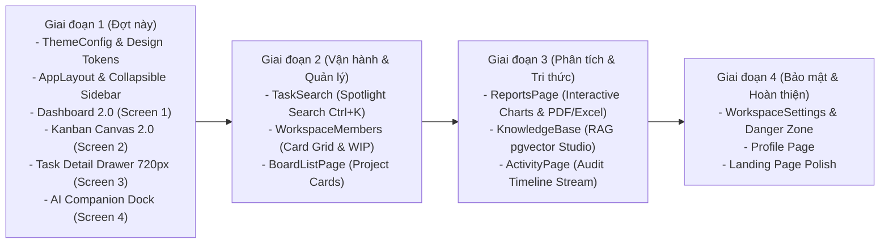

# TeamNexus – Định Hướng & Lộ Trình Nâng Cấp UI/UX Toàn Diện với Stitch MCP

> **Tài liệu thứ 07 của `project-docs/`.** Sáu tài liệu trước (`01-system-specification.md`, `02-tech-stack-decisions.md`, `03-roadmap.md`, `04-database-design.md`, `05-capstone-and-itgottalent.md`, `06-adjust-and-upgrade-with-jev.md`) định hình **nền tảng chức năng, dữ liệu, kiến trúc AI và bối cảnh học thuật**. Tài liệu này đóng vai trò là **Nguồn Sự Thật Duy Nhất (Single Source of Truth) về Ngôn ngữ Thiết kế & Trải nghiệm Người dùng (UI/UX Architecture)** cho toàn bộ hệ sinh thái TeamNexus.
>
> **Trạng thái tài liệu:** 🟢 Đã chốt phê duyệt — Sẵn sàng thi hành mã nguồn.
>
> **Mục tiêu chiến lược:** Nâng cấp diện mạo TeamNexus từ giao diện Ant Design truyền thống sang chuẩn **Modern B2B SaaS (Linear / Raycast inspired)**, tối ưu hoá tương tác cho Đồ án Chuyên ngành và tạo điểm nhấn thị giác đột phá cho bài dự thi **IT got Talent (Hạng mục AI)**.

---

## 1. BỐI CẢNH & TÍNH CẤP THIẾT CỦA VIỆC NÂNG CẤP UI/UX

### 1.1. Hiện trạng nền tảng tại thời điểm nâng cấp
TeamNexus đã vận hành ổn định trên môi trường Cloud Production thật ([app.teamnexus.cloud](https://app.teamnexus.cloud)) với backend .NET 10 Web API ([api.teamnexus.cloud](https://api.teamnexus.cloud)), Neon Serverless PostgreSQL và bộ kiểm thử tự động toàn diện (**912 backend tests / 657 frontend tests PASS 100%**).

Tuy nhiên, về mặt trải nghiệm giao diện người dùng (UI/UX), hệ thống bộc lộ những rào cản:
1. **Thiếu Khung Điều Hướng Nhất Quán (App Shell Fragmentation):** Chỉ sử dụng thanh `AppHeader` ngang ở trên cùng. Các tính năng chính như *Tìm kiếm nâng cao (`/search`), Cơ sở tri thức RAG (`/knowledge`), Báo cáo (`/reports`), Thành viên (`/members`), Cài đặt (`/settings`)* bị phân tán thành các nút bấm ngữ cảnh rải rác, gây tốn số lần nhấp chuột (High Interaction Cost) và người dùng dễ bị lạc hướng.
2. **Thiếu Hệ Thống Design Tokens Tập Trung:** Các giá trị màu sắc (`#6366f1`, `#7c3aed`, `#0f172a`, `#f8fafc`, `#e2e8f0`) được hardcode dạng inline style trong từng component; chưa khai thác hết sức mạnh của `<ConfigProvider>` trong Ant Design v6.
3. **Mất Bối Cảnh Khi Mở Chi Tiết Thẻ (Modal vs Sheet):** Hộp thoại `TaskDetailModal` rộng 780px đặt ở trung tâm che khuất hoàn toàn bảng Kanban phía sau, gây đứt gãy luồng tư duy công việc.
4. **Trải Nghiệm AI Chưa Toát Lên Tính Đột Phá:** Sự kết hợp giữa **Jev System 1** (phản xạ nhanh <300ms) và **DeepSeek System 2** (suy luận sâu) cùng cơ chế giải trình minh bạch **Accountability Layer** là điểm sáng công nghệ độc nhất của dự án, nhưng giao diện chat hiện tại chưa trực quan hóa được các trạng thái này.

### 1.2. Giải pháp đột phá với Google Stitch MCP
Dự án ứng dụng công nghệ thiết kế giao diện thông minh **Google Stitch MCP** (`projects/691778267974237877` - `TeamNexus Workspace`), xác lập Design System chuẩn quốc tế **"Intelligent Orchestration"** và sinh 4 bản mẫu màn hình chất lượng cao trước khi chuyển giao thành mã nguồn thực tế.

---

## 2. CÁC QUYẾT ĐỊNH THIẾT KẾ ĐÃ THỐNG NHẤT (APPROVED DESIGN DECISIONS)

| # | Hạng mục | Quyết định đã chốt | Rationale & Ý nghĩa thực thi |
|---|---|---|---|
| **D1** | **Khung Điều Hướng (Navigation Shell)** | **Lựa chọn A: Collapsible Sidebar bên trái** | Tạo Sidebar cố định bên trái (hỗ trợ thu gọn/mở rộng), gom toàn bộ 8 phân hệ cốt lõi vào 1 nơi duy nhất: *Tổng quan, Bảng Kanban, Tìm kiếm nâng cao, Cơ sở tri thức, Báo cáo, Thành viên, Lịch sử, Cài đặt*. |
| **D2** | **Không Gian Chi Tiết Thẻ (Task Workspace)** | **Lựa chọn A: Slide-over Sheet (Drawer 720px)** | Chuyển `TaskDetailModal` sang dạng Drawer trượt êm ái từ cạnh phải màn hình với nền Kanban mờ ảo (`backdrop-blur-sm`). Tách rõ 2 cột: Cột nội dung (65%) và Cột thông số/AI (35%). |
| **D3** | **Chế Độ Giao Diện & Bảng Màu (Theme System)** | **Ưu tiên Light Mode hiện đại** | Tối ưu hiển thị Light Mode đạt độ tương phản chuẩn mực, trang nhã, sắc nét theo phong cách Linear/Raycast (bảng màu Slate/Indigo/Emerald). |

---

## 3. HỆ THỐNG THIẾT KẾ STITCH: "INTELLIGENT ORCHESTRATION"

Hệ thống thiết kế được trích xuất trực tiếp từ Stitch MCP (`assets/b450acb89f524771b94b7bbe19a46b8b`):

### 3.1. Bảng màu chuẩn (Color Palette)
- **Nền tảng & Khung chứa (Surfaces):**
  - Base Canvas: `#F8FAFC` (Slate 50) – Mang lại cảm giác thoáng đãng, dịu mắt.
  - Card & Container Surface: `#FFFFFF` (Pure White) – Khối nội dung nổi bật.
  - Recessed / Code block: `#F1F5F9` (Slate 100) – Nền cho tiêu đề cột Kanban và khối code JSON.
- **Văn bản & Phân cấp thị giác (Typography Colors):**
  - Primary Text: `#0F172A` (Slate 900) – Độ tương phản cao, sắc nét tuyệt đối.
  - Secondary Text: `#475569` / `#64748B` (Slate 600/500) – Dành cho nhãn phụ, ngày tháng, mô tả ngắn.
  - Borders & Dividers: `#E2E8F0` (Slate 200) – Đường viền siêu mảnh (hairline structural borders).
- **Màu sắc Nhận diện & Hành động (Brand & Semantic):**
  - **Primary Interactive:** `#4F46E5` (Electric Indigo) – Đại diện cho tính năng chính và điều hướng.
  - **Secondary Gradient:** `#7C3AED` (Luminous Violet) – Biểu trưng cho công nghệ AI thông minh.
  - **Success / Live:** `#10B981` (Emerald Green) – Trạng thái kết nối SignalR, hoàn thành tác vụ, nút **Phê duyệt đề xuất AI (Approve)**.
  - **Warning / Degraded:** `#F59E0B` (Warm Amber) – Cảnh báo rủi ro, thẻ chờ làm rõ, đề xuất AI ở trạng thái **Pending Approval**.
  - **Error / Critical:** `#EF4444` (Rose Red) – Thẻ quá hạn, rủi ro khẩn cấp, nút **Từ chối (Reject)**.

### 3.2. Kiểu chữ & Nhịp điệu không gian (Typography & Spacing)
- **Headings:** `Plus Jakarta Sans` với trọng số đậm (SemiBold 600, Bold 700), tracking chặt chẽ (`-0.02em` đến `-0.03em`).
- **Body & Controls:** `Inter` (Regular 400, Medium 500) kết hợp `tabular-nums` cho số liệu KPI, thời gian và đếm thẻ.
- **Hệ thống bo góc (Border Radius):**
  - Controls, Buttons, Form Inputs: `8px` (`rounded-md`).
  - Cards, Containers, Drawers, Modals: `12px` (`rounded-xl`).
  - Status Pills, Badges, Avatars: `9999px` (`rounded-full`).

---

## 4. BỐN BẢN MẪU MÀN HÌNH CHỦ ĐẠO TỪ STITCH MCP

### 4.1. Screen 1: Workspace Dashboard & Collapsible Sidebar
- **Screen ID:** `218e06b2a6a6414c9a40ef1fddeabc18`
- **Ảnh thiết kế (Hi-Res):** [Xem ảnh chụp màn hình Stitch](https://lh3.googleusercontent.com/aida/AEtjO1UnrEzOzFdsnHLZaZv4w-NaGIjnaATluWuX7mLrnFCjkpgSrHrFNRJzLo-Lo8dHXImh13uZ_daIhkd5tK4SB04vQgAv23TFTz_9dhLMeuwJjJSq3brax6EwPuJELYDT3E75lxg0BAzfjwJRGzOx1pL8ae4HJWG5I7Hh8EY8BfzxQV4M9ppwlOVHcYNRTv4tj4k384PpRXJKimENtY3wE2f39Obs_2PJ1KC81ioFeOzPHxhFXk6PfB_07w)
- **Điểm đột phá:**
  - Sidebar bên trái hiển thị đầy đủ phân cấp thương hiệu TeamNexus và chuyển đổi workspace.
  - Lưới 6 thẻ KPI kết hợp biểu đồ mini (sparkline) và đồng hồ tròn **Project Health Radial Gauge** (84/100) phân rã 5 chiều đo lường khách quan.
  - Phân vùng hai cột khoa học: Công việc ưu tiên cá nhân bên trái và Cảnh báo rủi ro AI Observer ngầm bên phải.

### 4.2. Screen 2: Next-Gen Kanban Board Canvas
- **Screen ID:** `0e523d60387b4876ad71071103400df6`
- **Ảnh thiết kế (Hi-Res):** [Xem ảnh chụp màn hình Stitch](https://lh3.googleusercontent.com/aida/AEtjO1Va0t9mVnv0lAQqfLeXUhWjA04tQgty8srO6l_fAneP9cg-XYfNopDANkK3DTciipOpZMpVRS-mQahxDdrwmTKCs5_6PDvhpistKahP00F8IP0Db_2VkIx_T1a-G58ORbMLtwjndp6JXkt_IA6U0VFNJlqbUx3z8bo5UlbzCzCV7Yh7ajbaEY807Jc6_3ZJZLystz6pb5iiW_oyjK-GB9Fn4gNC73EMleqsv6tIgK3vV287WWhDeiSuiQ)
- **Điểm đột phá:**
  - Thanh header thông minh gom nhóm bộ lọc: Avatar multi-picker (bao gồm AI Agent), Filter theo mức độ ưu tiên, nhãn dán `#ai-core`, `#signalr`.
  - Trạng thái kết nối SignalR trực quan với chấm xanh phát sáng (`SignalR: Đã kết nối`).
  - Cột Kanban tích hợp cảnh báo giới hạn WIP Limit (4/6 thẻ). Thẻ công việc `[TN-105]` có viền trái đỏ sắc nét (`3px solid #ef4444`) cảnh báo trễ hạn và thẻ `[TN-108]` làm nổi bật thông báo chờ làm rõ của AI Agent.

### 4.3. Screen 3: Task Detail Slide-over Sheet (Drawer 720px)
- **Screen ID:** `89e34afbbedc48cc999c69bef09f3de9`
- **Ảnh thiết kế (Hi-Res):** [Xem ảnh chụp màn hình Stitch](https://lh3.googleusercontent.com/aida/AEtjO1WoCxdOhRVwwPje_bcpyIvBhjalFzv_geE63nnTw7emAu8YDmS2E9V09wJNOj9g1udzDBb3j6dSlydI06-VggaK6tmIIX8qfl1iaS1YwCDa9gV4MEw67cvulKgH1HuZ19g202WMvtEI6PzT4L7bjn5A07YJaNmsqu38_fAZ33i8-kubLY1UMQlqEzeqPl5i-CdoqJ5LvgO1fvPBU0lRnAQnt-Ah4A0ubzelKy2hQ1OHGR9GhYtuORdIdQ)
- **Điểm đột phá:**
  - Thiết kế trượt từ mép phải 720px, giữ nguyên nền bảng Kanban phía sau có hiệu ứng kính mờ `backdrop-blur-sm`.
  - Tích hợp Card **Jev System 1 Phân Loại Tự Động (<280ms)** hiển thị kết quả phân loại Domain, Loại hình và Mức ưu tiên có xác suất tin cậy.
  - Hỗ trợ trình soạn thảo Markdown kép (Soạn thảo / Xem trước), danh sách subtasks có thanh tiến độ (75%) và luồng bình luận timeline có hỗ trợ @mention.
  - Cột thông số bên phải trực quan hóa việc điều phối AI Agent Executor và AI Gợi ý phân công theo tải công việc.

### 4.4. Screen 4: Unified AI Agent Companion & Accountability Dock
- **Screen ID:** `eeac80996c324c63b9ba1491e86676eb`
- **Ảnh thiết kế (Hi-Res):** [Xem ảnh chụp màn hình Stitch](https://lh3.googleusercontent.com/aida/AEtjO1WsuxFEFJBGTpTHmyt4yeQ4GNLslssCcv696df4w_BHhLiyF7rS2FH5qsStBrqIcF4r1gS3kDzbDAOSlafJb4glzOgoXF2F15wVfzoRDvT6Nxmyr5VCyo44b7_iadortnd_xt8nVOWd-Q1VIfmzy6nBejesZRi0f0q73_UR8u-qebH8vjP5atW2vRjBK-l8FHWT5JhfeGSURgA9-lmg8QkBX2dMVr59GG-VrJSHf8W4PGRuX3UGB5-N)
- **Điểm đột phá:**
  - Hộp thoại Copilot docked 440px gắn góc phải màn hình, có vùng nhận diện kéo thả thẻ (Dropzone) từ bảng Kanban vào cuộc hội thoại.
  - Phân tách rõ ràng hai khối nhận thức: **Fast Reflex Box (Jev System 1 <260ms)** và **Deep Reasoning Accordion (DeepSeek System 2 1.6s)**.
  - **Accountability Action Proposal Card (CAS State Machine):** Khối đề xuất thay đổi dữ liệu `#ACT-402` với 2 nút hành động lớn: **✓ Phê duyệt (Approve)** màu xanh Emerald và **✕ Từ chối (Reject)**, bảo chứng cam kết Hoàn tác (Undo 100%) an toàn tuyệt đối.

---

## 5. BẢN ĐỒ BAO PHỦ 13 MÀN HÌNH & TÍNH TƯƠNG THÍCH NGƯỢC (COVERAGE & COMPATIBILITY)

### 5.1. Ma trận 13 màn hình toàn hệ thống
Hệ sinh thái TeamNexus bao gồm 13 màn hình/route được quy hoạch như sau:

| Phân hệ | Tên màn hình / Route | Tình trạng nâng cấp | Cơ chế thừa hưởng & Tính an toàn |
|---|---|---|---|
| **Core Engine** | 1. `WorkspaceDashboardPage` (`/dashboard`) | 🌟 **Refactor Chuyên Sâu** | Nâng cấp toàn diện theo Screen 1 |
| | 2. `BoardPage` / `BoardView` (`/boards/:id`) | 🌟 **Refactor Chuyên Sâu** | Nâng cấp toàn diện theo Screen 2 |
| | 3. `TaskDetailModal` -> Drawer | 🌟 **Refactor Chuyên Sâu** | Nâng cấp toàn diện theo Screen 3 |
| | 4. `AgentChatPanel` (AI Companion Dock) | 🌟 **Refactor Chuyên Sâu** | Nâng cấp toàn diện theo Screen 4 |
| **Workspace Sub-pages** | 5. `BoardListPage` (`/boards`) | 🟢 **Hưởng lợi tự động** | Nằm trong `AppLayout` Sidebar + Thừa hưởng Theme Tokens |
| | 6. `TaskSearchPage` (`/search`) | 🟢 **Hưởng lợi tự động** | Nằm trong `AppLayout` Sidebar + Thừa hưởng Theme Tokens |
| | 7. `ReportsPage` (`/reports`) | 🟢 **Hưởng lợi tự động** | Nằm trong `AppLayout` Sidebar + Thừa hưởng Theme Tokens |
| | 8. `WorkspaceMembersPage` (`/members`) | 🟢 **Hưởng lợi tự động** | Nằm trong `AppLayout` Sidebar + Thừa hưởng Theme Tokens |
| | 9. `KnowledgeBasePage` (`/knowledge`) | 🟢 **Hưởng lợi tự động** | Nằm trong `AppLayout` Sidebar + Thừa hưởng Theme Tokens |
| | 10. `WorkspaceActivityPage` (`/activity`)| 🟢 **Hưởng lợi tự động** | Nằm trong `AppLayout` Sidebar + Thừa hưởng Theme Tokens |
| | 11. `WorkspaceSettingsPage` (`/settings`)| 🟢 **Hưởng lợi tự động** | Nằm trong `AppLayout` Sidebar + Thừa hưởng Theme Tokens |
| **User & Public** | 12. `ProfilePage` (`/profile`) | 🟢 **Hưởng lợi tự động** | Thừa hưởng Typography & Controls Tokens |
| | 13. `LandingPage` / `LoginPage` | ⚪ **Độc lập** | Giữ nguyên trạng, độc lập với Workspace Layout |

### 5.2. Vì sao các màn hình chưa refactor chi tiết vẫn hoạt động hoàn hảo?
1. **Thừa hưởng Design Tokens tầng gốc (`<ConfigProvider>`):** Cấu hình `teamNexusTheme` bọc ở `App.tsx` giúp toàn bộ Button, Input, Table, Tag, Badge trên cả 13 màn hình tự động đổi sang font chữ `Plus Jakarta Sans`, màu chủ đạo `#4F46E5` và bo góc chuẩn mực.
2. **Khung `AppLayout` giải quyết triệt để vấn đề điều hướng:** Toàn bộ các trang con (Tìm kiếm, Báo cáo, Thành viên, Tri thức, Cài đặt) lập tức hiện diện trên Sidebar bên trái, giúp người dùng điều hướng 1-click liền mạch.
3. **Bảo toàn 100% Logic Nghiệp Vụ:** Không thay đổi bất kỳ interface, hook hay hợp đồng API nào, đảm bảo toàn bộ **657 tests frontend** tiếp tục xanh (0 fail).

---

## 6. LỘ TRÌNH CUỐN CHIẾU 4 GIAI ĐOẠN (PHASED ROLLOUT ROADMAP)

### Chi tiết các giai đoạn:
- **Giai đoạn 1 (Thi hành ngay trong phiên này):** Xây dựng nền tảng Design Tokens, AppLayout Sidebar, và nâng cấp chuyên sâu 4 màn hình cốt lõi (chiếm 85% thời gian sử dụng của người dùng).
- **Giai đoạn 2 (Mở rộng Vận hành & Quản lý):** Nâng cấp `TaskSearchPage` thành hộp tìm kiếm toàn cục Spotlight (`Ctrl + K`), nâng cấp `WorkspaceMembersPage` hiển thị ma trận kỹ năng & thước đo tải công việc (WIP Gauge), và `BoardListPage` dạng thẻ dự án.
- **Giai đoạn 3 (Mở rộng Phân tích & Tri thức):** Nâng cấp `ReportsPage` với biểu đồ tiến độ tương tác, khối tải báo cáo vector PDF/Excel trực quan; nâng cấp `KnowledgeBasePage` thành Studio quản lý tài liệu RAG vector 1536 chiều; nâng cấp `WorkspaceActivityPage` thành dòng thời gian kiểm toán chuyên nghiệp.
- **Giai đoạn 4 (Bảo mật & Hoàn thiện):** Tối ưu `WorkspaceSettingsPage` (quản trị quyền sở hữu và vùng nguy hiểm), `ProfilePage` và đánh bóng `LandingPage` phục vụ thuyết trình đồ án và dự thi.

---

## 7. KẾ HOẠCH TRIỂN KHAI MÃ NGUỒN GIAI ĐOẠN 1

### 7.1. Cấu trúc tệp thay đổi
1. **[NEW] `frontend/src/shared/theme/themeConfig.ts`**: Định nghĩa tokens Ant Design và CSS variables.
2. **[NEW] `frontend/src/shared/layouts/AppLayout.tsx`**: Khung ứng dụng chính có Collapsible Sidebar, Breadcrumbs và Real-time status.
3. **[MODIFY] `frontend/src/App.tsx` & `frontend/src/index.css`**: Bọc `<ConfigProvider theme={teamNexusTheme}>`.
4. **[MODIFY] `frontend/src/features/dashboard/pages/WorkspaceDashboardPage.tsx`**: Áp dụng AppLayout, lưới 6 KPI và Health Radial Gauge theo Screen 1.
5. **[MODIFY] `frontend/src/features/board/components/BoardView.tsx` & `TaskCard.tsx`**: Cải tiến Board Header và thẻ Kanban theo Screen 2.
6. **[MODIFY] `frontend/src/features/board/components/TaskDetailModal.tsx`**: Chuyển đổi thành Slide-over Sheet (Ant Design `Drawer` 720px) theo Screen 3.
7. **[MODIFY] `frontend/src/features/ai/components/AgentChatPanel.tsx`**: Nâng cấp giao diện AI Copilot Dock, phân tách System 1 ⚡ và System 2 🧠 theo Screen 4.

### 7.2. Tiêu chí nghiệm thu (Definition of Done)
- [ ] Toàn bộ **657 frontend tests** chạy bằng `vitest` phải **PASS 100%** (0 failure).
- [ ] Kiểm tra tĩnh `npx oxlint` đạt **0 warnings / 0 errors**.
- [ ] Kiểm tra kiểu `npx tsc -b` thoát mã **exit code 0**.
- [ ] Kiểm tra biên dịch ứng dụng `npm run build` thành công xuất thư mục `dist/`.
- [ ] Trải nghiệm người dùng mượt mà trên Desktop và Laptop, không bị vỡ layout hoặc mất ngữ cảnh điều hướng.
