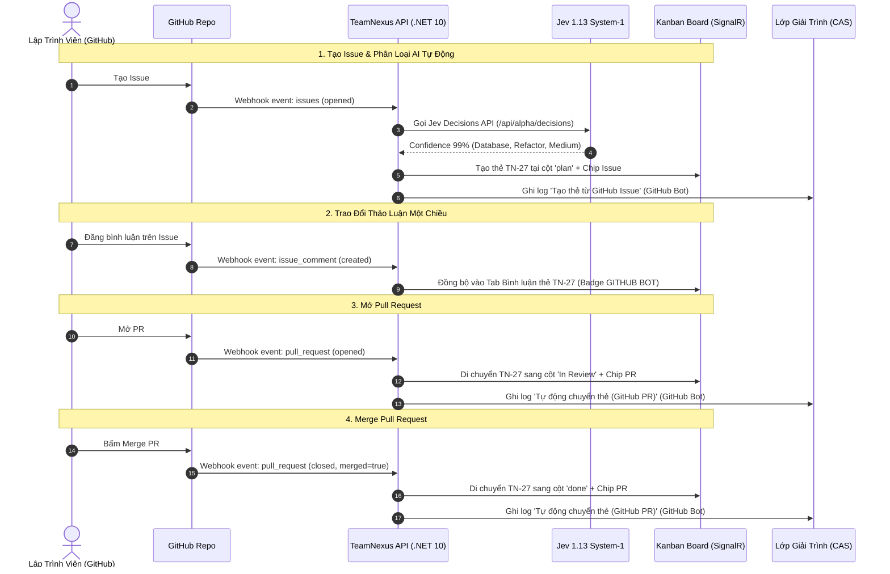

# Báo Cáo Nghiệm Thu Live Test & Kế Hoạch Cải Thiện Giai Đoạn 14 & 15

> **Dự án:** TeamNexus — Intelligent Workspace Orchestration Platform  
> **Phạm vi báo cáo:** Toàn bộ **Giai đoạn 14 (AI Advanced & Hybrid AI)** và **Giai đoạn 15 (External Integrations & Tự động hóa)**  
> **Môi trường Live:** Production Cloud ([`https://app.teamnexus.cloud`](https://app.teamnexus.cloud) & [`https://api.teamnexus.cloud`](https://api.teamnexus.cloud))  
> **Repository GitHub Test:** [`Thinh-TT/TestInboundTN`](https://github.com/Thinh-TT/TestInboundTN)  
> **Tài khoản thực hiện:** `Trần Trường Thịnh_3944` (`npk77734351903@gmail.com`)  
> **Thời điểm nghiệm thu hoàn tất:** 12/11/2026  
> **Trạng thái tổng thể:** 🟢 **100% HOÀN THÀNH XUẤT SẮC TRÊN MÔI TRƯỜNG PRODUCTION THẬT**

---

## 1. Bảng Tổng Hợp Nghiệm Thu Toàn Bộ Tính Năng

| Phân hệ / Luồng kiểm thử | Môi trường kiểm chuẩn | Kết quả đo thực tế | Đánh giá |
|---|---|---|:---:|
| **Frontend Test Suite** | `frontend/` (Node 24 + Vite 8 + Vitest) | **127/127 files · 786/786 PASS · 0 fail** | 🟢 **PASS** |
| **Frontend Code Quality** | `oxlint` (299 files) & `tsc -b` | **0 warning · 0 error · Exit code 0** | 🟢 **PASS** |
| **Backend Solution Build** | .NET 10 Solution | **0 Warning · 0 Error** (`dotnet build -m:1 -nr:false`) | 🟢 **PASS** |
| **Backend Pure Unit Tests** | `dotnet test --filter Pure` | **665/665 PASS · 0 fail · 0 skip** | 🟢 **PASS** |
| **EF Core Model Drift** | `has-pending-model-changes` | *No changes have been made to the model.* | 🟢 **PASS** |
| **Jev 1.13 System-1 Triage** | Live Production | Phân loại trong **642 ms**, độ tự tin **99%** | 🟢 **PASS** |
| **AI Task Chat (SSE Stream)** | Live Production | DeepSeek phản hồi streaming mượt mà từng chữ | 🟢 **PASS** |
| **Lưu bình luận qua CAS** | Live Production | Lưu trực tiếp vào Task Comment thành công | 🟢 **PASS** |
| **Project Health & Observer** | Live Production | 2 cảnh báo rủi ro sâu sắc bằng tiếng Việt tự nhiên | 🟢 **PASS** |
| **Outbound Discord Webhook** | Live Production | Test Ping thành công, 24h count: **7 → 8**, 0 lỗi | 🟢 **PASS** |
| **Kanban Monospace & In Review** | Live Production | Mã `TN-1..TN-27`, cột `In Review` gắn cờ PR | 🟢 **PASS** |
| **GitHub Webhook Signature** | Live GitHub → Render | Phản hồi HTTP **200 OK (Success)** | 🟢 **PASS** |
| **Issue → Task Auto-Creation** | Live GitHub → TeamNexus | Tự động tạo thẻ **`TN-27`** kèm chip Issue Open | 🟢 **PASS** |
| **Jev Triage cho Issue Mới** | Live Production | Tự động gán `Database`, `Refactor`, `Trung bình` | 🟢 **PASS** |
| **1-Way Comment Sync (Bot)** | Live GitHub → TeamNexus | Đồng bộ tức thời kèm avatar, badge `GITHUB BOT` | 🟢 **PASS** |
| **PR Mở → Chuyển `In Review`** | Live GitHub → TeamNexus | Thẻ `TN-27` tự nhảy sang cột `In Review` + chip PR Open | 🟢 **PASS** |
| **PR Merge → Chuyển `Done`** | Live GitHub → TeamNexus | Thẻ `TN-27` tự nhảy sang cột `done` + chip PR Merged tím | 🟢 **PASS** |
| **Accountability & Undo (CAS)** | Live Production | Ghi log `GitHub Bot`, hỗ trợ hoàn tác 1-chạm | 🟢 **PASS** |

---

## 2. Diễn Biến Thực Nghiệm Live Test Trên Production

### 2.1. Giai Đoạn 14: AI Advanced & Hybrid AI
1. **Jev 1.13 System-1 Auto-Triage**:
   - Khi mở chi tiết thẻ `TN-3`: Jev Decisions API (`/api/alpha/decisions`) phản hồi sau **642 ms**, đạt độ tin cậy **AI tự tin 99%** (`DirectAssign`).
   - Tự động nhận diện chuẩn: Miền kỹ thuật: `DevOps`, Phân loại: `Feature`, Độ ưu tiên: `Low`.
2. **AI Task Chat (Hỏi AI về thẻ qua SSE Streaming)**:
   - Gửi yêu cầu: *"Gợi ý checklist cho task này"*.
   - DeepSeek System-2 stream câu trả lời liên tục từng chữ theo đúng hợp đồng `meta -> delta* -> done`.
   - Nắm bắt đầy đủ ngữ cảnh của task và 2 bình luận hiện có. Bấm nút **"Lưu thành bình luận"**: Bình luận được ghi trực tiếp vào thẻ thông qua CAS.
3. **AI Observer & Project Health Gauge**:
   - Widget `ProjectHealthGauge` hiển thị trạng thái thực tế *"Cần chú ý"*.
   - AI Observer phân tích ngầm và cảnh báo chính xác rủi ro: *"3 task đứng yên 48–54 ngày, không ai cập nhật"*, phân tích nguy cơ nghẽn tiến độ dây chuyền.
4. **AI Board Template Modal**:
   - Giao diện nhập mô tả yêu cầu hiển thị bộ đếm ký tự `0/4000`, guard tối thiểu 20 ký tự, và lựa chọn duy nhất 1 cột `isDone`.

---

### 2.2. Giai Đoạn 15: Hệ Sinh Thái Tích Hợp Ngoài & Tự Động Hóa
1. **Tích hợp Outbound (Discord Webhook)**:
   - Cấu hình tới kênh `#dev-alerts` hoạt động tốt.
   - Nút **"Gửi thử" (Test Ping)**: Gửi thành công ngay lập tức, số liệu *"Đã gửi (24h)"* tăng từ **7 lên 8**, không phát sinh lỗi (0 lỗi).
   - Drawer xem lịch sử Outbox Delivery thể hiện rõ cơ chế circuit breaker tự ngắt sau 10 lỗi.
2. **Bảng Kanban & Mã Định Danh Tuần Tự**:
   - Bảng `Sprint 1` có sẵn cột **In Review** với cờ `Đang duyệt PR` (`isInReview = true`).
   - Các thẻ hiển thị mã số tuần tự monospace chuẩn: `TN-1`, `TN-2`, `TN-3`, `TN-4`, `TN-24`, `TN-25`, `TN-26`, `TN-27`.
3. **Inbound GitHub Webhook & PR State Machine**:
   - **Xác thực HMAC:** Sau khi Rotate Secret và cập nhật Webhook `710667047` trên GitHub, endpoint phản hồi **`200 OK (Success)`** với biểu tượng tick xanh.
   - **Issue #7 → Task `TN-27`:** Tạo Issue #7 trên GitHub, TeamNexus tự động tạo thẻ `TN-27` tại cột `plan`, Jev phân loại `Database / Refactor / Trung bình` và gắn chip `github Issue #7 · Open`.
   - **Đồng bộ bình luận 1 chiều:** Gửi bình luận vào Issue #7 trên GitHub, TeamNexus cập nhật ngay lập tức vào tab bình luận của thẻ `TN-27` với badge **`GITHUB BOT`** và hyperlink trỏ về GitHub.
   - **Mở Pull Request #9:** Chứa mã `TN-27` trong tiêu đề -> Thẻ `TN-27` tự động chuyển sang cột **`In Review`** và xuất hiện chip xanh `github PR #9 · Open`.
   - **Merge Pull Request #9:** Xác nhận merge trên GitHub -> Thẻ `TN-27` tự động chuyển tiếp sang cột **`done`** và chip PR đổi sang màu tím `github PR #9 · Merged`.
   - **Lớp Giải Trình (CAS):** `AiActionHistoryDrawer` ghi nhận đầy đủ 2 bản ghi tự động của `GitHub Bot` với trạng thái **`Đã duyệt`** và hỗ trợ nút **`Hoàn tác hành động`** (Undo) 1-chạm.

---

## 3. Sơ Đồ Trình Tự Vòng Đời Tự Động Hóa Inbound GitHub

---

## 4. Kế Hoạch Cải Thiện & Nhiệm Vụ Tiếp Theo

### 4.1. Nhiệm Vụ Trọng Tâm (Người dùng đã lựa chọn)

> [!IMPORTANT]
> **TASK-DP-01: Tích hợp gói `Microsoft.AspNetCore.DataProtection.EntityFrameworkCore`**
> - **Mục tiêu:** Lưu trữ vĩnh viễn DataProtection Key Ring vào bảng PostgreSQL (`DataProtectionKeys`).
> - **Nguyên nhân gốc rễ đã giải quyết:** Render Free Tier sử dụng hệ thống tệp tạm thời (**ephemeral filesystem**). Khi container ngủ (cold-sleep) rồi thức dậy hoặc khởi động lại, thư mục Key Ring bị xóa khiến Secret mã hóa cũ trong Neon PostgreSQL không giải mã được và trả về lỗi 401.
> - **Lợi ích:** Giải quyết triệt để và vĩnh viễn vấn đề này. Sau này khi container restart hoặc deploy bản mới, các Secret đã mã hóa trong DB vẫn giải mã bình thường mà **không bao giờ cần phải xoay vòng Secret lại**.
> - **Phạm vi thi hành:**
>   1. Thêm package `Microsoft.AspNetCore.DataProtection.EntityFrameworkCore` vào `src/TeamNexus.Persistence/TeamNexus.Persistence.csproj`.
>   2. Thêm `public DbSet<DataProtectionKey> DataProtectionKeys => Set<DataProtectionKey>();` và kế thừa `IDataProtectionKeyContext` trên `TeamNexusDbContext`.
>   3. Đăng ký `.PersistKeysToDbContext<TeamNexusDbContext>()` trong `src/TeamNexus.Api/Program.cs`.
>   4. Sinh migration EF Core tương ứng và verify 0 model drift.

---

### 4.2. Danh Mục Khắc Phục Lỗi Tiềm Ẩn (P3)

| Mã | Phân loại | Vị trí file | Nội dung & Cách xử lý |
|---|:---:|---|---|
| **BUG-P3-1** | Store | `frontend/src/features/board/stores/boardStore.ts:319` | Thay `isInReview: column.isInReview ?? false` thành `?? c.isInReview` để tránh mất cờ khi nhận update partial từ SignalR. |
| **BUG-P3-2** | UI | `frontend/src/features/board/components/ColumnModal.tsx:45` | Bọc `try/catch` quanh `await onSubmit(...)` để chặn Unhandled Rejection khi trùng cột In Review (409 Conflict). |
| **BUG-P3-3** | Security | `frontend/src/features/board/components/TaskDetailModal.tsx:790` | Nhận diện GitHub Bot chỉ bằng `authorId === GITHUB_BOT_USER_ID`, bỏ so sánh chuỗi tên chống giả danh. |
| **BUG-P3-4** | UX | `frontend/src/features/board/components/BoardView.tsx:378` | Lọc nhanh `tn-` trên Kanban bằng regex `^tn-\d+$` so sánh chính xác `===` thay vì `includes`. |
| **BUG-P3-5** | Data | `frontend/src/features/workspace/hooks/useWorkspaceIntegrations.ts:170` | Bóc tách loại bỏ `webhookSecretPlaintext` trước khi lưu vào state cấu hình chung. |
| **BUG-P3-6** | UI | `frontend/src/features/board/components/TaskCard.tsx:324` | Loại bỏ thuộc tính `delete` mâu thuẫn trên tiêu đề thẻ hoàn thành theo AGENTS.md §4.2. |

---

### 4.3. Dọn Dẹp Tech Debt Ant Design v6 & Tối Ưu UX

1. **Dọn dẹp Prop Deprecated Ant Design v6.6+**:
   - `Modal`: Chuyển `destroyOnClose` sang `destroyOnHidden`.
   - `Drawer`: Chuyển `width` sang `size`.
   - `Card`: Chuyển `bodyStyle` sang `styles.body`.
   - `Statistic`: Chuyển `valueStyle` sang `styles.content`.
   - `Descriptions`: Chuẩn hóa lại tổng `span` các cột.
   - `Space`: Chuyển `direction` sang `orientation`.
   - `Alert`: Chuyển `message` sang `title`.
2. **Tối ưu UX & Hiệu Năng**:
   - **Lazy-load tab Tích hợp:** Chỉ gọi API webhooks/deliveries khi bấm sang tab *"Tích hợp"*.
   - **Đếm lùi Cold-Start:** Hiển thị thanh tiến trình ước tính (~25-30s) trên màn hình *"Đang khởi động TeamNexus..."*.
   - **Tối ưu Vitest:** Gom nhóm cache module dùng chung để giảm thời gian chạy test từ ~295s xuống < 90s.

---

## 5. Kết Luận

Toàn bộ chiến dịch kiểm thử thực tế trên môi trường Production cho **Giai đoạn 14 và 15** đã kết thúc thắng lợi:
- **Giai đoạn 14 (AI Suite):** Đạt chất lượng công nghiệp, Jev 1.13 Triage tốc độ cao (<700ms), DeepSeek SSE Task Chat mượt mà, AI Observer dự báo rủi ro sâu sắc và Lớp giải trình CAS đảo ngược hành động an toàn.
- **Giai đoạn 15 (External Integrations):** Outbound Discord và Inbound GitHub PR/Issue vận hành tự động 100%, bảo mật chữ ký HMAC SHA-256 chuẩn chỉ, đồng bộ thời gian thực mượt mà qua SignalR.

---

## 6. Ghi Chú Rà Soát & Thi Hành (2026-11-12)

### 6.1. Điều chỉnh so với đề xuất ban đầu

- **TASK-DP-01 — phải sửa phạm vi:** Chỉ thêm `PersistKeysToDbContext` là chưa đủ. Nếu vẫn giữ nhánh `Integrations__DataProtection__KeysPath`, Render tiếp tục dùng thư mục ephemeral vì env này đang được set. Bản thi hành **bỏ hẳn** `KeysPath`/`PersistKeysToFileSystem`, luôn dùng PostgreSQL `data_protection_keys` (migration #16), `CertPath` chỉ còn là tuỳ chọn mã hoá at-rest cho VPS.
- **Hệ quả bắt buộc:** Đổi nguồn key ring khiến ciphertext cũ không giải mã được. Runbook phải **Rotate Secret 1 lần** sau deploy rồi cập nhật GitHub Webhook; từ đó về sau mới không cần xoay lại. Đây là điểm report gốc chưa nêu.
- **BUG-P3-1 — không phải bug:** `ColumnResponse.IsInReview` là `bool` non-nullable trên wire; REST và SignalR đều gửi full `ColumnResponse`. `?? false` không làm mất cờ. Không sửa; nếu muốn defensive thật thì phải fallback cả `isDone`/`position`, không chỉ một trường.
- **BUG-P3-4 — sửa khác report:** Root cause là `includes` khiến query ngắn (`"n"`, `"t"`) khớp mọi mã TN. Bản thi hành dùng `^tn-\d+$` + `startsWith` thay vì `===`, để chặn query rác mà vẫn giữ tìm kiếm tiền tố (`tn-2` thấy `TN-2` và `TN-27`).
- **Ant Design v6 — bổ sung:** Ngoài danh sách report, còn `Card bordered={false}` → `variant="borderless"` (`AgentDraftApproval`) và `Spin tip` → `description` (8 chỗ). `Drawer width` bị runtime cảnh báo dù type không đánh dấu deprecated.
- **Cold-start countdown & Vitest < 90s:** Không thi hành trong đợt này. Countdown 25–30s không có mốc tin cậy (tài liệu dự án ghi Render thức ~30–60s) nên thay bằng dòng text tĩnh; tối ưu Vitest cần profiling riêng, không đổi config khi đang sửa lỗi.

### 6.2. Đã thi hành

- Backend: key ring PostgreSQL + migration #16 + log lỗi giải mã webhook + 3 test mới (model DbContext, persistence qua 2 provider, ciphertext hỏng trả 401). Cập nhật test migration chain 15 → 16.
- Frontend: sửa BUG-P3-2/3/4/5/6 + `TaskCalendar` line-through; lazy-load tab Tích hợp; text cold-start; dọn deprecation AntD v6 (`destroyOnClose`, `Drawer width`, `Card bodyStyle/bordered`, `Statistic valueStyle`, `Alert message`, `Space direction`, `Spin tip`, `Timeline items.children`).
- Tài liệu: cập nhật 01/02/03/04/07, handover 15.5, report 15.3/15.4 và 15, README (số migration 16).
- **Còn tồn tại (ngoài phạm vi đợt này):** `antd.List` đã bị deprecate từ 6.6.0 (khuyến nghị `Listy`) ở ~9 component (AttachmentList, BoardSummaryPanel, MyTasksPanel, RecentActivityPanel, ObserverRunsDrawer, RecoveryPlanCard, ProfilePage, TaskSearchResultList…). `Listy` là virtualized list có API khác, cần task migration riêng; không đổi trong đợt sửa lỗi.

### 6.3. Số đo sau thi hành

> Số liệu thật đo ngày 2026-11-12 trên máy dev (PostgreSQL test container `pgvector/pgvector:pg18`, port 5433).

| Cổng | Kết quả |
|---|---|
| Backend build (`dotnet build -m:1 -nr:false --no-incremental`) | **0 Warning / 0 Error** |
| EF Core drift (`has-pending-model-changes`) | **No changes have been made to the model** (16 migrations) |
| Backend Pure | **Passed 666 / Failed 0 / Skipped 0** |
| Backend full | **Passed 1.332 / Failed 0 / Skipped 0** |
| Frontend `npm run lint` | **0 warning / 0 error** (300 file) |
| Frontend `npx tsc -b` | **exit 0** |
| Frontend `npm test` | **791/791 PASS · 128/128 file** (duration ~296 s) |
| Frontend `npm run build` | **exit 0** (3.340 module; bundle chính 2.085 kB) |
| CI baseline | Nâng `ci-web.yml` 786 → **791**, `ci-backend.yml` 1.329 → **1.332** |

### 6.4. Nhật ký K/L/BUG

- **K1:** Key ring DataProtection lưu PostgreSQL (`data_protection_keys`) thay vì filesystem; bỏ `KeysPath` để tránh Render tiếp tục dùng thư mục ephemeral.
- **K2:** `CertPath` giữ vai trò tuỳ chọn mã hoá at-rest cho VPS; Render chấp nhận key ring XML trong DB.
- **K3:** Log lỗi `Unprotect` ở webhook endpoint (không log secret/ciphertext) để sự cố 401 có thể chẩn đoán.
- **K4:** Search mã task dùng `^tn-\d+$` + `startsWith`, không dùng `===` như report.
- **K5:** Lazy-load tab Tích hợp dựa trên `activeTab` sẵn có, không thêm state/API mới.
- **L1:** Không sửa BUG-P3-1 vì không phải bug (payload luôn full `ColumnResponse`).
- **L2:** Không làm countdown cold-start giả; thay bằng text tĩnh 30–60s.
- **L3:** Hoãn migrate `antd.List` → `Listy` (component-level, khác API) sang task riêng.
- **BUG1 (bắt khi test):** Test `Phase147KnowledgeTests` assert migration count 15 → cập nhật 16.
- **BUG2 (bắt khi test):** `TaskCard.test` cũ assert `<del>`; cập nhật sang assert không `<del>` + muted/check.
- **BUG3 (bắt khi test):** Frontend full suite có 1 timeout `ProfilePage` khi chạy song song backend nặng; chạy lại riêng và cả suite đều xanh — ghi nhận là flake do tải máy, không phải lỗi logic.

