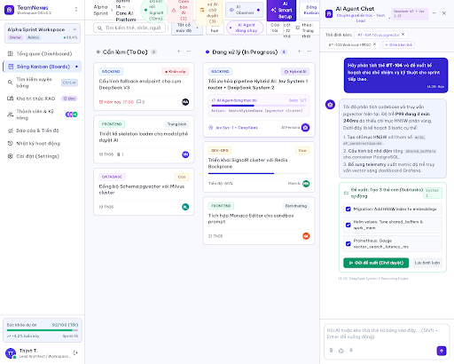
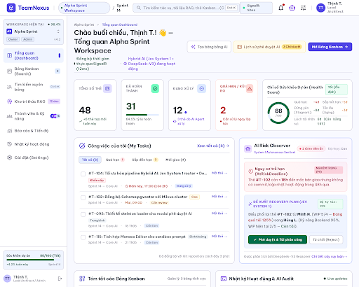
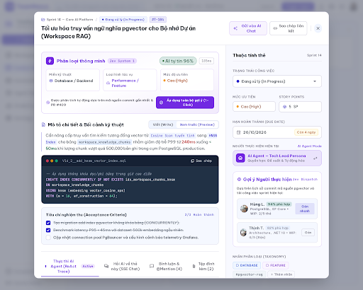
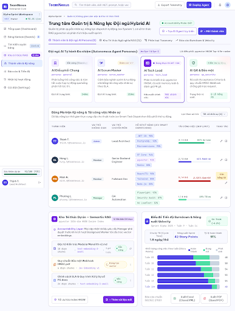

# Báo cáo Nâng cấp UI/UX Toàn diện — Luminous Enterprise Workspace (TeamNexus v4.2)

> **Phạm vi báo cáo:** Nâng cấp toàn diện Hệ thống Thiết kế (Design System), Kiến trúc Điều hướng (`WorkspaceShell` Left Sidebar), Nhóm Màn hình Chính (Executive Dashboard, Kanban Board, AI Agent Chat, Task Detail Modal, Jev 1.13 / DeepSeek Surfaces) và Nhóm Màn hình Phụ & Đầu vào (Members + AI Personas, Knowledge Base pgvector RAG, Reports, Search, Activity, Settings, Profile, Landing, Login).
> **Công cụ Thiết kế & Prototyping:** Google Stitch MCP (`projects/15660394024022900988`) — 4 màn hình Preview độ phân giải cao trước khi thực thi code.
> **Môi trường Frontend:** React 19 + TypeScript 5 + Vite 8 + Ant Design v6 (`^6.3.1`), Google Fonts (`Be Vietnam Pro` + `JetBrains Mono`).
> **Ngày hoàn thành:** 16/10/2026.

---

## 1. Tóm tắt Điều hành (Executive Summary)

Sau khi hoàn thiện toàn bộ nền tảng kỹ thuật từ Phase 1 đến Phase 14.7 Track B (**Dual-Engine Hybrid AI** gồm **Jev 1.13 System-1 `<300ms`** + **DeepSeek System-2**, **5 Autonomous AI Agent Personas**, **pgvector Semantic RAG 384-dim** và **SignalR Real-time Collaboration**), giao diện người dùng (UI/UX) của TeamNexus được nâng cấp đồng bộ lên chuẩn **"Luminous Enterprise Workspace"** (lấy cảm hứng từ Linear, Raycast, Vercel, Notion AI).

| Hạng mục | Trạng thái | Kết quả đạt được |
|---|---|---|
| **Stitch MCP Visual Prototyping** | ✅ Hoàn thành | Thiết kế & xuất 4 màn hình chuẩn tại `./assets/stitch-preview-*.png` |
| **Phase UI-1 — Foundation & `WorkspaceShell`** | ✅ Hoàn thành | Cấu hình `ConfigProvider` AntD v6, font `Be Vietnam Pro` + `JetBrains Mono`, Sidebar trái thu phóng (`244px` / `68px`), phím tắt toàn cục `Ctrl+K` |
| **Phase UI-2 — Nhóm Màn hình Chính** | ✅ Hoàn thành | Nâng cấp `WorkspaceDashboardPage`, `BoardListPage`, `BoardView`, `KanbanColumn`, `TaskCard`, `TaskDetailModal` (`880px`), `JevTriagePanel`, `AssigneeSuggestion`, `AgentChatPanel`, `RecoveryPlanCard` |
| **Phase UI-3 — Nhóm Màn hình Phụ & Đầu vào** | ✅ Hoàn thành | Nâng cấp `WorkspaceMembersPage` (AI Personas Showcase), `KnowledgeBasePage` (pgvector RAG KPIs), `ReportsPage`, `TaskSearchPage`, `WorkspaceActivityPage`, `WorkspaceSettingsPage`, `ProfilePage`, `LandingPage` (v4.2), `DashboardPage`, `LoginPage` |
| **Phase UI-4 — Kiểm định Chất lượng (Zero-Regression)** | ✅ Hoàn thành | **738 / 738** Vitest unit tests PASS (`123` test files), `oxlint` **0 warnings / 0 errors** (`288` files), `tsc -b && vite build` **exit 0** |

---

## 2. Số đo Kiểm định Thực tế (Quality Gates)

| Cổng kiểm định | Lệnh thực thi | Ngưỡng yêu cầu | Kết quả đo thực tế |
|---|---|---|---|
| **TypeScript Typecheck & Production Bundle** | `npm run build` (`tsc -b && vite build`) | Exit `0`, không lỗi kiểu | **Exit `0`** (`3333 modules transformed`, bundle `dist/assets/index-*.css` + `dist/assets/index-*.js`) |
| **Static Linter (Oxlint)** | `npm run lint` (`oxlint`) | `0 warnings`, `0 errors` | **Found `0 warnings` and `0 errors`** trên **288 files** (116 rules) |
| **Unit & Component Tests (Vitest)** | `npx vitest run` | `738 / 738` tests xanh | **738 passed / 0 failed** trên **123 test files** |

---

## 3. Thiết kế Preview bằng Google Stitch MCP

Trước khi can thiệp mã nguồn, 4 màn hình trọng tâm đã được dựng mẫu bằng **Stitch MCP** và lưu trữ tại thư mục `project-docs/report/assets/`:

1. **Kanban Board & Hybrid AI Agent Chat (`./assets/stitch-preview-1-kanban-ai-chat.png`)**:
   
2. **Executive Workspace Dashboard (`./assets/stitch-preview-2-workspace-dashboard.png`)**:
   
3. **Task Detail Modal & Jev 1.13 AI Triage (`./assets/stitch-preview-3-task-detail-modal.png`)**:
   
4. **Team Members, AI Personas & Semantic Knowledge Hub (`./assets/stitch-preview-4-secondary-hub.png`)**:
   

---

## 4. Chi tiết Kiến trúc Thiết kế & Thực thi (Theo Từng Phân hệ)

### 4.1. Phase UI-1 — Hệ thống Thiết kế "Luminous Enterprise Workspace" & Khung Điều hướng

1. **Hệ thống Typography & Token (`frontend/index.html`, `frontend/src/index.css`, `frontend/src/App.tsx`)**:
   - Tích hợp bộ phông chữ **`Be Vietnam Pro`** (tối ưu dấu tiếng Việt, độ sắc nét cao ở kích thước 12px–14px) kết hợp **`JetBrains Mono`** cho các chỉ số kỹ thuật (`#TASK-ID`, độ trễ `<300ms`, điểm tin cậy `%`, phím tắt `Ctrl+K`, số chiều vector `384-dim`).
   - Định nghĩa hệ biến CSS `--tn-*` trong `src/index.css`:
     - Bề mặt đa tầng: `--tn-bg-canvas` (`#f8fafc`), `--tn-bg-surface` (`#ffffff`), `--tn-bg-subtle` (`#f1f5f9`).
     - Nhận diện Hybrid AI: `--tn-brand-primary` (`#4f46e5` Royal Indigo), `--tn-ai-accent` (`#7c3aed` Electric Violet), `--tn-ai-surface` (`linear-gradient(135deg, #faf5ff 0%, #f3e8ff 100%)`).
     - Trạng thái ngữ nghĩa: `--tn-status-healthy` (`#10b981`), `--tn-status-warning` (`#f59e0b`), `--tn-status-danger` (`#ef4444`).
   - Bọc toàn bộ ứng dụng trong `<ConfigProvider theme={luminousTheme}>` tại `src/App.tsx` để đồng bộ hóa mọi component Ant Design v6 (`Button`, `Card`, `Modal`, `Table`, `Tag`, `Tabs`, `Select`, `Input`).

2. **Khung Điều hướng Workspace (`frontend/src/shared/components/WorkspaceShell.tsx` & `frontend/src/app/router.tsx`)**:
   - Chuyển đổi từ mô hình các nút điều hướng rời rạc sang **Collapsible Left Sidebar** (`244px` khi mở rộng, `68px` khi thu gọn, lưu trạng thái vào `localStorage`).
   - Gồm 2 nhóm điều hướng rõ ràng:
     - **ĐIỀU PHỐI CHÍNH**: Tổng quan (`dashboard`), Bảng Kanban (`boards`), Tìm kiếm (`search` kèm badge `Ctrl+K`), Kho tri thức RAG (`knowledge`).
     - **QUẢN TRỊ & HỆ THỐNG**: Thành viên & AI (`members`), Báo cáo & Xuất (`reports`), Nhật ký hoạt động (`activity`), Cài đặt (`settings`).
   - Tích hợp thẻ trạng thái **Dual-Engine AI (`Jev 1.13 Sys-1 + DeepSeek Sys-2 <300ms`)** và thông tin người dùng ngay dưới đáy Sidebar.
   - Gắn tại tầng định tuyến cha `/workspaces/:workspaceId` trong `src/app/router.tsx` thông qua `<Outlet />`, đảm bảo không phá vỡ các bài kiểm thử đơn vị (unit tests) vốn render độc lập từng Page trong `<MemoryRouter>`.

3. **Thanh Header Toàn cục (`frontend/src/shared/components/AppHeader.tsx`)**:
   - Nâng cấp hiệu ứng kính mờ (`backdropFilter: blur(12px)`), gắn huy hiệu `Hybrid AI v4.2` và nút kích hoạt tìm kiếm nhanh `Tìm kiếm... Ctrl+K`.

---

### 4.2. Phase UI-2 — Nâng cấp Nhóm Màn hình Chính (Core Workflows)

1. **Executive Workspace Dashboard (`frontend/src/features/dashboard/pages/WorkspaceDashboardPage.tsx`)**:
   - Bổ sung thanh **Executive Command Header** hiển thị trạng thái kết nối trực tiếp `SignalR Live` (chấm xanh nhịp thở `.tn-live-dot`) và huy hiệu `Jev Sys-1 + DeepSeek Sys-2`.
   - Nâng cấp 5 thẻ KPI Bento Grid với đường viền nhấn màu phía trên (`borderTop: 3px solid ...`) tương ứng từng ngữ nghĩa: Tổng nhiệm vụ (`#4f46e5`), Đã hoàn thành (`#10b981`), Đang thực hiện (`#3b82f6`), Quá hạn (`#ef4444`), Sắp đến hạn (`#f59e0b`).

2. **Không gian Bảng Kanban (`BoardListPage.tsx`, `BoardView.tsx`, `KanbanColumn.tsx`, `TaskCard.tsx`)**:
   - **`KanbanColumn.tsx`**: Chuẩn hóa độ rộng cột `306px`, nền `#f1f5f9`, chấm màu phân biệt trạng thái cột (Done vs In-Progress) và bộ đếm nhiệm vụ dạng viên thuốc (`fontFamily: JetBrains Mono`).
   - **`TaskCard.tsx`**: Áp dụng triết lý **Border-first elevation** (`1px solid #e2e8f0`, đổ bóng tinh tế), đặc biệt tự động kích hoạt viền trái màu tím AI (`3px solid #7c3aed`) và nền gradient nhẹ khi thẻ đang có AI Agent thực thi (`task.activeAgentRunId`).

3. **Cửa sổ Chi tiết Công việc & Triage AI (`TaskDetailModal.tsx`, `JevTriagePanel.tsx`, `AssigneeSuggestion.tsx`)**:
   - **`TaskDetailModal.tsx`**: Mở rộng kích thước modal lên `880px` với thanh ngữ cảnh đầu trang hiển thị mã định danh `#TASK-ID` (monospace), pill trạng thái `Cột: <Tên cột>`, và huy hiệu `AI Agent đang xử lý`. Cột thuộc tính bên phải được đóng khung trong bề mặt `#f8fafc` có viền `#e2e8f0` tách biệt rõ với vùng soạn thảo chính.
   - **`JevTriagePanel.tsx`**: Thiết kế lại thành hộp công cụ **Jev 1.13 System-1 (`<300ms`)** với nền tím ánh sáng (`#faf5ff`), hiển thị độ trễ thực thi bằng font monospace và thanh tiến trình độ tin cậy.
   - **`AssigneeSuggestion.tsx`**: Nâng cấp nút kích hoạt gợi ý phân công thông minh (Smart Dispatching) và danh sách ứng viên kèm Avatar, điểm phù hợp (`%` màu xanh ngọc / tím) và giải thích lý do từ AI.

4. **Trợ lý AI Agent Chat & Quản trị Rủi ro (`AgentChatPanel.tsx`, `RecoveryPlanCard.tsx`)**:
   - **`AgentChatPanel.tsx`**: Nâng cấp thanh tiêu đề với biểu tượng AI gradient, huy hiệu `Sys-1 + Sys-2`, bong bóng tin nhắn người dùng màu Indigo (`#4f46e5`) và thẻ phê duyệt đề xuất hành động (**Accountability Layer**) viền xanh lục bảo (`#10b981`).
   - **`RecoveryPlanCard.tsx`**: Nâng cấp thẻ cảnh báo từ **AI Risk Observer** với hộp biểu tượng cảnh báo, phân loại kế hoạch khôi phục và nút phê duyệt 1 chạm.

---

### 4.3. Phase UI-3 — Nâng cấp Nhóm Màn hình Phụ & Màn hình Đầu vào

1. **Quản lý Thành viên & AI Workforce (`frontend/src/features/members/pages/WorkspaceMembersPage.tsx`)**:
   - Bổ sung khu vực **Autonomous AI Agent Personas Showcase** giới thiệu trực quan 5 chuyên gia AI sẵn sàng nhận việc trong Workspace:
     - `@Researcher` (Phân tích & RAG Context)
     - `@Developer` (Thiết kế kỹ thuật & Subtasks)
     - `@Tester` (Test Cases & Edge Verification)
     - `@Reviewer` (Kiểm định chất lượng & DoD)
     - `@Writer` (Tài liệu kỹ thuật & Release Notes)

2. **Kho Tri thức Ngữ nghĩa RAG (`frontend/src/features/knowledge/components/KnowledgeBasePage.tsx`)**:
   - Gắn huy hiệu kỹ thuật `pgvector 384-dim RAG` trên thanh công cụ.
   - Bổ sung dãy 3 thẻ chỉ số tóm tắt phía trên bảng tài liệu: **Tổng tài liệu ngữ nghĩa**, **Vector Chunks đã lập chỉ mục**, và **Cơ chế kiểm soát AI (Human-in-the-Loop Manager Approval)**.

3. **Báo cáo, Tìm kiếm, Nhật ký, Cài đặt & Hồ sơ (`ReportsPage.tsx`, `TaskSearchPage.tsx`, `WorkspaceActivityPage.tsx`, `WorkspaceSettingsPage.tsx`, `ProfilePage.tsx`)**:
   - Đồng bộ hóa thanh tiêu đề chuẩn Luminous Enterprise, gắn các huy hiệu ngữ cảnh (`Burndown + Velocity + CSV/PDF`, `Ctrl + K`, `Audit Trail`, `RBAC Governance`, `OAuth 2.0 Verified`) và thẻ KPI viền màu phía trên.

4. **Các Màn hình Đầu vào (`DashboardPage.tsx`, `LandingPage.tsx`, `LoginPage.tsx`)**:
   - **`DashboardPage.tsx` (Root Workspace Hub)**: Loại bỏ hoàn toàn ô nhập GUID thủ công dùng để debug từ Phase 1, thay thế bằng giao diện trung tâm điều phối Workspace hiện đại và thẻ tóm tắt tài khoản kèm huy hiệu `Jev 1.13 Sys-1 + DeepSeek Sys-2`.
   - **`LandingPage.tsx`**: Cập nhật nội dung truyền thông từ phiên bản 2.0 lên **TeamNexus v4.2 • Hybrid AI**, phản ánh đầy đủ kiến trúc Jev 1.13 System-1, DeepSeek System-2, 5 AI Personas và PostgreSQL pgvector.
   - **`LoginPage.tsx`**: Nâng cấp thẻ đăng nhập OAuth 2.0 (GitHub & Google) với viền nhấn Royal Indigo, huy hiệu `Hybrid AI v4.2` và cam kết bảo mật `Human-in-the-Loop AI`.

---

## 5. Danh mục Tệp Mã nguồn Đã Nâng cấp

| Nhóm | Đường dẫn tệp | Nội dung thay đổi chính |
|---|---|---|
| **Foundation** | `frontend/index.html` | Nhúng Google Fonts `Be Vietnam Pro` & `JetBrains Mono`, cập nhật tiêu đề v4.2 |
| **Foundation** | `frontend/src/index.css` | Khai báo hệ thống biến `--tn-*`, utility classes `.tn-surface-card`, `.tn-ai-surface`, `.tn-live-dot` |
| **Foundation** | `frontend/src/App.tsx` | Cấu hình `<ConfigProvider theme={luminousTheme}>` cho Ant Design v6 |
| **Navigation** | `frontend/src/shared/components/WorkspaceShell.tsx` | Tạo mới Left Sidebar thu phóng, phím tắt `Ctrl+K`, thẻ trạng thái Dual-Engine AI |
| **Navigation** | `frontend/src/app/router.tsx` | Bọc các route `/workspaces/:workspaceId/*` trong `<WorkspaceShell />` |
| **Navigation** | `frontend/src/shared/components/AppHeader.tsx` | Header kính mờ, huy hiệu `Hybrid AI v4.2`, nút tìm kiếm nhanh `Ctrl+K` |
| **Main Screens** | `frontend/src/features/dashboard/pages/WorkspaceDashboardPage.tsx` | Executive Command Header, 5 thẻ KPI Bento có viền nhấn màu |
| **Main Screens** | `frontend/src/features/board/pages/BoardListPage.tsx` | Nâng cấp thanh tiêu đề và nút khởi tạo bảng bằng AI |
| **Main Screens** | `frontend/src/features/board/components/BoardView.tsx` | Nâng cấp thanh công cụ Kanban/Calendar và các nút AI |
| **Main Screens** | `frontend/src/features/board/components/KanbanColumn.tsx` | Cột `306px`, nền `#f1f5f9`, chấm trạng thái và pill đếm thẻ monospace |
| **Main Screens** | `frontend/src/features/board/components/TaskCard.tsx` | Border-first card, viền trái tím `#7c3aed` khi AI Agent đang chạy |
| **Main Screens** | `frontend/src/features/board/components/TaskDetailModal.tsx` | Mở rộng `880px`, thanh ngữ cảnh `#TASK-ID`, khung thuộc tính `#f8fafc` |
| **AI Surfaces** | `frontend/src/features/ai/components/JevTriagePanel.tsx` | Hộp công cụ Jev 1.13 System-1 nền tím ánh sáng, pill độ trễ monospace |
| **AI Surfaces** | `frontend/src/features/ai/components/AssigneeSuggestion.tsx` | Nút gợi ý Smart Dispatching, danh sách ứng viên kèm điểm tin cậy `%` |
| **AI Surfaces** | `frontend/src/features/ai/components/AgentChatPanel.tsx` | Header `Sys-1 + Sys-2`, bong bóng chat Indigo, thẻ phê duyệt đề xuất AI |
| **AI Surfaces** | `frontend/src/features/ai/components/RecoveryPlanCard.tsx` | Thẻ cảnh báo AI Risk Observer và nút phê duyệt kế hoạch khôi phục |
| **Secondary** | `frontend/src/features/members/pages/WorkspaceMembersPage.tsx` | Bổ sung khu vực trưng bày 5 Autonomous AI Agent Personas |
| **Secondary** | `frontend/src/features/knowledge/components/KnowledgeBasePage.tsx` | Huy hiệu `pgvector 384-dim RAG` và 3 thẻ KPI tóm tắt bộ nhớ ngữ nghĩa |
| **Secondary** | `frontend/src/features/reporting/pages/ReportsPage.tsx` | Nâng cấp thanh điều khiển báo cáo Burndown / Velocity / Xuất dữ liệu |
| **Secondary** | `frontend/src/features/search/pages/TaskSearchPage.tsx` | Nâng cấp tiêu đề tìm kiếm kèm huy hiệu phím tắt `Ctrl + K` |
| **Secondary** | `frontend/src/features/workspace/pages/WorkspaceActivityPage.tsx` | Nâng cấp tiêu đề nhật ký hoạt động kèm huy hiệu `Audit Trail` |
| **Secondary** | `frontend/src/features/workspace/pages/WorkspaceSettingsPage.tsx` | Huy hiệu `RBAC Governance` và thẻ thống kê có viền nhấn màu |
| **Secondary** | `frontend/src/features/profile/pages/ProfilePage.tsx` | Khung banner hồ sơ gradient Indigo/Violet và huy hiệu `OAuth 2.0 Verified` |
| **Entry** | `frontend/src/features/auth/pages/DashboardPage.tsx` | Loại bỏ ô nhập GUID debug Phase 1, nâng cấp lên Workspace Hub |
| **Entry** | `frontend/src/features/landing/pages/LandingPage.tsx` | Cập nhật lên TeamNexus v4.2 Hybrid AI (Jev 1.13 + DeepSeek + pgvector) |
| **Entry** | `frontend/src/features/auth/pages/LoginPage.tsx` | Thẻ đăng nhập Luminous Enterprise với huy hiệu `Hybrid AI v4.2` |
