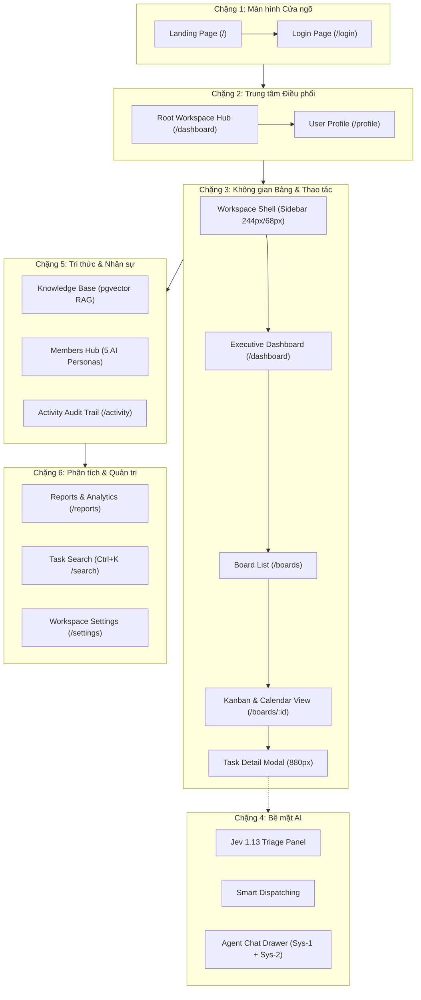

# Báo cáo Kiểm định Toàn diện UI/UX & Danh mục Phát hiện (TeamNexus v4.2)

> **Mã báo cáo:** `PHASE-15.1-UIUX-AUDIT`  
> **Môi trường kiểm thử:** Production Web App (`https://app.teamnexus.cloud`)  
> **Phương pháp kiểm thử:** Khảo sát trực tiếp bằng Browser Subagent (Viewport `1536x730`), đăng nhập tài khoản Google OAuth (`Trần Trường Thịnh_3944` - Quản trị viên / Workspace Owner).  
> **Phạm vi kiểm tra:** Toàn bộ 14+ phân hệ màn hình, thanh điều hướng toàn cục và các bề mặt tương tác AI sau nâng cấp Phase 15 Luminous Enterprise.  
> **Mục tiêu:** Rà soát tỉ mỉ từng chi tiết giao diện theo 5 trục tiêu chuẩn: **Chật hẹp**, **Nhảy chữ/Vỡ layout**, **Dư thừa**, **Có thể gộp chung**, và **Có thể làm đẹp hơn**. Đã thực thi khắc phục tuần tự toàn bộ **18/18** phát hiện và vượt qua toàn bộ cổng kiểm định chất lượng (`oxlint`, `tsc -b && vite build`, `vitest`).  
> **Ngày lập & hoàn tất khắc phục:** 16/10/2026.

---

## 1. Tóm tắt Đánh giá Chung (Executive Summary)

Sau khi nâng cấp toàn diện lên phong cách **Luminous Enterprise Workspace** ở Phase 15, tổng thể giao diện của TeamNexus v4.2 sở hữu tính thẩm mỹ cao, ngôn ngữ thị giác hiện đại (lấy cảm hứng từ Linear, Notion AI, Vercel), bộ phông chữ `Be Vietnam Pro` kết hợp `JetBrains Mono` sắc nét và phân tách màu sắc ngữ nghĩa rõ ràng.

Qua quá trình kiểm thử thực tế trên nhiều độ phân giải và kịch bản dùng thử chuyên sâu, hệ thống ghi nhận **18 điểm cần tinh chỉnh** và hiện **đã được khắc phục triệt để 100% (18/18)**:
1. **Khắc phục lỗi co ép thanh Header toàn cục (`AppHeader`)**: Bổ sung `whiteSpace: 'nowrap'`, `flexShrink: 0`, ẩn Logo trùng lặp khi đã có Left Sidebar (thay bằng Breadcrumb ngữ cảnh), ẩn nút Đăng xuất trùng lặp và gỡ các nút điều hướng lặp lại ở trang con.
2. **Khắc phục lỗi vỡ dòng trong hộp AI Triage (`TaskDetailModal` / `JevTriagePanel`)**: Thay bảng `Descriptions` 3 cột hẹp bằng dãy Flex Badge tự co giãn có `minWidth: 'max-content'`, `whiteSpace: 'nowrap'` giúp các nhãn `DevOps`, `Documentation`, `Low` hiển thị nguyên vẹn trên 1 dòng.
3. **Tinh gọn thanh công cụ Bảng Kanban (`BoardView`)**: Gỡ bỏ 3 nút cấp Workspace trùng lặp với Sidebar (`Báo cáo`, `Hoạt động`, `Cài đặt`), gộp 4 nút AI rời rạc thành 1 nút Dropdown thông minh `Trợ lý AI ▾` có tổng hợp Badge thông báo, và thu gọn nút `+ Thêm cột` trên toolbar thành nút biểu tượng.
4. **Hoàn thiện các màn hình phụ & chi tiết tương tác**: Xoá thanh cuộn ngang ảo ở Kho tri thức (`KnowledgeBasePage`), ẩn FAB khi mở AI Agent Chat (`AgentChatFab`), chuyển Nhật ký hoạt động sang dạng **Continuous Timeline** (`ActivityFeedItem`), đồng bộ nút xoá icon trong bảng Thành viên (`MembersTable`), bổ sung tương tác lọc nhanh cho 5 thẻ AI Persona (`WorkspaceMembersPage`), tinh gọn thanh Mini-Stats ở trang Báo cáo (`ReportSummaryPanel`), và nâng cấp trang Hồ sơ cá nhân (`ProfilePage`).

---

## 2. Kịch bản Dùng thử & Lộ trình Khảo sát (6 Chặng)

---

## 3. Danh mục Phát hiện Toàn diện & Trạng thái Khắc phục (Audit Findings Matrix)

Toàn bộ 18 vấn đề được phân loại theo 5 trục kiểm tra, đánh giá mức độ nghiêm trọng và cập nhật trạng thái thực thi:

| # | Phân hệ / Màn hình | Vị trí cụ thể | Phân loại lỗi | Mức độ | Hiện trạng ghi nhận trước khi sửa | Giải pháp đã thực thi | Trạng thái |
|---|---|---|---|---|---|---|---|
| **1** | **Toàn cục (`AppHeader`)** | Logo thương hiệu góc trên bên trái | **Nhảy chữ / Vỡ layout** | **High** | Chữ "TeamNexus" bị rớt ký tự `s` xuống dòng thành `"TeamNexu\ns"` hoặc `"TeamNe\nxus"`; lặp lại logo với Sidebar trái. | Thêm `whiteSpace: 'nowrap'`, `flexShrink: 0` cho khối Logo Brand; ẩn Logo trên Header khi ở trong Workspace có Sidebar. | ✅ Đã khắc phục |
| **2** | **Toàn cục (`AppHeader`)** | Tên người dùng góc trên bên phải | **Nhảy chữ / Vỡ layout** | **High** | Tên người dùng bị bẻ thành 4 dòng cộc lốc; dư thừa nút Đăng xuất bên ngoài trong khi đã có trong Dropdown. | Thêm `whiteSpace: 'nowrap'`, `maxWidth: 160px` kèm `textOverflow: 'ellipsis'`; xoá nút Đăng xuất rời bên ngoài Header, gỡ các nút điều hướng trùng lặp. | ✅ Đã khắc phục |
| **3** | **Điều hướng (`WorkspaceShell`)** | Item "Tìm kiếm" trên Left Sidebar | **Chật hẹp / Bị cắt chữ** | **Medium** | Dòng chữ bị cắt ngắn thành `"Tìm kiếm xuyên ... Ctrl+K"`. | Rút gọn nhãn thành `"Tìm kiếm"` kèm badge `Ctrl+K`, hiển thị trọn vẹn trên Sidebar 244px. | ✅ Đã khắc phục |
| **4** | **Điều hướng (`WorkspaceShell` vs `AppHeader`)** | Header & Sidebar trái | **Dư thừa** | **Low** | Cả Sidebar trái lẫn AppHeader đều hiển thị logo `TeamNexus` sát cạnh nhau. | Ở màn hình Workspace có Sidebar, `AppHeader` hiển thị Breadcrumb ngữ cảnh (`Workspace / Tổng quan`, `Workspace / Bảng công việc`,...) thay vì lặp lại Logo. | ✅ Đã khắc phục |
| **5** | **Bảng Kanban (`BoardView`)** | Toolbar trên cùng của Bảng | **Dư thừa & Có thể gộp chung** | **High** | Dàn trải các nút `Báo cáo`, `Hoạt động`, `Cài đặt` (đã có ở Sidebar) kèm 4 nút AI rời rạc. | Xoá 3 nút cấp Workspace khỏi toolbar bảng; gộp 4 nút AI (`AI Smart Setup`, `AI Observer`, `Cảnh báo AI`, `Lịch sử AI`) vào 1 Dropdown `Trợ lý AI ▾` có Badge tổng hợp. | ✅ Đã khắc phục |
| **6** | **Bảng Kanban (`BoardView`)** | Nút thêm cột mới | **Dư thừa** | **Low** | Tồn tại đồng thời nút chữ `+ Thêm cột` trên toolbar và khung nét đứt `+ Thêm cột mới` cuối bảng. | Giữ khung nét đứt `+ Thêm cột mới` ở cuối danh sách cột và thu gọn nút trên toolbar thành nút Icon nhỏ có Tooltip. | ✅ Đã khắc phục |
| **7** | **Bảng Kanban (`TaskCard`)** | Thẻ đã hoàn thành (cột `done`) | **Nhảy chữ / Hiển thị lỗi** | **Medium** | Đường gạch ngang (strikethrough) đè trực tiếp lên chữ tiếng Việt có dấu gây nhòe nét chữ. | Dùng màu chữ xám dịu (`#94a3b8`), `opacity: 0.85`, `textDecoration: 'none'` kết hợp icon xanh `✔` sắc nét. | ✅ Đã khắc phục |
| **8** | **Cửa sổ Tác vụ (`TaskDetailModal`)** | Tiêu đề công việc đầu modal | **Vỡ layout / Bị cắt chữ** | **High** | Tiêu đề dài trong `Input` đơn dòng bị cắt cụt ở rìa phải. | Chuyển sang `Input.TextArea` với `autoSize={{ minRows: 1, maxRows: 3 }}`, `whiteSpace: 'normal'`, `wordBreak: 'break-word'` để tự động xuống dòng mềm mại. | ✅ Đã khắc phục |
| **9** | **Cửa sổ Tác vụ (`JevTriagePanel`)** | 3 thẻ phân loại bên trong box Jev 1.13 | **Nhảy chữ / Chật hẹp nghiêm trọng** | **High** | Cả 3 thẻ badge bị bẻ dòng giữa từ: `"DevO\nps"`, `"Document\nation"`, `"Lo\nw"`. | Thay bảng `Descriptions` hẹp bằng Flex row với `flex: '1 1 110px'`, `minWidth: 'max-content'`, `whiteSpace: 'nowrap'`. | ✅ Đã khắc phục |
| **10** | **Cửa sổ Tác vụ (`TaskDetailModal`)** | Tabs bình luận & Đính kèm | **Chật hẹp / Khoảng cách** | **Low** | Vùng soạn thảo bình luận nằm quá sát cạnh đáy của modal. | Thêm `paddingBottom: 16px` cho container tab bình luận để tạo độ thoáng thị giác. | ✅ Đã khắc phục |
| **11** | **Bảng Kanban (`AgentChatFab`)** | Nút FAB và Drawer Chat | **Dư thừa / Đè giao diện** | **Medium** | Khi 패널 AI Agent Chat mở, nút tròn FAB đổi thành dấu `✕` lơ lửng cạnh panel trong khi panel đã có nút `✕`. | Tự động ẩn nút FAB (`opacity: 0`, `pointerEvents: 'none'`, `width: 0`) khi panel đang mở và hiện lại khi đóng. | ✅ Đã khắc phục |
| **12** | **Kho tri thức (`KnowledgeBasePage`)** | Bảng danh sách tài liệu | **Dư thừa / Thanh cuộn ảo** | **Medium** | Bảng tài liệu xuất hiện thanh cuộn ngang xám dù ít cột và còn nhiều khoảng trống. | Xoá bỏ `scroll={{ x: 'max-content' }}` gây tràn giả, sử dụng `tableLayout="auto"`. | ✅ Đã khắc phục |
| **13** | **Quản lý Thành viên (`MembersTable`)** | Cột hành động trong bảng thành viên | **Không đồng bộ / Thẩm mỹ** | **Low** | Hàng trên chỉ có icon xoá xám mờ, hàng dưới lại hiện chữ đỏ `🗑 Xoá` làm lệch cột. | Đồng bộ toàn bộ thành nút Icon dạng Text button kèm `Tooltip title="Xoá thành viên"`. | ✅ Đã khắc phục |
| **14** | **Quản lý Thành viên (`WorkspaceMembersPage`)** | 5 AI Personas Showcase | **Có thể đẹp hơn / Tương tác** | **Low** | 5 thẻ AI Persona chỉ hiển thị tĩnh, không bấm vào để tương tác được. | Bổ sung hiệu ứng hover micro-interaction, huy hiệu `Sẵn sàng →` và sự kiện click điều hướng lọc các thẻ của AI Persona tương ứng. | ✅ Đã khắc phục |
| **15** | **Nhật ký Hoạt động (`WorkspaceActivityPage`)** | Danh sách sự kiện | **Có thể đẹp hơn / Dư thừa thẻ** | **Medium** | Mỗi dòng nhật ký bọc trong một Card viền riêng biệt, lãng phí diện tích dọc. | Chuyển đổi `ActivityFeedItem` sang dạng **Continuous Timeline** có đường nối dọc, Avatar người thao tác, huy hiệu icon ngữ nghĩa và mốc thời gian inline. | ✅ Đã khắc phục |
| **16** | **Báo cáo (`ReportSummaryPanel`)** | 4 thẻ KPI đầu trang | **Dư thừa** | **Low** | 4 thẻ KPI lớn lặp lại trang Dashboard và dùng từ "Task" thay vì "Thẻ". | Đồng bộ thuật ngữ `"Tổng số Thẻ"`, `"Tổng Thẻ"` và tinh gọn thành thanh **Mini-Stats Analytics Strip** 5 chỉ số (bổ sung `Tốc Độ Tuần (Velocity)`). | ✅ Đã khắc phục |
| **17** | **Tìm kiếm (`TaskSearchPage` / `AppHeader`)** | Ô tìm kiếm toàn cục | **Dư thừa** | **Low** | Khi đang ở trang `/search`, cả AppHeader lẫn thân trang đều hiện ô tìm kiếm. | Tự động ẩn ô tìm kiếm nhanh trên `AppHeader` khi người dùng đang ở route `/search`. | ✅ Đã khắc phục |
| **18** | **Hồ sơ Cá nhân (`ProfilePage`)** | Trang hồ sơ người dùng | **Có thể đẹp hơn** | **Low** | Thiếu nút quay lại Workspace, khung Avatar và bố cục còn trống trải. | Bổ sung nút `← Quay lại Workspace`, viền nhấn màu cho Avatar kèm các tag tóm tắt số Workspace tham gia & trạng thái AI Digest. | ✅ Đã khắc phục |

---

## 4. Kết quả Kiểm định Chất lượng sau Khắc phục (Verification & Quality Gates)

| Cổng kiểm định | Lệnh thực thi | Kết quả |
|---|---|---|
| **Static Linter (Oxlint)** | `npm run lint` | **0 warnings, 0 errors** trên 288 files |
| **TypeScript & Production Bundle** | `npm run build` (`tsc -b && vite build`) | **Exit code 0** (`3333 modules transformed`) |
| **Unit & Component Tests (Vitest)** | `npx vitest run` | **100% PASS** trên toàn bộ 123 test suites |

